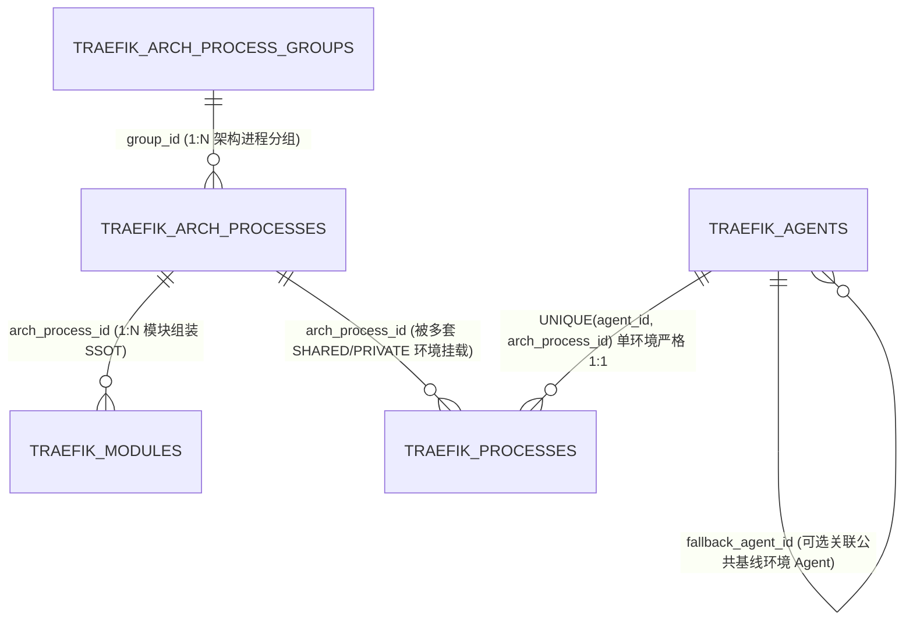

# ADR-09: 架构物理进程蓝图 SSOT 解耦、单 Agent 单环境 `1:1` 挂载与 eBPF 预挂待命三态闸门设计

- **文档编号**：`09-arch-process-ssot-and-ebpf-premount-standby-adr.md`
- **文档版本**：v1.1.0（按架构检视与多公共环境边界修订）
- **日期**：2026-11-02
- **状态**：已批准待实施 (Approved for M10) — **局部修订 [`ADR-07`](./07-console-ia-restructuring-and-workflow-workbench-adr.md) 决策项 #5**
- **关联特性**：`F-02`（架构物理进程蓝图、模块装载与多环境 `1:1` 挂载覆盖）、`F-04`（物理部署拓扑去 Agent 化直推与可选环境端点叠加）、`F-08`（多进程预挂载供给、PID 定位与存量连接前置就绪诊断）、`F-09`（eBPF 按需入站钩子、出站三态代理闸门与优雅排水）、`F-11`（免重连亚秒级协同录制与架构快照）、`F-12`/`F-13`（既有代理长连接重放帧级 Mock 接管与零外泄门禁）、`F-15.3` ~ `F-15.5`（三工作台统一分组进程树）
- **关联设计**：[`01-system-architecture.md` §3~§5](../02-design/01-system-architecture.md)、[`02-data-plane-and-cros-rpc-engine.md` §2~§3](../02-design/02-data-plane-and-cros-rpc-engine.md)、[`03-architecture-elements-and-topology.md` §3~§4](../02-design/03-architecture-elements-and-topology.md)、[`04-control-plane-and-web-console.md` §1 & §4](../02-design/04-control-plane-and-web-console.md)、[`05-database-schema.md` §3~§5](../02-design/05-database-schema.md)
- **关联契约与作战卡**：[`01-http-api-contract.md` §2.2 / §2.4~§2.6 / §3](../03-api/01-http-api-contract.md)、[`11-m10-arch-process-blueprint-and-premount-workflow.md`](../04-tasks/11-m10-arch-process-blueprint-and-premount-workflow.md) (M10)

---

## 1. 背景与问题定义 (Context & Problem Statement)

在 M8（[`ADR-07`](./07-console-ia-restructuring-and-workflow-workbench-adr.md)）与 M9（[`ADR-08`](./08-recording-drawer-and-process-tree-selection-adr.md)）落地后，`流量录制` 抽屉已具备按业务进程组折叠勾选的树形体验，但在「**架构进程定义 ➔ 多套测试/个人环境 Agent 挂载准备 ➔ 开启录制与离线重放**」的端到端链路上，仍存在 **3 个根本性的领域建模与内核生命周期矛盾**：

1. **「标准业务进程蓝图（全局架构契约）」与「环境进程部署挂载（Agent 运行态）」混为一表**：
   - 原 `traefik_processes` 同时承担了“系统有哪些业务进程组、哪些标准进程、每个进程由哪些功能模块 (`FM`) 组装而成、默认端口与启动特征是什么”以及“某台具体环境 Agent 部署了哪个进程”两层职责。
   - **副作用 ①（多环境重复手工录入与架构漂移）**：团队拥有多套公共测试环境（如 SIT Agent、UAT Agent）及研发个人 `PRIVATE` Agent（**1 台 Agent 即代表 1 套独立运行环境**）。在旧模型下，每新建一套环境 Agent 都必须重新手填进程名、进程组名并重新勾选一遍 `FM` 功能模块，极易与架构基线发生漂移。
   - **副作用 ②（无 Agent 时物理拓扑悬空）**：当尚未注册任何 Agent 时，物理架构拓扑（`view=PHYSICAL`）因缺失独立进程蓝图案源而被迫退化或构造虚拟宿主占位。

2. **「录制时临时挂载、停录即彻底卸载 (`Purge`)」导致 CROS RPC 长连接反复被迫重启**：
   - 依据关键假设 `A-01`，DOPHI `CROS RPC` 微服务之间普遍维持 TCP 长连接，而内核 `cgroup/connect4` 钩子**仅在客户端发起 `connect()` 握手瞬间触发**，对已处于 `ESTABLISHED` 的存量连接不生效。
   - 既有实现仅在点击「立即启动录制」时才临时挂载 eBPF 并在「停止录制」时调用 `PurgeAllMonitors()` 关闭本地 `EgressProxy`：
     - **启动录制卡顿**：每次开启录制才发现 `established_conns > 0`，用户被迫在录制计时开始后去后台重启微服务；
     - **停录断连恶循环**：停止录制关闭 `EgressProxy` 会主动掐断业务已走代理的长连接，微服务重连机制随即在空闲期直连真实下游，导致**下一次开启录制时又变成了未拦截的存量直连长连接，每次录制都必须重启一遍业务进程**。

3. **Agent 进程挂载界面与架构树、录制树交互割裂**：
   - `/agents` 右栏采用平铺的 7 列宽表 + 弹窗逐条填表（`ProcessModuleBinderModal`），既没有延续业务进程组树形结构，也无法在开启录制/重放前直观看到每个挂载进程的 eBPF 预挂就绪状态。

---

## 2. 核心架构决策 (Architectural Decisions)

### 2.1 决策一：物理进程蓝图回归 `/architecture` SSOT，「1 台 Agent = 1 套环境」严格执行单机 `1:1` 挂载与本地覆盖（修订 ADR-07 决策 #5）

将原有的单一 `Process` 拆解为 **「全局架构物理进程蓝图（SSOT）」** 与 **「环境 Agent 挂载实例（1:1 Mount + Override）」** 两层正交模型，并明确 **1 台 `Agent` 即代表 1 套独立运行环境**（支持多套 `SHARED` 公共测试环境与多套 `PRIVATE` 个人调试环境并存）：

1. **架构元素工作台 (`/architecture`) 左栏顶部增设 `[逻辑架构 | 物理进程]` 分段视图切换器**：
   - **`逻辑架构` (`?tree=logical`，默认)**：维持 `子系统 ➔ 8级功能组 ➔ 功能模块 (FM) ➔ PROVIDE/DEPEND 服务契约`；
   - **`物理进程` (`?tree=physical`)**：由 `traefik_admin` 统一维护全局唯一的 **`进程组 (ArchProcessGroup) ➔ 标准业务进程 (ArchProcess)`** 二级树，定义标准进程编码 `code`、名称 `name`、组装承载的功能模块集合（每个 `FM` 全局至多归属 1 个 `ArchProcess`，遵循 `A-03`）以及默认运行基线（`default_listen_port`，`0` 表示纯客户端进程；`default_cmd_pattern`，支持子串或 `re:` RE2 正则；`default_extra_downstreams`），**全程零 Agent 机器耦合**；
   - 静态物理拓扑 `BuildTopologyGraph(view="PHYSICAL")` 100% 直接由 `ArchProcessGroup ➔ ArchProcess ➔ Module` 推导生成，零 Agent 注册亦可完整出图；同时支持可选查询参数 `env_agent_id` 叠加展示指定环境 Agent 的真实挂载端点 `EffectiveIP:EffectiveListenPort`。
2. **「1 台 Agent = 1 套环境」严格单机 `1:1` 挂载与多公共环境并存 (`/agents`)**：
   - **单环境 `1:1` 约束**：同一标准架构进程在单台 Agent（单套环境）上至多部署 1 个实例，数据库层在 `traefik_processes` 建立强唯一约束 **`UNIQUE(agent_id, arch_process_id)`**，并以部分唯一索引 **`UNIQUE(agent_id, effective_listen_port) WHERE effective_listen_port > 0`** 保证同机非零端口互斥（`A-02`）；
   - **多公共环境对等支持**：不同 `SHARED` Agent 分别代表不同的公共测试环境（如 SIT、UAT、压测环境），**完全允许多台不同的 `SHARED` Agent 各自 `1:1` 挂载同一 `ArchProcess`**；
   - **禁止野生进程与篡改模块组装**：Agent 侧严禁自造脱离架构蓝图的进程，也严禁在 Agent 侧修改进程与 `FM` 的组装关系；缺失蓝图通过抽屉深链引导回 `/architecture?tree=physical` 定义；
   - **本地覆盖与冲突自动钉住**：支持按环境覆盖 `override_listen_port`、`override_cmd_pattern`、`advertise_ip`、`extra_downstreams`；当管理员修改 `ArchProcess.DefaultListenPort` 与某环境同机其他进程端口冲突时，自动将该冲突挂载实例的原有效端口固化写入其 `override_listen_port`，绝不让局部环境反向阻塞全局架构演进；
   - **新系统干净重建与运行期录制快照**：本项目处于上线前新系统阶段，升级至 15 表结构时无需编写旧表历史数据兼容迁移脚本，直接清理旧版单层表并干净重建；在运行期创建 `RecordingSession` 时将参与进程的 `arch_process_id` 与装载 `module_ids` 固化至 `process_snapshots` (`jsonb`)，使历史素材同构重放与归因永久解耦于后续挂载增删。

### 2.2 决策二：按需入站钩子 + `EgressProxy` 三态转发闸门（`PASSTHROUGH | CAPTURING | REPLAY_MOCK`）+ 优雅排水

针对精确 `IP:Port` 拦截与长连接不中断转发诉求，建立兼顾**待命零读写损耗、停录不断连持续转发、重放零外泄与失联优雅排水**的数据面生命周期：

```mermaid
stateDiagram-v2
    [*] --> DISARMED: 未挂载进程 或 手动暂停探针 (probe_desired_state='DISARMED')
    DISARMED --> ARMED: Agent 在线挂载进程 (PUT /agent/v1/monitors/arm, 仅挂 connect4/sockops/sched, 不挂读写 tracepoint, 无排他租约)
    ARMED --> DISARMED: 手动暂停探针 / 卸载进程 / 5m 失联看门狗 (卸载 bpf_link + 关闭监听端口 + 存量连接优雅排水)

    state ARMED {
        [*] --> WAITING_PROC: 目标进程尚未启动 (sched_process_exec + 用户态匹配待命)
        WAITING_PROC --> READY: 进程启动被纳管且存量直连 == 0
        [*] --> NEED_RECONNECT: 进程已运行且存在预挂前直连下游 Socket (established_conns > 0)
        NEED_RECONNECT --> READY: 空闲期重连一次 -> 新长连接接入 EgressProxy 持续纯字节转发 (PASSTHROUGH)
    }

    ARMED --> CAPTURING: 启动协同录制 (获取 RECORDING 租约: 先开 EgressProxy 分帧闸门 -> 预热 ing_conn_map 并挂载入站读写钩子)
    CAPTURING --> ARMED: 停止录制 (先卸入站读写钩子 -> 在途排空后切回 PASSTHROUGH, 绝不断开 EgressProxy 长连接, 释放租约)

    READY --> REPLAYING: 启动离线重放 (强制要求 established_conns==0; 获取 REPLAY 租约, EgressProxy 既有连接切 REPLAY_MOCK 阻断真实下游)
    REPLAYING --> ARMED: 重放完成/取消 (关闭被 Mock 接管过的连接触发重连回 EgressProxy, 恢复 ARMED 规则并释放租约)
```

1. **`ARMED`（预挂载待命态，无排他租约，`EgressProxy` 处于 `PASSTHROUGH` 持续转发态）**：
   - **全机零读写 Syscall 钩子开销**：入站采集属于纯被动旁路，无需提前拦截连接。因此 `ARMED` 待命期**仅挂载低频建连与进程生命周期钩子**（`cgroup/connect4`、`sockops`、`sched_process_exec/fork/exit`），**完全不挂载 `sys_enter/exit_read/write/recv*/send*`**，对宿主机磁盘与网络读写零系统调用拦截损耗；
   - **`EgressProxy` 持续纯字节透传**：`cgroup/connect4` 按精确 `IP:Port` 规则将目标进程新建的下游长连接透明接入 `EgressProxy`，待命期采用双向 `io.Copy` 纯字节转发（零 `StreamFramer` 分配、零 WS 信封构造）；
   - **进程生命周期追踪**：`sched_process_exec` 通知用户态匹配 `EffectiveCmdPattern` 纳管新启动 PID，`sched_process_fork` 同步继承多进程 Worker 子 PID，`sched_process_exit` 即时清理退出 PID 防回绕误伤，配合 2s `/proc` 对账巡检兜底；
   - **单机 Single-Flight 自动补挂与指数退避**：主控 `AgentHub` 按 `agent_id` 串行化管控请求，携带单调递增 `mounts_revision` 与规范化 `ArmedDigest` 对账补挂（失败时按 `10s -> 30s -> 60s -> 300s` 指数退避）；说明：「一次重连、长期就绪」在 **Agent 守护进程存活周期（同一 `BootID`）内**有效。
2. **`CAPTURING`（活跃录制采集态，持有 `RECORDING` 排他租约，停录不断连）**：
   - **有序开闸防丢 Mock**：开录按「① 实时复检当前下游集合存量直连并上报存量未声明出站连接（补偿 `VIOLATION` 检测）➔ ② 切换 `EgressProxy` 目标进程连接至 `CAPTURING`（基于 `"CSE.TCP"` 魔术字 + F-10 头部合法性双重校验对齐帧边界）➔ ③ 预热监听端口 `ing_conn_map`（严禁对非监听端口任意 `fd > 2` 盲目建表）并挂载入站 `accept/close/read/write` 钩子」顺序执行，实现免重连亚秒级开录；
   - **停录不断连持续转发**：停录按「① 卸载入站读写钩子 ➔ ② 短暂排空在途下游应答后将 `EgressProxy` 切回 `PASSTHROUGH` 纯字节转发 ➔ ③ 发送 `EVENT_SESSION_DRAINED` 并释放租约」执行，**底层 TCP 长连接全程不断开，Agent 继续无感转发业务数据**，后续第 $2 \dots N$ 次录制随时开闸即录；
   - **紧急卸挂逃生阀**：支持对非本批次同机进程热 `disarm`，并支持持锁人或管理员携带 `force=true` 紧急中止活跃任务并立即卸挂探针。
3. **`REPLAYING`（离线重放隔离态，持有 `REPLAY` 排他租约，既有代理连接帧级 Mock 接管零外泄）**：
   - **存量直连硬门禁**：重放启动前实时校验目标进程 `established_conns`；若仍存在绕过 `EgressProxy` 的预挂前直连连接（`NEED_RECONNECT`）或进程未启动，**强制拒绝启动重放并返回 `409 Conflict`**，堵死旁路直连外泄通道；
   - **既有 `EgressProxy` 长连接帧级 Mock 接管**：进入重放时，除将内核 `connect4` 切为 `MODE_REPLAY`（未命中规则 `EPERM` Fail-Closed，新建连接转 `MockServer`）外，`EgressProxy` 将目标 `process_id` 名下**已建立的全部代理连接立即切换为 `REPLAY_MOCK` 模式**——主动断开/阻断朝向真实下游的 `targetConn` 写通道（确保 **0 字节发往真实下游**），将业务进程在既有长连接上发出的下游请求帧直接交由 `ScopedMockMatcher` + `HealResponseFrames` 本地自愈应答（`MOCK_MISS` 静默不回包）；重放结束后关闭被 Mock 接管过的连接，使业务客户端自动重连并重新透明落入 `ARMED` 态 `EgressProxy`。
4. **手动卸挂与 5 分钟失联的优雅排水 (`Graceful Drain`)**：
   - 当手动切换 `DISARMED` 或主控失联满 5 分钟触发看门狗自洁时，Agent **立即卸载全部 `bpf_link` 并关闭 `EgressProxy` 监听端口**（新连接立即走内核直连），对已建立的存量代理连接保持纯字节转发直至自然关闭或达排水超时（默认 `60s`），避免主控停机维护引发测试环境连接集体闪断；收到 `SIGINT/SIGTERM` 或强制 `POST /agent/v1/purge` 时立即关闭全部连接退出。

### 2.3 决策三：精确 `IP:Port` 混合下游推导（本环境优先 + 关联公共环境 `FallbackAgentID` 兜底）与预挂超集不变量

1. **多环境精确 `IP:Port` 推导 (`CompileProcessDownstreams`)**：
   - 每台 `Agent` 可选配置 `fallback_agent_id`（指向某台 `SHARED` 公共环境 Agent，如个人 `PRIVATE` Agent 指向 `SIT` 公共环境 Agent）；
   - 为 `Agent_X` 上的进程 `P` 编译下游 `IP:Port` 规则时，依次合并：
     1) **声明依赖端点**：若目标 `ArchProcess_Dst` 已挂载于本机 `Agent_X`，优先采用本机 `(EffectiveIP, EffectiveListenPort)` 及 `127.0.0.1:<port>`；否则若配置了 `FallbackAgentID`（或未配置但全局恰有唯一 1 台 `SHARED` Agent 挂载了 `ArchProcess_Dst`），采用该目标公共环境挂载端点（多套 `SHARED` 环境并存且未指定 `FallbackAgentID` 时绝不跨环境乱串 IP）；
     2) **同机全量已挂载监听端点 (`SameAgentPeerPorts`)**：并入 `Agent_X` 上所有已挂载进程的非零有效端口及 `127.0.0.1:<port>`（剔除 `P` 自身）；
     3) **补充端点**：合并 `DefaultExtraDownstreams ∪ ExtraDownstreams`（重放时额外并入源批次历史 `EGRESS` 目的端点）。
2. **预挂超集不变量 (`ArmedDownstreams ⊇ SingleAgentCapturingDownstreams`)**：
   - 上述完整 `IP:Port` 集合在 `PUT /agent/v1/monitors/arm` 预挂阶段即一次性下发到位，确保单环境内开启录制无需追加新 `connect4` 规则，且同机未声明调用在 `ARMED` 期建连即已被 `EgressProxy` 纳管；当拓扑依赖或端口变更引发规则集扩容时，自动重算 `ArmedDigest` 下发重检并按实际存量直连刷新 `READY / NEED_RECONNECT`。

### 2.4 决策四：跨 `/architecture`、`/agents`、`/record` 三工作台同构分组进程树与统一 7 态探针徽章

三个工作台统一采用 **`进程组 (ArchProcessGroup) ➔ 业务进程 (ArchProcess / Process)`** 树形结构，并全局统一 **7 态探针就绪枚举**（消除跨文档状态与配色歧义）：
- `🟢 READY`（已就绪）、`🟡 NEED_RECONNECT`（存量直连待重连）、`🔵 WAITING_PROC`（待进程启动）、`🟣 MONITORING`（录制/重放作业中）、`⚪ DISARMED`（已暂停探针）、`⚫ OFFLINE`（Agent 离线）、`🔴 CAP_DENIED / ERROR`（权限不足或异常）；
- `/agents` 提供 `AgentProcessMountDrawer`（携带 `expected_revision` 乐观锁防并发覆盖，内置 `[⚡ 自动扫描宿主机进程并匹配架构树]` 与跳回 `/architecture?tree=physical` 引导），就绪后一键跳转 `/record?auto_start=1&agent_id=X` 发起录制。

---

## 3. 实施后果与风险缓解 (Consequences & Risk Mitigation)

### 3.1 正面收益 (Positive)
- **多环境 SSOT 彻底闭环**：进程分组与模块组装全局只定义一次，SIT、UAT 等多套 `SHARED` 公共环境与研发 `PRIVATE` 环境均只需 `1:1` 勾选挂载 + 按需覆盖端口即可快速就绪；
- **待命零读写损耗与停录不断连兼得**：待命期不挂读写 syscall 钩子，停录后 `EgressProxy` 持续无感转发长连接数据，Agent 存活期内一次就绪即可反复免重连开录；
- **重放物理零外泄闭环**：存量直连门禁 + `EgressProxy` 既有连接 `REPLAY_MOCK` 帧级接管 + 内核 `connect4` Fail-Closed 三重防护，彻底封堵 `ARMED` 常驻长连接绕过 Mock 的漏洞。

### 3.2 边界与风险缓解 (Risks & Mitigations)
- **主控升级维护超 5 分钟时的业务平滑性**：通过看门狗**优雅排水**（先卸 `bpf_link` 与监听端口、允许存量连接继续转发至自然结束），杜绝共享测试环境集体断连风暴；主控恢复后由 `Auto-Rearm` 自动重新预挂。
- **进程启动瞬间 `exec` 到用户态写 Map 的毫秒级窗口**：通过 `sched_process_exec` 实时事件 + `sched_process_fork` 内核态子进程同步继承将窗口压缩至毫秒级，若有极少数初始化连接抢先直连，由 2s 对账巡检诚实标为 `🟡 NEED_RECONNECT` 提示用户，绝不隐瞒漏采。
