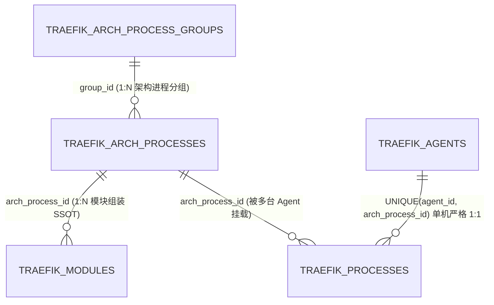
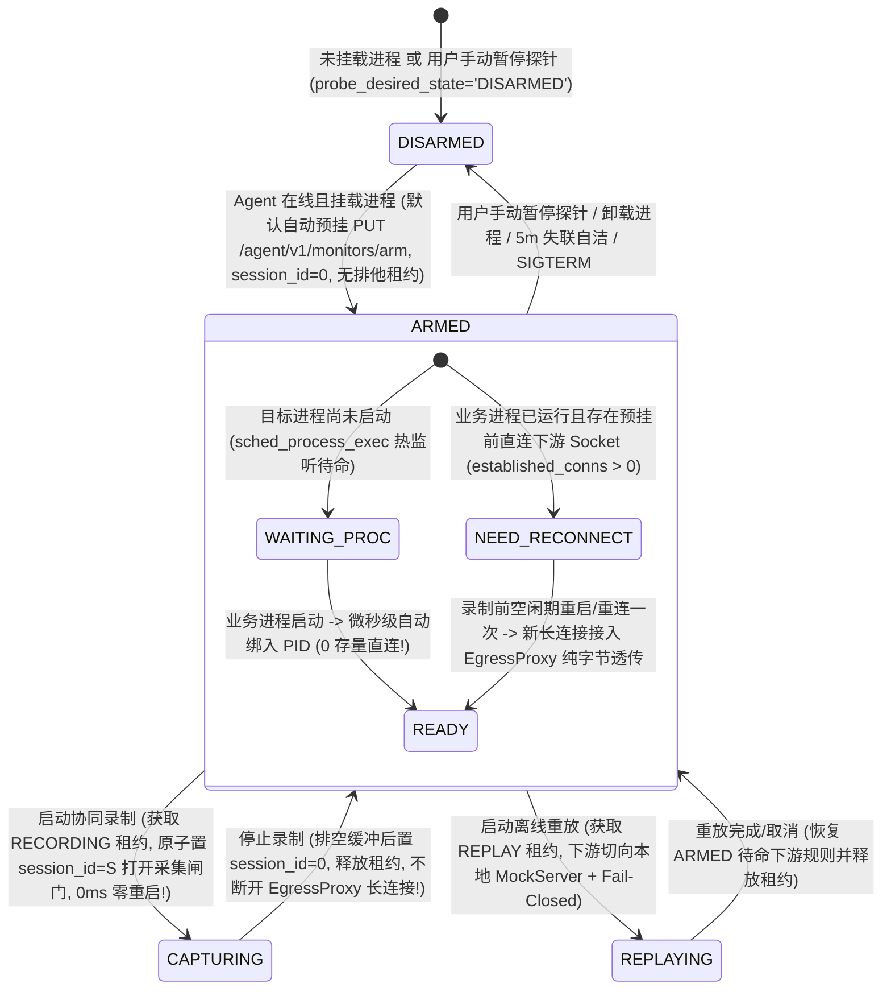

# ADR-09: 架构物理进程蓝图 SSOT 解耦、eBPF 默认自动预挂载待命与三台同构分组进程树设计

- **文档编号**：`09-arch-process-ssot-and-ebpf-premount-standby-adr.md`
- **文档版本**：v1.0.0
- **日期**：2026-11-02
- **状态**：已采纳 (Accepted) — **局部修订 [`ADR-07`](./07-console-ia-restructuring-and-workflow-workbench-adr.md) 决策项 #5**
- **关联特性**：`F-02`（架构物理进程蓝图、模块装载与宿主机挂载覆盖）、`F-04`（物理部署拓扑去 Agent 化直推）、`F-08`（多进程预挂载供给、PID 定位与存量连接前置就绪诊断）、`F-09`（eBPF 待命透传与采集闸门分离）、`F-11`（零重启秒级协同录制）、`F-15.3` / `F-15.4` / `F-15.5`（三工作台统一分组进程树与挂载就绪流）
- **关联设计**：[`01-system-architecture.md` §4~§5](../02-design/01-system-architecture.md)、[`02-data-plane-and-cros-rpc-engine.md` §2](../02-design/02-data-plane-and-cros-rpc-engine.md)、[`03-architecture-elements-and-topology.md` §3~§4](../02-design/03-architecture-elements-and-topology.md)、[`04-control-plane-and-web-console.md` §4](../02-design/04-control-plane-and-web-console.md)、[`05-database-schema.md` §3](../02-design/05-database-schema.md)
- **关联契约与作战卡**：[`01-http-api-contract.md` §2.2 / §2.4 / §3](../03-api/01-http-api-contract.md)、[`11-m10-arch-process-blueprint-and-premount-workflow.md`](../04-tasks/11-m10-arch-process-blueprint-and-premount-workflow.md) (M10)

---

## 1. 背景与问题定义 (Context & Problem Statement)

在 M8（[`ADR-07`](./07-console-ia-restructuring-and-workflow-workbench-adr.md)）与 M9（[`ADR-08`](./08-recording-drawer-and-process-tree-selection-adr.md)）落地后，`流量录制` 抽屉已具备按业务进程组折叠勾选的树形体验，但在「**架构进程定义 ➔ Agent 挂载业务进程并准备探针 ➔ 开启流量录制**」的端到端链路上，仍存在 **3 个根本性的领域建模与内核生命周期矛盾**：

1. **「标准业务进程蓝图（架构契约）」与「宿主机进程部署挂载（Agent 运行态）」混为一表**：
   - 在 M8 将物理进程单点收口至 `/agents` 后，`traefik_processes` 同时承担了“系统有哪些业务进程组、哪些标准进程、每个进程由哪些功能模块 (`FM`) 组装而成、默认端口与启动特征是什么”以及“某台具体 Agent 部署了哪个进程”两层职责。
   - **副作用 ①（重复手工录入与架构漂移）**：每位研发在自己的 `PRIVATE` Agent 上配置调试环境时，都必须重新手填进程名、进程组名并重新勾选一遍 `FM` 功能模块，极易与公共基线不一致；若需新增标准进程，也缺乏脱离具体 Agent 机器的架构定义入口。
   - **副作用 ②（无 Agent 时物理拓扑悬空）**：当环境尚未注册 `SHARED` Agent 时，物理架构拓扑（`view=PHYSICAL`）因缺失独立进程蓝图案源而被迫退化或构造虚拟宿主占位。

2. **「录制时临时挂载、停录即彻底卸载 (`Purge`)」导致 CROS RPC 长连接反复被迫重启**：
   - 依据关键假设 `A-01`，DOPHI `CROS RPC` 微服务之间普遍维持 TCP 长连接，而内核 `cgroup/connect4` 钩子**仅在客户端发起 `connect()` 握手瞬间触发**，对已处于 `ESTABLISHED` 的存量连接不生效。
   - 既有实现仅在点击「立即启动录制」时才临时挂载 eBPF 并在「停止录制」时调用 `PurgeAllMonitors()` 关闭本地 `EgressProxy`：
     - **启动录制卡顿**：每次开启录制才发现 `established_conns > 0`，用户被迫在录制计时已经开始后去后台重启微服务；
     - **停录断连恶循环**：停止录制关闭 `EgressProxy` 会主动掐断业务已走代理的长连接，微服务重连机制随即在空闲期直连真实下游，导致**下一次开启录制时又变成了未拦截的存量长连接，每次录制都必须重启一遍业务进程**！

3. **Agent 进程挂载界面与架构树、录制树交互割裂**：
   - `/agents` 右栏采用平铺的 7 列宽表 + 弹窗逐条填表（`ProcessModuleBinderModal`），既没有延续业务进程组树形结构，也无法在开启录制前直观看到每个挂载进程的 eBPF 预挂就绪灯态（`🟢 已就绪` / `🟡 待重启重连` / `🔵 待进程启动`）。

---

## 2. 核心架构决策 (Architectural Decisions)

### 2.1 决策一：物理进程蓝图回归 `/architecture` SSOT，Agent 严格执行 `1:1` 挂载与本地覆盖（修订 ADR-07 决策 #5）

将原有的单一 `Process` 拆解为 **「全局架构物理进程蓝图（SSOT）」** 与 **「宿主机 Agent 挂载实例（1:1 Mount + Override）」** 两层正交模型：

1. **架构元素工作台 (`/architecture`) 左栏顶部增设 `[逻辑架构 | 物理进程]` 分段视图切换器**：
   - **`逻辑架构` (`?tree=logical`，默认)**：维持 `子系统 ➔ 8级功能组 ➔ 功能模块 (FM) ➔ PROVIDE/DEPEND 服务契约`；
   - **`物理进程` (`?tree=physical`)**：由 `traefik_admin` 统一维护全局唯一的 **`进程组 (ArchProcessGroup) ➔ 标准业务进程 (ArchProcess)`** 二级树，定义标准进程编码 `code`、名称 `name`、组装承载的功能模块集合（每个 `FM` 全局至多归属 1 个 `ArchProcess`，遵循 `A-03`）以及默认运行基线（`default_listen_port`，`0` 表示纯客户端进程；`default_cmd_pattern`；`default_extra_downstreams`），**全程零 Agent 机器耦合**；
   - 静态物理拓扑 `BuildTopologyGraph(view="PHYSICAL")` 100% 直接由 `ArchProcessGroup ➔ ArchProcess ➔ Module` 推导生成，彻底告别虚拟 Agent 占位（若某 `ArchProcess` 已挂载于公共 `SHARED` Agent，则自动富化其 `EffectiveIP:EffectiveListenPort` 端点信息）。
2. **Agent 严格 `1:1` 挂载架构进程并支持本地覆盖 (`/agents`)**：
   - 依据部署事实：**同一标准架构进程在单台计算机（单个 Agent）上至多部署 1 个实例**，数据库层在 `traefik_processes` 强制建立唯一约束 **`UNIQUE(agent_id, arch_process_id)`**（同时在全局公共 `SHARED` 域内同一 `arch_process_id` 至多被 1 台 `SHARED` Agent 挂载，严格守护 `A-03`）；
   - Agent 侧**严禁自造脱离架构元素的野生进程，也严禁在 Agent 侧篡改进程与 `FM` 模块的组装关系**；若所需进程尚未定义，抽屉底部直接引导深链跳回 `/architecture?tree=physical` 先完善架构定义；
   - Agent 挂载实例支持**按需本地自定义覆盖**（`override_listen_port`、`override_cmd_pattern`、`advertise_ip`、`extra_downstreams`）：未覆盖字段实时继承 `ArchProcess` 默认值，覆盖字段在界面显式标注 `[本地已覆盖]` 并支持一键恢复默认基线。

### 2.2 决策二：eBPF「默认自动预挂载待命 (`ARMED`) + 毫秒级采集闸门 (`CAPTURING`)」三态生命周期

确立**方案 A（默认自动预挂，省心）**：将「内核 eBPF 挂载与出站透明接入（低频环境准备）」与「报文分帧上报录制（高频排他租约作业）」彻底解耦为三态状态机：

1. **`ARMED`（预挂载待命态，`session_id = 0`，不占用 Agent 排他租约）**：
   - **零开销入站短路**：内核 `accept`/`close` 钩子照常维护 `ing_conn_map` 套接字四元组，但高频 `sys_enter_read/write/recv*/send*` 在查到 `tp->session_id == 0` 时立即 `return 0`（耗时 `< 20ns`，零 `bpf_probe_read_user`、零 RingBuf 内存拷贝）；
   - **零解析出站透传**：`cgroup/connect4` 将目标进程新建的下游长连接透明接入本地 `EgressProxy`，当 `session_id == 0` 时代理仅执行内核/用户态纯字节流转发（跳过 `StreamFramer` 分帧与 WebSocket 信封分配）；
   - **一次重连、长期就绪**：若预挂时业务进程已有存量直连连接（`🟡 NEED_RECONNECT`），用户在录制前空闲期重启一次进程（或进程本就在 Agent 预挂后才启动），长连接即永久驻留于 `EgressProxy`（`🟢 READY`）；
   - **自愈重挂与探针卫生双保险**：Agent 重启（`BootID` 变化）或断线重连上线时，主控 `AgentHub` 在 10s 心跳对账中检测 `ArmedDigest` 差异并自动补推 `PUT /agent/v1/monitors/arm` 恢复预挂；同时保留按进程/组/整机手动「暂停卸载探针 (`DISARMED`)」开关，并严格保留 **主控失联超 5 分钟宽限期或收到 `SIGINT/SIGTERM` 时自动卸载全部 `bpf_link` 与代理端口** 的安全底线。
2. **`CAPTURING`（活跃录制采集态，`session_id = S`，持有 `RECORDING` 排他租约）**：
   - 点击「立即启动录制」仅需锁定 `RECORDING` 租约并将已选进程的 `session_id` 切换为 `S`（对处于 `DISARMED` 的进程支持自动兜底临时挂载）；
   - `EgressProxy` 在既有长连接上即时挂载 `StreamFramer`（依靠 `"CSE.TCP"` 魔术字滑窗自动对齐下一帧起点），实现 **0ms 秒级开录、零进程重启**；
   - 点击「停止录制」刷空缓冲后仅将 `session_id` 拨回 `0` 并释放排他租约，**绝不关闭 `EgressProxy` 既有业务长连接**，从而让后续第 $2 \dots N$ 次录制彻底告别重启业务进程！

### 2.3 决策三：跨 `/architecture`、`/agents`、`/record` 三工作台同构分组进程树与宿主机自动扫描匹配

统一三个工作台的进程树视觉结构为 **`进程组 (ArchProcessGroup) ➔ 标准业务进程 (ArchProcess / Process)`**：

1. **`/architecture?tree=physical`（定义态）**：左侧管理 `ArchProcessGroup ➔ ArchProcess` 树，右侧 `ArchProcessDetailPane` 集中呈现运行基线、组装的 `FM` 模块、自动汇总的 `PROVIDE/DEPEND` 服务契约及各 Agent 挂载血缘；
2. **`/agents`（挂载与就绪准备态）**：
   - 右栏升级为**分组进程挂载与探针就绪树台账**（展示有效端口、`[本地已覆盖]` 标记、`FM` 模块徽章与实时四色就绪灯 `🟢 已就绪` / `🟡 待重启重连` / `🔵 待进程启动` / `⚪ 已暂停探针`），顶栏提供 `[前往发起录制 ->]` 一键带参直达 `/record?auto_start=1&agent_id=X`；
   - 点击 `[+ 挂载架构进程]` 滑出 `680px` 右侧抽屉 **`AgentProcessMountDrawer`**：渲染完整架构进程分组勾选树，顶部内置 **`[⚡ 自动扫描宿主机进程并匹配架构树]`**（调用 `/proc` 探查自动匹配 `default_listen_port` / `default_cmd_pattern`，高亮 `✨ 本机已探测 PID · :Port` 并支持一键勾选），节点内联支持折叠展开 `⚙ 本地覆盖配置`，保存即自动下发预挂并回显就绪诊断；
3. **`/record` `RecordingStartDrawer`（消费录制态）**：复用完全一致的分组进程树，直接回显各进程实时预挂就绪徽章，打开抽屉时自动默认勾选目标 Agent 上所有已预挂进程。

### 2.4 决策四：本机优先、公共基线兜底的混合下游端点推导 (`CompileProcessDownstreams`)

当主控为某台 Agent `A` 上挂载的进程 `P`（对应 `ArchProcess_Src`）编译 eBPF 出站拦截规则 `Downstreams` 时，对每条声明依赖的目标供给方 `ArchProcess_Dst` 采用**「同机挂载优先 ➔ 全局 `SHARED` 基线挂载兜底」**双层解析：
1. 若 `ArchProcess_Dst` 同样挂载于当前这台 `Agent A` 上（如研发在本机 `PRIVATE` Agent 同时跑了上下游两个微服务），优先采用本机挂载实例的有效端口（连同 `127.0.0.1:<effective_port>`）；
2. 否则自动回退查找 `ArchProcess_Dst` 在全局 `SHARED` Agent 上的挂载实例端点（支撑研发本机单服务调用远端公共测试环境下游的混合联调场景），再合并同机/同批次协同监控端口与 `DefaultExtraDownstreams ∪ LocalExtraDownstreams`。

---

## 3. 实施后果与风险缓解 (Consequences & Risk Mitigation)

### 3.1 正面收益 (Positive)
- **架构唯一真实源（SSOT）彻底闭环**：进程分组、进程与 `FM` 模块组装关系全局只定义一次，研发在 `PRIVATE` Agent 上只需“勾选 + 可选改个本地端口”即可在 10 秒内完成挂载与同构重放准备；
- **彻底终结“每次录制都要重启微服务”的痛点**：预挂载待命将重连动作前置解耦到空闲准备期，且停录不断连，一次就绪后无限次秒级启停录制；
- **认知负荷最低**：定义（`/architecture`）、挂载准备（`/agents`）、发起录制（`/record`）共享同一棵分组进程树心智模型。

### 3.2 边界与风险缓解 (Risks & Mitigations)
- **预挂载待命期 `EgressProxy` 常驻稳定性**：
  - *缓解*：待命态（`session_id == 0`）跳过一切协议解析、缓冲驻留与 WS 发送，仅做纯粹的本地 loopback TCP `io.Copy` 桥接（同机 P99 附加延迟 `< 0.3ms`）；同时提供一键 `暂停探针 (DISARMED)` 逃生阀以及 5 分钟失联自洁看门狗。
- **架构层修改默认端口对已挂载在线 Agent 的联动**：
  - *缓解*：`PUT /api/arch/processes/:id` 在同一数据库事务内校验所有未设置 `override_listen_port` 的挂载实例是否存在同机端口冲突（冲突返 `409`），更新 `effective_listen_port` 后由 `AgentHub` 异步向空闲在线 Agent 推送最新 `/agent/v1/monitors/arm` 待命规格。
