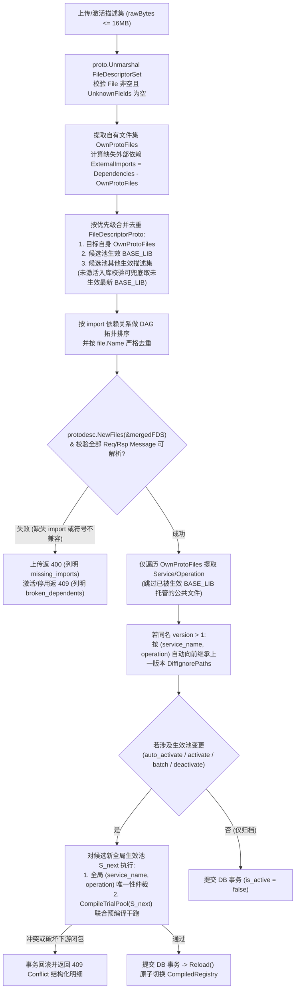
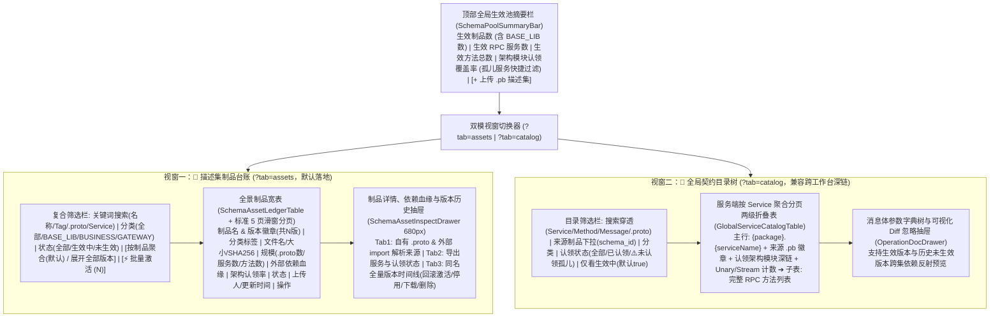

# ADR-10: 增强 Protobuf 描述集管理：多 .pb 资产台账、跨描述集依赖闭包解析与全局单一生效池设计

- **文档编号**：`10-enhanced-proto-schema-file-management-adr.md`
- **文档版本**：v1.1.0（按深度架构检视修订：补齐 `own_proto_files` 去重提取、运行期联合编译池、`CompileTrialPool` 预编译与停用反向依赖门禁、同名升级 `DiffIgnorePaths` 继承及服务级分页目录）
- **日期**：2026-11-02
- **状态**：已批准待实施 (Approved for M11) — **局部深化与修订 [`ADR-06`](./06-proto-schema-repository-and-field-inspection-adr.md) 及 [`ADR-07`](./07-console-ia-restructuring-and-workflow-workbench-adr.md) `/schemas` 工作台规范**
- **关联特性**：`F-03`（Protobuf 描述集注册与接口映射）、`F-03.5`（多描述集制品资产台账、按制品聚合与双模宽表工作台）、`F-03.6`（跨 `.pb` 描述集依赖闭包解析、联合编译与 `BASE_LIB` 公共基础库底座）、`F-03.7`（全局单一生效池、`CompileTrialPool` 预编译演练、停用反向依赖门禁与批量激活仲裁）、`F-21`（正式取消外部联动）
- **关联设计**：[`01-system-architecture.md` §3.1 & §6](../02-design/01-system-architecture.md)、[`04-control-plane-and-web-console.md` §2.1~§2.4, §4.1~§4.2 & §4.4](../02-design/04-control-plane-and-web-console.md)、[`05-database-schema.md` §3.4 & §4~§5](../02-design/05-database-schema.md)
- **关联契约与作战卡**：[`01-http-api-contract.md` §2.3](../03-api/01-http-api-contract.md)、[`12-m11-enhanced-proto-schema-asset-management.md`](../04-tasks/12-m11-enhanced-proto-schema-asset-management.md) (M11)

---

## 1. 背景与问题定义 (Context & Problem Statement)

在 M7（[`ADR-06`](./06-proto-schema-repository-and-field-inspection-adr.md)）交付两级嵌套服务折叠表、消息体字段字典树与可视化 Diff 忽略勾选后，单描述集内的契约透视与字段级回归断言已形成闭环。然而，面向超大型企业级微服务系统（包含数百个 `.proto` 源文件、数十个按领域独立编译的 `.pb` 描述集制品），既有实现与 v1.0.0 初稿经代码级深度检视暴露出 **6 个核心领域建模与工程边界瓶颈**：

1. **“只见方法树，不见文件库”且多版本平铺刷屏**：
   - 既有 `/schemas` 页面采用左栏 `320px` 窄卡片列表（`SchemaVersionList`）+ 右栏 `80%` 方法映射表的双栏布局；当系统存在数十个描述集且各自演进多个版本（累计上百条记录）时，左栏卡片无限纵向滚动，缺乏按制品聚合、分类过滤、大小/时间排序、批量激活及零 N+1 的架构认领率台账概览；
   - 同时，既有契约表底层按扁平 `ProtoOperation` 分页（`GET /api/proto-operations?page_size=25`），导致方法数较多的同一个 RPC `Service` 被跨页腰斩，服务方法计数失真。
2. **“依赖孤岛”与运行期 `Reload()` / 字典树反射断裂**：
   - 超大系统中，公共基础包（如 `dophi_base.pb`：含公共头、通用枚举，通常 `OperationCount == 0` 无 RPC Service）与各业务域包（如 `order.pb`、`pay.pb`）往往独立编译；
   - 既有服务端上传、`Registry.Reload()` 以及 `GetOperationSchemaTree()` 均对单个 `.pb` 的 `DescriptorBytes` **孤立调用 `protodesc.NewFiles(&fds)`**。若业务 `.pb` 未携带 `--include_imports` 公共依赖，上传即报 `400`；即便上传时临时合并校验，若不改造 `Reload()` 与 `GetOperationSchemaTree()` 的联合类型池构建，运行期解码仍会静默跳过退化为 `NO_SCHEMA_RAW_HEX`，点击字段树亦会报 `404`。
3. **跨集依赖合并时的“重名文件冲突”与“父依赖 Service 重复提取”陷阱**：
   - 若多个 `.pb` 均携带了 `--include_imports`（同时包含 `"common/base.proto"`），简单拼接 `FileDescriptorSet.File` 调用 `protodesc.NewFiles` 会直接抛出 `file is already registered` 致命错误；
   - 若将借用的外部依赖 `FileDescriptorProto` 混入 `extractOperationsFromDescriptor` 遍历范围，会把被依赖包中的 `Service` 重复提取到当前业务包名下，激活时 100% 触发跨集 `(service_name, operation)` 自我冲突 (`409`)。
4. **缺失“停用下线 (`Deactivate`)”与反向依赖保护，版本升级易破坏生效池闭包或丢失 `DiffIgnorePaths`**：
   - 既有 API 仅有 `Activate` 与 `Delete`（生效态禁删），导致废弃的生效描述集陷入“无法停用、无法删除”的管理死锁；
   - 若直接停用 `BASE_LIB` 基础库，或激活删减了公共 Message 的 `base v2`，会导致依赖它的已生效业务描述集在运行期闭包崩溃；
   - 上传同名新版本 `v2` 时，既有逻辑将所有 `ProtoOperation.DiffIgnorePaths` 重置为 `[]`，导致测试团队在 `v1` 字典树上沉淀的忽略规则全部丢失。
5. **外部模块延期倒逼系统完全自闭环**：
   - 原 P2 规划项 `F-21`（从 `code-proto` 导入 `.pb`）因兄弟模块排期推迟而取消，`code-traefik` 必须在自身模块内闭环提供完备的多 `.pb` 制品资产治理与标准 CI/CD OpenAPI 直推能力。

---

## 2. 核心架构决策 (Architectural Decisions)

### 2.1 决策一：特性边界收敛，正式取消 `F-21` 并实现多 `.pb` 制品自闭环

1. **正式取消 `F-21`**：在 [`01-feature-matrix.md`](../01-features/01-feature-matrix.md) 中将 `F-21` 标记为 **`已取消 (CANCELLED)`**，彻底解除对外部未就绪系统的耦合；
2. **自闭环制品生命周期**：由 `code-traefik` 独立覆盖 **上传预检（`<= 16MB`）➔ 跨集依赖闭包解析 ➔ `DiffIgnorePaths` 版本向前继承 ➔ 按制品聚合台账 ➔ 激活/批量激活/停用下线/回滚 ➔ 原始 `.pb` 下载导出** 全链路；
3. **单一分类枚举 SSOT（消除双列状态分裂）**：
   - 废除初稿中 `category` 与 `is_base_lib` 并存的冗余设计，收敛为单一受控枚举列 **`category` (`'BASE_LIB' | 'BUSINESS' | 'GATEWAY'`，默认 `'BUSINESS'`)**；
   - **`category == 'BASE_LIB'`** 即唯一权威的“公共基础依赖库”标识；原生允许 `OperationCount == 0`（纯 Message/Enum 公共类型库）上传、入库与激活，并提供 `PATCH /api/proto-schemas/:id` 支持管理员轻量修订 `category`、`version_tag` 与 `description`。

---

### 2.2 决策二：系统全局单一生效池 (`Single Active Schema Pool`) 与咨询锁串行化仲裁

1. **全环境单一版本基线**：
   - 所有公共测试环境（`SHARED` Agent）与个人联调环境（`PRIVATE` Agent）共享同一套全局生效的 `.pb` 契约池，不设按环境或按 Agent 分裂的版本矩阵；
   - 历史已录制落盘的 `TrafficRecord` 继续保留录制瞬间的 `(schema_id, schema_version)` 快照（`F-03` 历史不可变契约），支持在调试台按最新全局生效池显式触发 `redecode`。
2. **统一内存联合类型池 (`CompiledRegistry`)**：
   - 控制面维护唯一的原子指针 `atomic.Pointer[CompiledRegistry]`，内部同时持有：
     - `Files *protoregistry.Files`：由全局所有 `is_active = true` 的描述集按拓扑去重联合构建的统一反射文件注册表；
     - `Operations map[string]*CompiledOperation`：以 `"{package}.{serviceName}:{operation}"` 为键的无锁方法编解码映射表。
3. **事务级咨询锁防并发 TOCTOU 竞态**：
   - 所有改变描述集版本或生效状态的写事务（`Upload`、`Activate`、`BatchActivate`、`Deactivate`、`Delete`），在 PostgreSQL 事务入口统一执行 **`SELECT pg_advisory_xact_lock(hashtext('traefik_proto_schema_registry'))`**，配合内存 `Registry.reloadMu` 互斥锁，100% 根治并发同名版本号自增冲突、跨集激活冲突漏检与内存快照乱序倒灌。

---

### 2.3 决策三：去重拓扑依赖闭包解析、自有服务提取与 `CompileTrialPool` 双向门禁



1. **自有文件与外部依赖严格分离（根治重复提取与重名文件崩溃）**：
   - **`ProtoFiles` (`own_proto_files`)**：仅记录本次上传 `.pb` 二进制内部实际包含的 `FileDescriptorProto.GetName()` 列表；
   - **`ExternalImports` (`external_imports`)**：遍历自有文件的 `file.GetDependency()`，凡不在 `own_proto_files` 中的路径（排除若已内联的 `google/protobuf/*`，或由内置 `protoregistry.GlobalFiles` 标准 Well-Known Types 兜底 `google/protobuf/*.proto`），记入 `external_imports`（`jsonb []string`）；
   - **按文件名去重与 DAG 拓扑排序**：合并多个 `.pb` 构建 `*protoregistry.Files` 时，由于 `protodesc.NewFiles` 要求同一个 `file.Name` 只能出现一次，引擎按 **「当前目标 Schema 自有文件 $\succ$ 生效 `BASE_LIB` 权威定义 $\succ$ 其他生效 Schema（按 `id ASC`）」** 优先级对 `file.Name` 去重，并补齐 Go 标准库内置的 `google/protobuf/*.proto`（如 `timestamp.proto`、`empty.proto`、`any.proto`、`wrappers.proto`、`struct.proto`、`duration.proto`、`field_mask.proto`、`descriptor.proto`）Well-Known Types 兜底，随后按 `Dependency` 拓扑序排列传入 `protodesc.NewFiles`；
   - **自有服务提取边界**：**仅从 `own_proto_files` 中提取 `ProtoOperation`**（若非 `BASE_LIB` 业务包因 `--include_imports` 打包了当前已生效 `BASE_LIB` 中的同名 `.proto` 文件，自动跳过该基础库文件的 `Service` 提取，彻底消除公共依赖引发的伪冲突）。
2. **动态符号依赖映射（替代僵死的静态 `dependency_ids`）**：
   - 数据库存储不可变的 `proto_files` 与 `external_imports`；控制面通过匹配 `external_imports` 与当前生效池（或最新基础库）各 Schema 的 `proto_files`，实时推导出 `resolved_dependencies: [{schema_id, name, version, category, matched_protos}]` 以及全局依赖有向图（`GET /api/proto-schemas/dependencies-graph`）；
   - 当 `dophi_base` 从 `v1` 升级激活至 `v2` 时，所有依赖 `common/base.proto` 的业务描述集自动桥接至 `v2`，零悬空 ID。
3. **两阶段闭包校验与 `CompileTrialPool(S_next)` 激活/停用双向硬门禁**：
   - **草稿入库 (`Upload` 且 `auto_activate = false`)**：允许从 `当前已生效池 ∪ 未生效 BASE_LIB 各名称最新版本` 补齐缺失 `import` 完成静态合法性校验（方便管理员先批量上传未激活的 `base.pb` + `order.pb`，再一键批量激活）；
   - **生效池变更（`auto_activate = true` / `Activate` / `BatchActivate` / `Deactivate`）**：计算出变更后的候选全局生效集合 $S_{\text{next}}$，在单事务内强制通过两道门禁：
     1. **方法全局唯一门禁**：$S_{\text{next}}$ 内所有 Schema 导出的 `(service_name, operation)` 两两无重叠（含批量激活内部互查），否则返 `409` 及 `conflicts`；
     2. **全局生效池自洽预编译门禁 (`CompileTrialPool(S_next)`)**：**仅使用 $S_{\text{next}}$ 内部成员（加内置 `google/protobuf/*` WKT）**执行联合 `protodesc.NewFiles` 并核验 $S_{\text{next}}$ 全部 `ProtoOperation` 的 `ReqMessageFullName / RspMessageFullName` 均可解析为 `MessageDescriptor`！
        - 若激活业务包时其依赖的 `BASE_LIB` 尚未激活 $\rightarrow$ 返 `409`（提示先激活基础库或勾选批量激活）；
        - 若停用某描述集（`POST /api/proto-schemas/:id/deactivate`）或激活删减了类型的 `base v2` 导致其他生效描述集闭包断裂 $\rightarrow$ 返 `409`（返回 `broken_dependents` 受影响下游清单），确保线上运行期 `Reload()` **永远 100% 编译成功**！
4. **同名版本升级 `DiffIgnorePaths` 向前自动继承**：
   - 上传同名新版本（`version > 1`）时，在事务内读取该 `name` 当前生效版本（若无则取 `version - 1`）的全部方法忽略配置，按 `(service_name, operation)` 精确匹配自动复制到新版本对应 `ProtoOperation.DiffIgnorePaths` 中。

---

### 2.4 决策四：`/schemas` 升级为双模工作台（按制品聚合台账 + 服务级分页全局目录树）

将 `/schemas`（`ProtoSchemaWorkbenchPage`）重构为 **顶部全局生效池健康摘要栏 + 双模视窗切换器（URL `?tab=assets|catalog` 双向同步）**：



1. **视窗一：`[📁 描述集制品台账]` (`?tab=assets`)**：
   - **默认按逻辑制品名 (`name`) 折叠聚合 (`latest_only=true`)**：每个制品展示 1 行代表版本（优先展示 `is_active = true` 的当前生效版本；若该制品全部版本均未生效，则展示 `max(version)` 最新草稿版本），并附带 `v{ver} (共 N 版)` 徽章，彻底解决多版本刷屏；支持一键切换为 `latest_only=false` 平铺查看全量版本；
   - **零 N+1 全景指标**：列表接口单次批量聚合返回 `proto_file_count`、`service_count`、`operation_count`、`claimed_service_count`、`claimed_ratio`（对于 `service_count == 0` 的纯类型 `BASE_LIB` 优雅显示 `基础类型库 (无 RPC 服务)`）、实时 `resolved_dependencies` 徽章以及 `created_by_name`；
   - **高频制品操作闭环**：
     - 行内【⬆️ 新版本】：唤起上传弹窗并**自动锁定预填 `name` 与 `category`**，杜绝手敲拼写分裂；
     - 行内【⚡ 激活】/【⏸️ 停用】/【📥 导出 .pb】/【🗑️ 删除】与表头多选【⚡ 批量激活】；当触发 `409` 方法冲突或反向依赖阻断时，以受控 React `Modal` 清晰表格化展示冲突接口或受影响下游制品明细；
     - 点击制品名或【详情/历史】滑出 `680px` `SchemaAssetInspectDrawer`，查看自有 `.proto`、外部依赖拓扑及同名全部历史版本的回滚/清理。
2. **视窗二：`[🌳 全局契约目录树]` (`?tab=catalog`)**：
   - 依托新增的 **`GET /api/proto-services`** 接口实现**服务端按 `Service` 粒度分页**，保证任意服务的全部 RPC 方法 100% 聚合在同一主行下不跨页断裂；
   - 主行新增**来源 `.pb` 制品徽章**（点击可切回台账定位该制品）与**架构模块认领血缘深链**，并支持 `claimed_status=UNCLAIMED` 一键筛出全系统未认领孤儿服务；
   - **跨工作台深链智能路由**：从 `/architecture`、`/topology` 或 `/debug` 携带 `?tab=catalog&search=<serviceName>`（或旧版携带 `?service_name=<svc>`）进入 `/schemas` 时，自动切入 `[🌳 全局契约目录树]` 并穿透展开目标服务。

---

## 3. 数据模型演进与约束迁移 (`traefik_proto_schemas`)

保持 15 张核心 `traefik_*` 业务表总数不变，对表 10 `ProtoSchema` (`models/proto_schema.go`) 实施原地列扩充与 PostgreSQL 约束幂等更新（`models/db.go`）：

```go
const (
	ProtoCategoryBaseLib  = "BASE_LIB"  // 公共基础依赖库（通用消息头、公共枚举/基础类型）
	ProtoCategoryBusiness = "BUSINESS"  // 业务微服务契约
	ProtoCategoryGateway  = "GATEWAY"   // 接入网关/边缘代理契约

	MaxDescriptorFileSize = 16 * 1024 * 1024 // 16MB (16,777,216 Bytes)
)

// ProtoSchema Protobuf 编译描述集 (.pb FileDescriptorSet) 多版本制品台账表 (traefik_proto_schemas)
type ProtoSchema struct {
	ID              uint64         `gorm:"primaryKey;autoIncrement" json:"id"`
	Name            string         `gorm:"size:128;not null;uniqueIndex:uk_traefik_proto_name_ver,priority:1" json:"name"`
	Version         int            `gorm:"not null;uniqueIndex:uk_traefik_proto_name_ver,priority:2" json:"version"` // 同名递增版本号 1, 2, 3...
	VersionTag      string         `gorm:"size:64;not null;default:''" json:"version_tag"`
	Category        string         `gorm:"size:32;not null;default:'BUSINESS';index:idx_traefik_proto_category" json:"category"` // BASE_LIB | BUSINESS | GATEWAY
	FileName        string         `gorm:"size:255;not null" json:"file_name"`                                                   // 经 filepath.Base 净化的原始文件名
	FileSHA256      string         `gorm:"size:64;not null;index:idx_traefik_proto_sha" json:"file_sha256"`
	FileSize        int            `gorm:"not null" json:"file_size"`                                // 0 < file_size <= 16777216 (由 db.go 显式维护 chk_traefik_proto_size)
	DescriptorBytes []byte         `gorm:"type:bytea;not null" json:"-"`                             // 原始无损二进制仅存 DB，列表与详情 JSON 永不透出
	IsActive        bool           `gorm:"not null;default:false;index:idx_traefik_proto_active" json:"is_active"`
	ProtoFileCount  int            `gorm:"not null;default:0" json:"proto_file_count"`               // 自有 .proto 文件数量
	ServiceCount    int            `gorm:"not null;default:0" json:"service_count"`                  // 自有导出的去重 RPC Service 数量
	OperationCount  int            `gorm:"not null;default:0" json:"operation_count"`                // 自有导出的 RPC Method 总数
	ProtoFiles      datatypes.JSON `gorm:"type:jsonb;not null;default:'[]'" json:"proto_files"`      // 自有 .proto 源文件路径清单 []string
	ExternalImports datatypes.JSON `gorm:"type:jsonb;not null;default:'[]'" json:"external_imports"` // 需外部描述集供给的 import .proto 路径清单 []string
	Description     string         `gorm:"type:text" json:"description"`
	CreatedBy       uint           `gorm:"not null;default:0" json:"created_by"`
	CreatedAt       time.Time      `json:"created_at"`
	UpdatedAt       time.Time      `json:"updated_at"`
}
```

* **PostgreSQL 存量约束幂等升级 (`models/db.go`)**：
  - 显式 `DROP CONSTRAINT IF EXISTS chk_traefik_proto_size` 并重建 `CHECK (file_size > 0 AND file_size <= 16777216)`（解决 GORM `AutoMigrate` 不更新既有 `4MB` CHECK 约束的问题）；
  - 显式维护 `chk_traefik_proto_category CHECK (category IN ('BASE_LIB', 'BUSINESS', 'GATEWAY'))`；
  - 对既有历史行幂等回填 `proto_file_count = jsonb_array_length(proto_files)` 与 `service_count = (SELECT COUNT(DISTINCT service_name) FROM traefik_proto_operations WHERE schema_id = traefik_proto_schemas.id)`。

---

## 4. API 契约演进总览

完整请求/响应 Schema 与 RBAC 审计映射详见 [`docs/03-api/01-http-api-contract.md` §2.3](../03-api/01-http-api-contract.md)：

| 方法 | 路由路径 | 守卫要求 | 核心演进职责 | `AuditAction` |
| :---: | :--- | :---: | :--- | :--- |
| `GET` | `/api/proto-schemas` | `JWT` | 支持 `latest_only`（按 `name` 聚合代表版本）、`name`、`category`、`active_only`、`search`（穿透匹配名称/Tag/文件名/`.proto`/Service）、白名单 `sort_by`/`sort_dir` 与通用分页；单次批量富化认领率、`version_count`、`resolved_dependencies` 与 `created_by_name` | - |
| `POST` | `/api/proto-schemas` | `AdminOnly` | `<= 16MB` 流式限制；支持 `category`；执行跨集依赖闭包校验、仅自有文件提取 `Operation`、同名新版本向前继承 `DiffIgnorePaths`；`auto_activate=true` 时执行 `CompileTrialPool` 仲裁 | `traefik_schema:upload` |
| `PATCH` | `/api/proto-schemas/:id` | `AdminOnly` | 更新描述集治理元数据（`category`、`version_tag`、`description`）并记录前后字段级 Diff 审计 | `traefik_schema:update` |
| `POST` | `/api/proto-schemas/:id/activate` | `AdminOnly` | 咨询锁事务内校验跨集方法冲突与 `CompileTrialPool` 全局闭包自洽性，原子替换同名旧版本并重载内存池 | `traefik_schema:activate` |
| `POST` | `/api/proto-schemas/:id/deactivate` | `AdminOnly` | **新增**：停用下线指定生效版本；前置执行反向依赖 `CompileTrialPool` 校验，若其他生效制品依赖该包则返 `409` (`broken_dependents`) | `traefik_schema:deactivate` |
| `POST` | `/api/proto-schemas/batch-activate` | `AdminOnly` | **新增**：传入 `schema_ids: uint64[]`（同批次禁传同名多版本），单事务联合验证依赖闭包与零方法冲突后原子批量激活 | `traefik_schema:batch_activate` |
| `GET` | `/api/proto-schemas/dependencies-graph` | `JWT` | **新增**：返回全局生效池汇总指标（生效制品数、基础库数、服务数、方法数、认领率）及描述集间 `import` 依赖血缘边列表 | - |
| `DELETE` | `/api/proto-schemas/:id` | `AdminOnly` | 删除 `is_active = false` 的历史/草稿版本（生效态返 `409`，引导先 `deactivate` 或切换版本） | `traefik_schema:delete` |
| `GET` | `/api/proto-services` | `JWT` | **新增**：按 `Service` 粒度聚合分页查询契约目录树（含来源 `.pb` 摘要、架构模块认领详情与完整 `operations` 子数组），支持 `claimed_status=CLAIMED\|UNCLAIMED` 与跨层搜索 | - |
| `GET` | `/api/proto-operations/:id/schema-tree` | `JWT` | 增强：依托联合类型池反射字段树，同时支持已生效版本与依赖外部 `BASE_LIB` 的历史未生效版本 `100%` 展开预览 | - |

---

## 5. 架构收益与风险缓解 (Benefits & Risk Mitigation)

### 5.1 架构收益
1. **超大系统多 `.pb` 拆包零摩擦接入**：无论是纯类型公共基础库（`0` Service）、未带 `--include_imports` 的轻量业务包，还是混带公共 import 的综合包，均能通过去重拓扑闭包引擎精准入库与联合编译；
2. **线上生效池 100% 永不破损不变量**：`CompileTrialPool` 预编译干跑 + `deactivate` 反向依赖门禁 + `pg_advisory_xact_lock` 事务串行化，从数学上杜绝了任何破坏运行期解码注册表的非法状态迁移；
3. **资产与契约双重视角各司其职**：制品台账按 `name` 折叠聚合告别版本刷屏，契约目录按 `Service` 聚合分页告别服务跨页腰斩，且版本迭代自动保留 `DiffIgnorePaths` 回归资产。

### 5.2 潜在风险与缓解措施
1. **16MB 大文件上传内存占用与 DoS 防护**：
   - *缓解*：路由层严格使用 `http.MaxBytesReader(w, r.Body, 16<<20+65536)` 截断超限流；仅允许 `traefik_admin` 调用上传端点；列表与摘要查询强制 `.Omit("descriptor_bytes")` 绝不在普通查询中加载 `bytea` 大字段。
2. **多描述集合并编译耗时**：
   - *缓解*：仅在管理员低频触发激活/停用/上传写操作时执行 `CompileTrialPool` 与 `Reload()`（数十个 `.pb` 内存构建 `protodesc.NewFiles` 耗时 `< 50ms`）；高并发流量录制与调试读取路径 100% 走 `atomic.Pointer[CompiledRegistry].Load()` 零锁 `O(1)` 查表。
