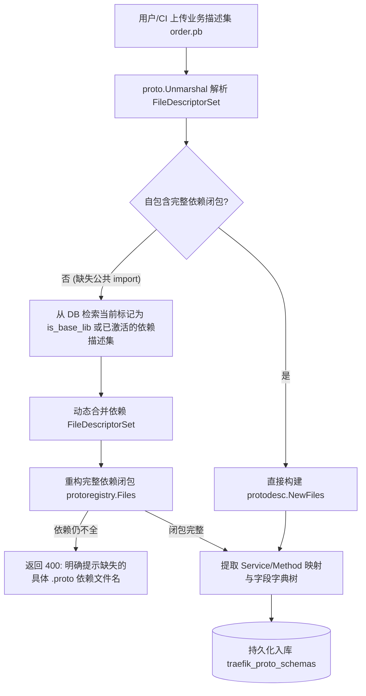

# ADR-10: 增强 Protobuf 描述集管理：多 .pb 资产台账、跨描述集依赖闭包解析与全局单一生效池设计

- **文档编号**：`10-enhanced-proto-schema-file-management-adr.md`
- **文档版本**：v1.0.0
- **日期**：2026-11-02
- **状态**：已批准待实施 (Approved) — **局部修订 [`ADR-06`](./06-proto-schema-repository-and-field-inspection-adr.md) 与 [`ADR-07`](./07-console-ia-restructuring-and-workflow-workbench-adr.md) 描述集管理模式**
- **关联特性**：`F-03`（Protobuf 描述集注册与多 .pb 资产台账）、`F-03.5`（描述集文件列表与全景资产台账）、`F-03.6`（跨 .pb 描述集依赖闭包与基础公共库底座）、`F-03.7`（全局单一生效池与批量激活冲突仲裁）、`F-21`（正式取消外部联动）
- **关联设计**：[`01-system-architecture.md` §2.1 & §5](../02-design/01-system-architecture.md)、[`04-control-plane-and-web-console.md` §2.1~§2.4 & §4.1](../02-design/04-control-plane-and-web-console.md)、[`05-database-schema.md` §3.4](../02-design/05-database-schema.md)
- **关联契约与作战卡**：[`01-http-api-contract.md` §2.3](../03-api/01-http-api-contract.md)、[`08-m7-proto-schema-deepening-and-nested-contract-workbench.md`](../04-tasks/08-m7-proto-schema-deepening-and-nested-contract-workbench.md) (M7)

---

## 1. 背景与问题定义 (Context & Problem Statement)

在 M7（[`ADR-06`](./06-proto-schema-repository-and-field-inspection-adr.md)）实现了方法级两级嵌套折叠表、参数字典树与 Diff 忽略勾选之后，系统的运行时 Payload 解码与字段断言能力已相对成熟。但在真实的超大型企业级微服务体系下，面对数以百计的 `.proto` 源码定义与持续交付场景，现有的 Protobuf 描述集工作台（`/schemas`，`ProtoSchemaWorkbenchPage`）暴露出 **4 个严重的领域建模与文件管理瓶颈**：

1. **“只见方法树，不见文件库”：缺乏独立的文件制品台账视角**：
   - 当前工作台界面采用左侧 320px 窄条卡片（`SchemaVersionList`）+ 右侧 80% 宽度平铺方法表格（`OperationMappingTable`）的双栏结构；
   - 当超大系统存在几十甚至上百个独立编译的 `.pb` 描述集文件时，左侧窄栏卡片无限纵向滚动、无法按文件名/业务域检索、无法按文件大小/上传时间/激活状态排序、无法分页与批量处理；
   - 用户无法将 `.pb` 作为“二进制软件制品资产”进行统一查看与治理。
2. **“依赖孤岛”：单文件独立解析机制无法支撑超大系统的多 `.pb` 依赖拆包**：
   - 现实超大系统中，不可能也不应当强求研发将全团队的 IDL 源码编译成一个数十兆的单体 `.pb`；团队通常会按公共库（如 `base_types.proto`、`rpc_header.proto`）、网关、核心业务域分别编译成独立的 `.pb` 文件；
   - 既有服务端上传逻辑对每个 `.pb` 单独执行 `protodesc.NewFiles(fds)`，如果业务 `.pb` 中 `import "common/base.proto"` 但该文件本身未携带公共依赖定义，上传直接校验失败并返回 `400 Bad Request`，导致多文件拆包体系在现有平台上寸步难行。
3. **缺乏“公共基础库”概念与依赖层级沉淀**：
   - 无法指定某些核心描述集作为“基础库 (Base Lib)”，无法表达描述集之间的前置依赖关系，无法实现基础库一旦更新自动级联驱动依赖方重构内存注册表。
4. **外部模块延期倒逼系统自闭环**：
   - 原规划特性 `F-21`（从 `code-proto` 自动拉取描述集）因 `code-proto` 团队排期严重推迟，短期内无法交付；`code-traefik` 必须确立自身独立自闭环的描述集资产管理能力，既能支持 Web 高效人工上传与维护，也能通过标准 OpenAPI 承接 CI/CD 流水线二进制直接推送。

---

## 2. 核心架构决策 (Architectural Decisions)

### 2.1 决策一：特性边界收敛，正式取消 `F-21`（外部联动解除）

1. **取消 `F-21`**：明确将原特性矩阵中的 `F-21 (从 code-proto 导入 .pb)` 标记为 **CANCELLED (已取消)**，解除对未就绪外部系统的强耦合依赖；
2. **描述集资产全生命周期自闭环**：由 `code-traefik` 自身建立完备的 `.pb` 描述集管理闭环，涵盖：**文件上传预检 ➔ 跨集依赖闭包校验 ➔ 资产分类台账 ➔ 多版本维护 ➔ 全局单一生效池 ➔ 原始制品导出**；
3. **开放标准 CI/CD 推送端点**：提供标准 OpenAPI `POST /api/proto-schemas`（支持 Token/Admin 鉴权与 Multipart 流），方便业务编译流水线构建完成后直接推送 `.pb` 制品。

---

### 2.2 决策二：系统全局单一生效池 (Single Active Schema Pool) 架构极简化

1. **单一全局版本基线**：
   - 确立统一原则：**系统内所有运行环境与所有 Agent 实例，均使用统一生效的接口描述集版本基线**，彻底消除针对不同 Agent 或不同环境维护复杂版本分化矩阵的开销；
2. **无锁全局活跃注册表 (`atomic.Pointer[CompiledRegistry]`)**：
   - 控制面维护唯一的全局内存注册表。所有标记为 `is_active = true` 的描述集，其导出的全部 RPC 方法统一定义在全局注册表中；
   - 流量录制解码、报文调试反序列化、重放 Payload Mock 匹配均统一通过该注册表执行；
3. **全局防冲突门禁 (`A-07` / `F-03.3`) 强保障**：
   - 依据规范 `ascServiceName` 格式统一为 `{package}.{serviceName}`；
   - 在激活单个或批量描述集时，严格在事务内判定：**待生效的所有方法 `(service_name, operation)` 在当前全局生效池中必须全局唯一**；若检测到跨描述集存在重叠冲突，立即中断并返回 `409 Conflict` 与冲突明细，确保运行期零语义歧义。

---

### 2.3 决策三：跨描述集依赖闭包解析引擎 (Cross-Schema Dependency Closure)

为了让超大系统支持公共基础包与各业务域 `.pb` 独立编译、协同生效，改造控制面解析校验引擎：



1. **级联依赖合并算法**：
   - 当新上传的 `.pb` 自身无法构成完整闭包时，解析引擎自动从当前数据库中加载所有**基础库描述集（`is_base_lib = true`）**以及**当前处于生效态的描述集**的原始 `FileDescriptorSet`；
   - 将缺失的外部 `FileDescriptor` 动态补充进当前的编译上下文，成功完成 `protodesc.NewFiles` 校验；
   - 若合并后仍缺失特定 import 文件，精准返回 `400 Bad Request: missing proto dependency file: "xxx/common.proto"`，明确指引用户先上传公共基础包；
2. **公共基础库底座 (`is_base_lib`)**：
   - 允许在描述集元数据中将通用基础协议集标记为 `is_base_lib = true`（如 `dophi_base.pb`、`common_types.pb`）；
   - 基础库将作为所有后续业务描述集解析与动态解码的常驻公共底座；
3. **体积上限提升至 16MB**：
   - 鉴于超大系统公共包或综合业务包体积较大，将单文件上传限制从 `4MB` 平滑提升至 `16MB (16,777,216 Bytes)`，同时保持全流式 `http.MaxBytesReader` 内存防爆保护。

---

### 2.4 决策四：契约工作台重塑为“双模工作台” (Dual-Mode Workbench)

将当前 `/schemas` 工作台升级为兼具**制品文件宏观治理**与**微观方法契约查阅**的双模形态，在工作台顶部增设视窗切换器：

```text
[ 📁 描述集制品台账 (File Assets Table) ]   |   [ 🌳 全局契约目录树 (Global Contract Catalog) ]
```

```mermaid
flowchart LR
    subgraph Mode1["视窗一：描述集制品台账 (File Assets Table)"]
        Table[全景资产宽表]
        Filter[搜索/业务分类/状态筛选]
        DetailDrawer[包含 .proto 列表与依赖关系抽屉]
        Actions[下载原文件 / 激活 / 批量激活 / 删除]
    end

    subgraph Mode2["视窗二：全局契约目录树 (Global Contract Catalog)"]
        SvcMaster[按 {package}.{serviceName} 聚合服务主行]
        OpSub[内层 RPC 方法子表]
        FieldTree[Req/Rsp 消息体字典树]
        DiffIgnore[可视化 Diff 忽略勾选]
    end
```

#### 视窗一：描述集制品台账（面向文件资产全景管理）
1. **全景宽表展示维度**：
   - **描述集名称**：`name` 与版本标签徽章 `v{version}`、`VersionTag`；
   - **制品分类**：`基础公共库 (Base Lib)`、`业务服务 (Business)`、`网关代理 (Gateway)`；
   - **文件信息**：经净化的文件名 `file_name`、格式化体积（如 `1.8 MB`）、截短哈希 `SHA256`；
   - **契约规模**：包含的 `.proto` 源码文件数（可点击弹出 Tag 清单）、包含的 RPC 方法数；
   - **架构认领率**：展示该描述集内服务被 `traefik_module_services` 认领的百分比徽章与孤儿告警；
   - **激活状态**：`当前生效中 (Active)` vs `历史/未生效 (Inactive)`；
   - **归属与时序**：上传人 `created_by`、创建与更新时间；
2. **多维检索与批处理能力**：
   - 支持按描述集名称、包含的 `.proto` 源文件名、包含的 RPC Service 全名进行全局模糊搜索；
   - 支持按分类标签（全部 / 基础库 / 业务）、状态（全部 / 仅看生效 / 仅看未生效）复合筛选；
   - 支持单文件【📥 导出 .pb】、【⚡ 激活】、【🗑️ 删除（仅未生效且未被依赖）】；
   - 支持勾选多个描述集一键【批量激活并入全局生效池】（后台自动执行全局依赖闭包与无冲突校验）。

#### 视窗二：全局契约目录树（面向方法契约与字段定义）
- 延续并深化 M7 的优秀能力：跨所有处于 `is_active = true` 的描述集，按 `{package}.{serviceName}` 聚合成全局服务总表；
- 展示所属来源 `.pb` 文件、认领功能模块、方法列表、展开查看 Req/Rsp 参数字典树并进行三级 Diff 忽略字段配置。

---

## 3. 数据模型演进与索引设计 (`traefik_proto_schemas`)

在现有 `models.ProtoSchema` 基础上，平滑增加分类标签与依赖描述集字段，无需破坏性变更：

```go
// models/proto_schema.go 增强
type ProtoSchema struct {
	ID              uint64         `gorm:"primaryKey;autoIncrement" json:"id"`
	Name            string         `gorm:"size:128;not null;uniqueIndex:uk_traefik_proto_name_ver,priority:1;uniqueIndex:uk_traefik_proto_active_name,where:is_active = true" json:"name"`
	Version         int            `gorm:"not null;uniqueIndex:uk_traefik_proto_name_ver,priority:2" json:"version"`
	VersionTag      string         `gorm:"size:64;not null;default:''" json:"version_tag"`
	Category        string         `gorm:"size:32;not null;default:'BUSINESS';index:idx_traefik_proto_category" json:"category"` // BASE_LIB (基础公共库) | BUSINESS (业务服务) | GATEWAY (网关)
	IsBaseLib       bool           `gorm:"not null;default:false;index:idx_traefik_proto_baselib" json:"is_base_lib"`           // 是否作为公共基础依赖库
	FileName        string         `gorm:"size:255;not null" json:"file_name"`
	FileSHA256      string         `gorm:"size:64;not null;index:idx_traefik_proto_sha" json:"file_sha256"`
	FileSize        int            `gorm:"not null;check:chk_traefik_proto_size,file_size > 0 AND file_size <= 16777216" json:"file_size"` // 扩容至 <= 16MB
	DescriptorBytes []byte         `gorm:"type:bytea;not null" json:"-"`
	IsActive        bool           `gorm:"not null;default:false;index:idx_traefik_proto_active" json:"is_active"`
	OperationCount  int            `gorm:"not null;default:0" json:"operation_count"`
	ProtoFiles      datatypes.JSON `gorm:"type:jsonb;not null;default:'[]'" json:"proto_files"`
	DependencyIDs   datatypes.JSON `gorm:"type:jsonb;not null;default:'[]'" json:"dependency_ids"` // 解析依赖的前置 Schema IDs []uint64
	Description     string         `gorm:"type:text" json:"description"`
	CreatedBy       uint           `gorm:"not null;default:0" json:"created_by"`
	CreatedAt       time.Time      `json:"created_at"`
	UpdatedAt       time.Time      `json:"updated_at"`
}
```

---

## 4. API 契约增补与演进

| 方法 | 路径 | 权限 | 说明 |
| :---: | :--- | :---: | :--- |
| `GET` | `/api/proto-schemas` | `JWT` | 扩展查询参数：`category`（分类过滤）、`is_base_lib`、`search`（支持检索 proto 文件名）、标准通用分页 |
| `POST` | `/api/proto-schemas` | `AdminOnly` | 扩展表单字段：`category`、`is_base_lib`（`bool`）；单文件体积上限提升为 16MB；接入依赖闭包解析 |
| `POST` | `/api/proto-schemas/batch-activate` | `AdminOnly` | 批量激活接口：传入 `schema_ids: uint64[]`，原子校验依赖闭包与无冲突后，整体并入全局生效池 |
| `GET` | `/api/proto-schemas/dependencies-graph` | `JWT` | 获取描述集间的依赖闭包引用关系拓扑，便于依赖追溯与删除防呆 |

---

## 5. 架构收益与权衡应对 (Benefits & Trade-offs)

### 5.1 架构收益
1. **彻底解脱单体超级大包困局**：支持超大系统按团队、按业务域自由拆分编译 `.pb`，通过跨集依赖闭包自动组装，兼顾解耦与协同；
2. **资产治理心智清晰**：从“仅有两层方法折叠”升维为“制品文件台账 + 契约目录”双重视角，文件属性、大小、归属、认领覆盖率一目了然；
3. **保持全局简单可靠**：不搞按环境、按 Agent 割裂的多套版本切片，坚持全局单一生效池，极大降低了运维排障与数据回溯的心智负担；
4. **自立自强解绑风险**：取消外部受阻特性 `F-21`，使得 `code-traefik` 拥有完全自主掌控的 IDL 资产治理能力。

### 5.2 权衡与应对措施
- **依赖闭包动态重构性能**：若每次上传或解码都重新遍历合并 FDS，可能存在开销。
  - *应对*：在控制面 `internal/server/decoder` 引入内存级 `DescriptorPoolCache`，对已解析入库的基础库与生效描述集保持内存句柄缓存，合并时直接做指针合并与哈希查重，实测百毫秒内完成解析。
