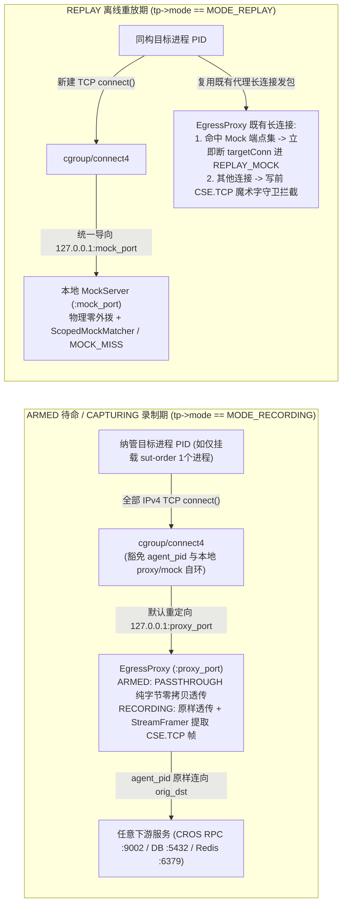

# ADR-11: 单进程开箱即用出入站双向采集 (`INGRESS + EGRESS`)、数据面链路修复与双工作台协同录制体验优化

- **文档编号**：`11-single-process-bidirectional-capture-and-recording-ux-adr.md`
- **文档版本**：v1.0.0
- **日期**：2026-11-03
- **状态**：已提议待检视 (Proposed for M12) — **局部修订 [`ADR-02`](./02-ebpf-hook-and-dual-subsystem-adr.md)、[`ADR-08`](./08-recording-drawer-and-process-tree-selection-adr.md) 与 [`ADR-09`](./09-arch-process-ssot-and-ebpf-premount-standby-adr.md)**
- **关联特性**：`F-08`（自动预挂载与精准存量连接诊断）、`F-09`（目标 PID 默认全出站透明代理与按需入站预热）、`F-10`（`StreamFramer` SIMD 滑窗紧缩）、`F-11`（单/多进程开箱即用双录与会话归属闭环）、`F-12`（历史 `EGRESS` 端点并集重放与写前魔术字零外泄守卫）、`F-15.4`（智能默认预勾选与文案消歧）、`F-15.5`（`/agents` 挂载台账修复与跨页双向深链）
- **关联设计**：[`01-system-architecture.md` §4.2~§4.3](../02-design/01-system-architecture.md)、[`02-data-plane-and-cros-rpc-engine.md` §1~§3](../02-design/02-data-plane-and-cros-rpc-engine.md)、[`04-control-plane-and-web-console.md` §1.2~§1.3 & §4.5](../02-design/04-control-plane-and-web-console.md)
- **关联契约与作战卡**：[`01-http-api-contract.md` §2.4 & §3](../03-api/01-http-api-contract.md)、[`13-m12-bidirectional-capture-and-agent-recording-ux.md`](../04-tasks/13-m12-bidirectional-capture-and-agent-recording-ux.md) (M12)

---

## 1. 背景与问题定义 (Context & Problem Statement)

在真实联调与测试验收中，用户围绕「**挂载单个业务进程（如 `sut-order:9001`）发起流量监听录制**」暴露出两大核心痛点：

### 1.1 痛点一：单进程挂载场景下“只录到入口 (`INGRESS`)，完全漏录出口 (`EGRESS`)”

当用户期望录制某个被测进程以支撑后续单服务离线 Mock 回归重放时，业务上必须同时捕获该进程的**入站请求/应答 (`INGRESS`)**（作为重放时的注入激励与断言基线）以及该进程调用外部下游服务的**出站请求/应答 (`EGRESS`)**（作为重放时的本地二进制 Mock 应答池）。然而既有架构与实现存在 **1 项架构前置死锁 + 5 项底层链路缺陷**：

1. **架构前置白名单死锁 (`downstream_rules_map` 强依赖拓扑或手工下游地址)**：
   - 既有 `cros_connect4` (`pkg/ebpf/bpf/cros_probe.c`) 仅当 `(process_id, dst_ip, dst_port)` 命中 `downstream_rules_map` 时才将出站 TCP `connect()` 重定向至本地 `EgressProxy`；
   - `CompileProcessDownstreams` 依赖静态架构已配置完整 `DEPEND -> PROVIDE` 模块依赖且下游进程已挂载，或用户手工填写 `extra_downstreams`。当用户**仅挂载 1 个业务进程且未预先穷举下游 `IP:Port`** 时，`Downstreams` 为空切片 `[]`，导致 **100% 的出站连接在内核态被直接放行，零字节进入 `EgressProxy`**。
2. **缺陷 A — BPF Map 网络字节序 (`__be32` / `__be16`) 与主机小端序错位**：
   - Linux `struct bpf_sock_addr` 中 `ctx->user_ip4` 为网络字节序 `__be32`（`127.0.0.1` 在小端 `x86_64` 内存表示为 `0x0100007f`），`ctx->user_port` 为网络字节序 `__be16`（需 `bpf_htons(port)`）；
   - Go 用户态 `pkg/ebpf/manager.go` 使用 `binary.BigEndian.Uint32(ip)`（产生主机整数 `0x7f000001`，小端内存落位反转为 `1.0.0.127`）及主机序 `uint16` 端口写入 `downstream_rules_map`、`agent_cfg_map` 并查询 `nat_tuple_map`，导致规则查表、本地端口重定向与 `orig_dst` 反查全部失配。
3. **缺陷 B — `EgressProxy` 上报信封缺失 `SessionOrTaskID` 且控制面硬编码 `agentID = 1`**：
   - `pkg/ebpf/egress_proxy.go` 构造 `EnvelopeHeader` 时未填充 `SessionOrTaskID`（恒为 `0`），导致慢轨 `ExchangeAssembler` 将出站记录落盘为 `session_id = 0`，在录制详情与 `/debug?session_id=X` 中彻底隐身；同时 `assembler.go` 落盘时硬编码 `agentID: 1` 而未透传真实采集 `agt.ID`。
4. **缺陷 C — 业务调用方向 (`Direction`) 与 Socket 读写半流 (`StreamHalf`) 语义混用**：
   - 入站 BPF 将 Socket `read` 标为 `direction = 1`、`write` 标为 `direction = 2` 并原样拷入信封；`EgressProxy` 又将 `Client -> Target` 标为 `DirectionEgress (2)`、`Target -> Client` 标为 `DirectionIngress (1)`；
   - 控制面快轨 SSE 预览与慢轨 `ExchangeAssembler` 均将 `EnvelopeHeader.Direction` 视为业务方向（`1 = INGRESS`, `2 = EGRESS`），导致入站应答与出站应答的方向标签发生错乱翻转，同连接 `REQ` 与 `RSP` 因分片键 `(session_id, process_id, direction, conn_key)` 不一致而无法配对！
5. **缺陷 D — 存量 `ESTABLISHED` 入站 FD 未执行预热，且 `DiagnoseEstablishedConns` 误扫全命名空间**：
   - `SyncMonitors` 开录时未将目标进程 `listen_port` 上已建立的存量入站 Socket FD 预写入 `ing_conn_map`，导致开录前已连入的上游客户端流量漏采；
   - `ProcScanner.DiagnoseEstablishedConns` 直接读取 `/proc/<pid>/net/tcp`（Linux 下返回整个网络命名空间的全部 Socket，包含 `agent_pid` 自身的 `EgressProxy -> 下游` 连接及其他无关进程连接），既未与 `/proc/<pid>/fd` 进程自有 Socket Inode 求交集，也未排除已接入 `127.0.0.1:proxyPort` 的受控代理连接，导致误报与漏报并存。
6. **缺陷 E — 停止录制控制面 HTTP 路由失配 (`404 Not Found`)**：
   - Agent 侧暴露路由为 `POST /agent/v1/monitors/{sessionId}/stop`，而主控 `Orchestrator.stopSessionInternal` 请求了错误的 `/agent/v1/monitors/stop`，导致停录指令返回 `404`、Agent 本地租约与 `CAPTURING` 钩子悬空直至心跳对账兜底。

### 1.2 痛点二：`/agents` 与 `/record` 两处进程配置职责混淆、空表展示 Bug 与重复操作摩擦

1. **`/agents` 左卡显示 `纳管进程: 1 个` 而右表显示空白**：
   - `handlers/agent_handler.go` 的 `GetAgent` 仍遗留 M10 重构前的废弃 GORM 关联 `Preload("ProcessModules.Module")` 与废弃列名 `Order("listen_port ASC")`，且违规使用 `_ =` 吞掉了 SQL 报错，导致前端拿到空数组 `processes: []`。
2. **两阶段配置心智文案歧义与重复勾选成本**：
   - `/agents` 属于 **Day-1 环境部署拓扑与常驻待命探针挂载（1 次配置、零损耗待命）**，而 `/record` 属于 **Day-2 单次录制批次的目标范围圈选**；
   - 既有 `RecordingStartDrawer` 文案写为“勾选即下发 eBPF 探针租约”，令用户误以为每次都要重新绑定探针；同时抽屉打开时默认 `targetProcessIds = []`，即使整台 Agent 只挂载了 1 个业务进程也强迫用户手动展开勾选；两个工作台之间也缺少一键互跳的双向深链。

---

## 2. 核心架构决策 (Architectural Decisions)

### 2.1 决策一：目标 PID 默认全出站透明代理拦截 (`Wildcard Target-PID Egress Interception`) 与历史 `EGRESS` 重放自动闭环

1. **单进程零拓扑前置即可开箱双录 (`INGRESS + EGRESS`)**：
   - 在 `ARMED` 待命与 `CAPTURING` 录制模式（`tp->mode == MODE_RECORDING`）下，`cros_connect4` 不再要求目标地址必须命中 `downstream_rules_map` 白名单，而是对 **`target_pids_map` 中所有纳管目标 PID 发起的 IPv4 TCP 出站连接默认透明重定向至 `127.0.0.1:cfg->proxy_port` (`EgressProxy`)**；
   - **严格防自环豁免条件**：① `pid == cfg->agent_pid` 直接放行并累加 `STAT_BYPASSED_SELF`；② 目的端口等于自身非零监听端口 `bpf_htons(tp->listen_port)`（无论目的 IP 为 `127.0.0.1` 还是宿主机局域网物理 IP，因入站 read/write 钩子已在监听端生效，直接放行杜绝进程自连死锁与双重代理）；或目的地址为 `127.0.0.1` 且目的端口等于 `cfg->proxy_port`、`cfg->mock_port` 时直接放行；③ 不在 `target_pids_map` 中的宿主机其他进程 `100%` 原样放行（严守 Non-Goal 6）；
   - `downstream_rules_map` 退化为纯粹的**「静态已声明下游参考集」**：活跃录制期若出站目的未命中 `downstream_rules_map`，在执行透明代理重定向的同时向 `connect_observe_ringbuf` 投递一条连接观测事件，继续支撑 `F-05` 架构未声明调用（`VIOLATION`）分析。
2. **非 CROS RPC 协议（PostgreSQL / MySQL / Redis / HTTP）100% 透明无损保障**：
   - `PASSTHROUGH` 态执行纯字节流转发，零协议假设；
   - `CAPTURING` 态下，`EgressProxy` **无条件将原始字节原样转发至 `targetConn`**，旁路副本交由 `pkg/crosrpc.StreamFramer` 扫描。`StreamFramer` 升级为 **`bytes.Index` SIMD 魔术字定位 + 尾部 `0..6` 字节原地紧缩**：扫描未命中时保留尾部 `keep = min(len(f.buf), len(MagicPrefix)-1)` 字节，执行原地拷贝 `copy(f.buf[:keep], f.buf[len(f.buf)-keep:])` 并收缩 `f.buf = f.buf[:keep]`。对于完全不含 `"CSE.TCP"` 魔术字的数据库/缓存长连接，既绝不误产出任何伪流量帧，又保证单连接滑窗缓冲恒定 `<= 8KB`，彻底消除切片底层数组向后漂移扩容与内存钉死泄漏，同时完整保留中途切入大包 CROS RPC 流后的自同步能力。
3. **重放期历史 `EGRESS` 端点自动并集与写前 `"CSE.TCP"` 零外泄守卫**：
   - 发起重放时，主控 `ReplayScheduler` 自动将 **「`CompileProcessDownstreams(target)` 静态推导端点 $\cup$ 源录制批次中该源进程实测捕获的全部 `EGRESS` 记录 `DstAddr (IP:Port)`」** 合并作为重放 Mock 端点集下发 Agent。即使系统未建任何模块依赖契约，单进程录制的下游调用在重放时也能 100% 自动闭环进入 `REPLAY_MOCK`；
   - **新建连接零外泄且可检出 `MOCK_MISS` (`SC-08`)**：`tp->mode == MODE_REPLAY` 时，`cros_connect4` 将目标 PID 的新建出站连接统一重定向至本地 `127.0.0.1:cfg->mock_port` (`MockServer`)。`MockServer` 物理上绝不向外发起任何真实 `Dial`（零外泄）；若收到 CROS RPC 请求则走 `ScopedMockMatcher` 匹配或精确记录包含 `(ascServiceName, ascOperation)` 的 `MOCK_MISS` 明细，若收到非 CROS RPC 首包则立即本地关闭；
   - **既有 `EgressProxy` 长连接双保险守卫**：命中 Mock 端点集的既有代理长连接在重放启动瞬间立即关闭/物理阻断 `targetConn` 切入 `REPLAY_MOCK`；同进程未命中 Mock 端点集的其余既有代理连接（如测试环境常驻 DB 连接，Non-Goal 8）开启**写前魔术字守卫**——转发客户端上行块前先检测是否含合法 `"CSE.TCP"` 帧头，一旦检出 CROS RPC 报文立即物理切断 `targetConn` 转入 `REPLAY_MOCK` 交由 `ScopedMockMatcher` 处理，确保任何突变新增的下游 CROS RPC 调用同样 **0 字节外泄至真实下游**。

---

### 2.2 决策二：数据面底层五项协议不变量对齐与 `/proc/<pid>/fd` 精准诊断

1. **BPF Map 字节序契约标准化 (`pkg/ebpf/endian.go`)**：
   - 统一封装跨架构安全的纯函数转换器（禁止散落手写 `binary.BigEndian.Uint32`）：
     - IPv4 地址（对标内核 `__be32` 内存四字节序列 `{a, b, c, d}`）：采用 `ipv4ToBPFBe32(ip net.IP) uint32`（`binary.NativeEndian.Uint32(ip.To4())`）与 `bpfBe32ToIPv4(v uint32) net.IP`；
     - TCP 端口：明确区分内核 `bpf_sock_addr.user_port` / `orig_port` / `agent_cfg.{proxy_port,mock_port}`（统一存储网络字节序 `__be16`，由 `htons(port)` 转换）与主机序诊断字段（由 `ntohs(bePort)` 还原），在 `cros_sock_ops` 与用户态 `NatTupleMap` 之间保持严格字节对称。
2. **正交解耦 `EnvelopeHeader.Direction` 与 `StreamHalf`**：
   - **全局唯一语义冻结**：56B 信封头 `Direction` 恒定表示**相对于被监控进程的业务调用方向**：
     - `1 = DirectionIngress`：目标进程在 `listen_port` 被动接收连接上的**全部帧**（含上游发来的 `REQ` 与本进程回写的 `RSP / RSP_SEG`）；
     - `2 = DirectionEgress`：目标进程主动发起出站连接上的**全部帧**（含本进程发出的 `REQ` 与下游返回的 `RSP / RSP_SEG`）；
   - 请求与应答的区分唯一由 CROS RPC 公共头 `ucMsgType` 决定；
   - `IngressReader` 以 `(PID, ConnSeq, StreamHalf)`（其中 BPF 事件内部 `rw_dir`: `1 = RX_READ`, `2 = TX_WRITE`）隔离收发两个 `StreamFramer`，但在封装输出 `EnvelopeHeader` 时统一赋 `Direction = DirectionIngress`，并将四元组归一化为 `Src = 远端客户端, Dst = 本机监听端点`；`EgressProxy` 在双向拷贝协程中统一赋 `Direction = DirectionEgress` 并固定 `Src = 本机客户端临时端口, Dst = orig_dst`，保证 `ExchangeAssembler` 的 `(session_id, process_id, direction, conn_key, sno)` 100% 精确配对。
3. **`EgressProxy` 会话 ID 原子注入、真实 `agent_id` 落盘与停录路由修复**：
   - `EgressProxy` 维护 `atomic.Uint64` 类型的 `activeSessionID`：`SyncMonitors(sessionID)` 开启采集闸门时注入 `sessionID`，`StopMonitor` 走完 `200ms` 在途应答排空并切回 `PASSTHROUGH` 后清零；`activeSessionID == 0` 时丢弃分帧输出；
   - `Orchestrator` 将 WebSocket 流绑定的真实 `agt.ID` 传入 `ExchangeAssembler.Feed(agentID, env, payload)`；
   - `Orchestrator.stopSessionInternal` 修正请求 URL 为 `fmt.Sprintf("%s/agent/v1/monitors/%d/stop", agt.Endpoint, sessionID)`。
4. **存量入站 FD 预热与基于进程自有 Socket Inode 的存量连接诊断**：
   - `ProcScanner` 新增 `ScanProcessEstablishedSockets(pid uint32)`：先读取 `/proc/<pid>/fd` 提取该进程持有的全部 `socket:[inode]`，再扫描 `/proc/<pid>/net/tcp`（状态 `01 = TCP_ESTABLISHED`）求交集，彻底隔离同机 `agent_pid` 与其他进程 Socket 干扰；
   - **入站预热**：`SyncMonitors` 将其中 `local_port == spec.ListenPort`（`spec.ListenPort > 0`）的 `(pid, fd) -> conn_tuple` 批量预写入 `ing_conn_map`，使开录前已连入的上游长连接 0ms 免重连即刻采集；
   - **出站诊断**：对 `local_port != spec.ListenPort` 的连接，凡 `rem_addr == 127.0.0.1:proxyPort` 视为已受 `EgressProxy` 接管；其余直连连接在 `len(downstreams) == 0`（单进程全出站模式）时全量计入 `established_conns`（提示 `NEED_RECONNECT`），在指定 `downstreams`（如重放 Mock 端点集校验）时按目标端点集合精准匹配。

---

### 2.3 决策三：双工作台职责边界澄清、智能默认预勾选与双向深链闭环 (`/agents` ⇄ `/record`)

保留 **`/agents`（Day-1 环境级架构进程 `1:1` 挂载与常驻预挂待命）** 与 **`/record`（Day-2 任务级按需采集范围圈选）** 的正交两层架构，通过以下四项工程改进彻底消除配置割裂感与多余点击：

| 优化维度 | `/agents` (`AgentManagementPage`) | `/record` (`RecordingStartDrawer`) |
| :--- | :--- | :--- |
| **1. 数据加载修复** | 修复 `GetAgent` 与 `BatchUpdateProcessMounts`：统一 `Preload("ArchProcess.Group").Preload("ArchProcess.Modules")`，按 `effective_listen_port ASC, id ASC` 排序并执行 `FillFromArchProcess()`，显式处理 DB 错误（严禁 `_ =`） | 同步获取每个挂载实例承载的 `modules` 与依赖血缘，支撑关联下游一键勾选 |
| **2. 职责文案消歧** | 副标题与右栏卡片标题明确标注为 **「环境进程部署映射与常驻待命探针 (配置一次 · 零损耗待命)」** | 字段标题修正为 **「本次采集目标进程（从已挂载进程中圈定范围 · 默认同时录制入口 INGRESS 与出口 EGRESS）」** |
| **3. 智能默认预勾选** | 新挂载进程按全局设置默认进入 `ARMED` 自动预挂待命 | 打开抽屉或切换 Agent 时过滤可用进程（`probe_desired_state !== 'DISARMED'`）： • **`1 <= 可用进程数 <= 5`**：**默认自动全选**（单进程及常规联调环境实现 **0 次手动勾选直接开录**）； • **`可用进程数 > 5`**：默认自动勾选 `probe_status === 'READY'` 的进程（防数十进程大环境误全选噪音）； • `DISARMED` 进程置灰禁用勾选并提示先恢复探针； • 快捷工具栏提供：`[全选可用]`、`[仅选就绪]`、`[🔗 勾选关联下游]`（直接复用挂载实例已预加载的 `ArchProcess.Modules` 元数据与本地架构拓扑缓存级联推导同机已挂载下游进程，避免 N+1 异步网络往返）、`[清空]` |
| **4. 双向深链闭环** | 1. 右栏顶栏新增 **`[🎬 发起录制]`** 按钮（Agent 在线空闲且已挂载进程时激活），一键跳转 `/record?auto_start=1&agent_id=<id>`； 2. 支持响应 URL `?agent_id=<id>&open_mount=1`（严格进行 Anti-IDOR 写权限门禁：仅对有编辑权限的用户自动滑出 `AgentProcessMountDrawer`；只读用户仅高亮锚定卡片并友好提示无权限，严禁弹出不可写抽屉） | 1. `RecordingWorkbenchPage` 解析 `?auto_start=1&agent_id=<id>` 自动打开 `RecordingStartDrawer` 预选对应 Agent（关闭抽屉时自动清除一次性 `auto_start` 参数防刷新重弹）； 2. 当所选 Agent 挂载进程为空时，空状态卡片提供主行动按钮 **`[前往挂载架构进程 →]`** 跳转 `/agents?scope=<scope>&agent_id=<id>&open_mount=1` |

---

## 3. 备选方案权衡 (Alternatives Considered)

1. **备选方案 A：合并 `/agents` 与 `/record`，在发起录制抽屉内直接扫描 `/proc` 临时绑定进程**
   - **否决理由**：违反 `ADR-09` 确立的架构物理进程蓝图 SSOT 与 `ARMED` 前置待命设计。若每次录制才临时挂载 `connect4`，业务进程早已建立的下游 CROS RPC 长连接 100% 处于 `NEED_RECONNECT` 绕过状态，每次录制都将被迫重启业务进程；保持 Day-1 常驻 `ARMED` + Day-2 智能默认勾选，既保留了 **0ms 免重启开录** 优势，又把单进程日常录制的点击成本降到了与单页配置完全相同的 **0 次额外勾选**。
2. **备选方案 B：不在内核态默认拦截全部目标 PID 出站连接，而是要求用户在挂载单进程时必填 `extra_downstreams` 列表**
   - **否决理由**：微服务环境下单个进程可能访问十余个下游实例，研发人员往往并不清楚所有下游物理 IP 与端口；强制预填 `extra_downstreams` 体验极差且极易遗漏。采用目标 PID 默认全出站透明代理配合 `StreamFramer` `"CSE.TCP"` 魔术字识别，可实现真正的零配置开箱即用双录。
3. **备选方案 C：重放期（`MODE_REPLAY`）内核 `connect4` 对未声明下游继续直接返回 `EPERM` 拒绝建连**
   - **否决理由**：在 `SC-08`（代码变更导致多调用一次未录制下游 RPC）或单进程未配置静态拓扑场景下，若 `connect()` 在 TCP 握手阶段即报 `EPERM`，业务进程根本来不及发出 CROS RPC 请求头，Agent 只能观测到连接失败而无法提取 `(ascServiceName, ascOperation)` 生成可定位问题的 `MOCK_MISS` 报告。将 `MODE_REPLAY` 新建连接统一导向绝不外拨的本地 `MockServer`，既保持了 **100% 物理零外泄**，又让 `MOCK_MISS` 诊断精确到具体服务与方法名。

---

## 4. 影响面与兼容性评估 (Consequences)

- **数据库表结构零变更**：保持既有 15 张业务表 + `traefik_settings` Schema 完全不变，无需任何 DDL 迁移。
- **主从物理隔离红线不变**：`cmd/agent` 与 `pkg/{crosrpc,agentproto,ebpf,replay}` 继续保持零数据库驱动、零 `dynamicpb/protoregistry` 依赖。
- **正向收益**：
  1. 单进程录制无需预配任何下游拓扑或 IP 白名单，开箱自动录齐 `INGRESS + EGRESS` 完整往返并可直接用于零外泄离线重放；
  2. 彻底根除 BPF 字节序错位、`session_id=0` 丢包、响应方向反转、停录 `404` 悬空租约及 `/proc` 全命名空间误诊 5 项深层缺陷；
  3. `/agents` 挂载列表正常呈现，单进程/小环境发起录制实现一键直达、自动预选。

