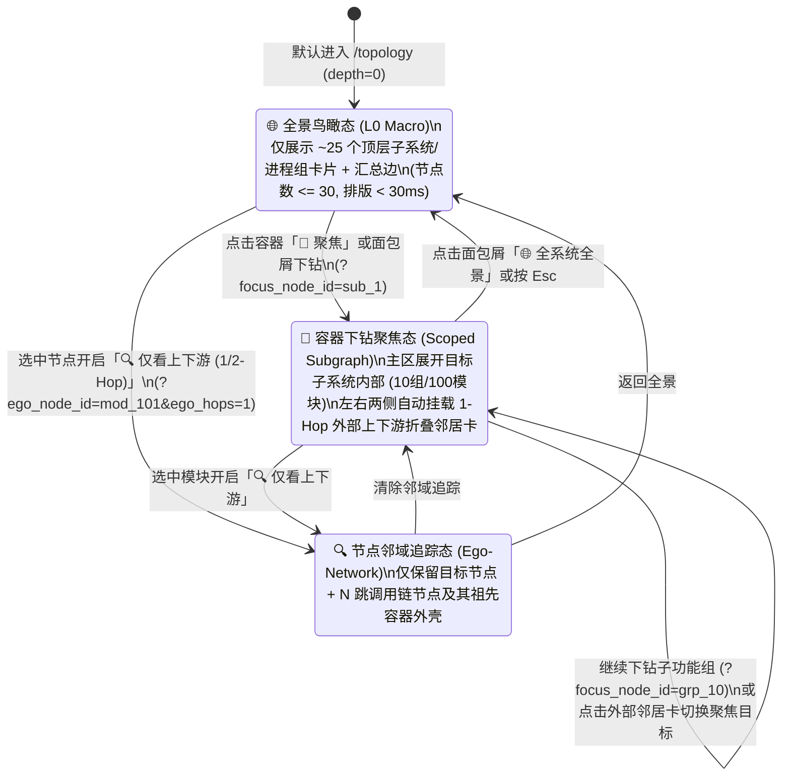
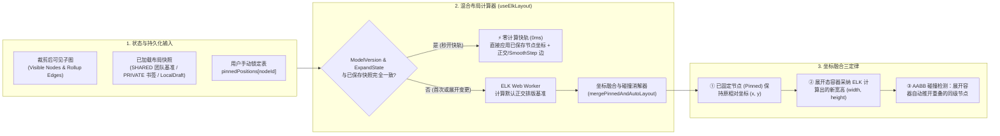

# ADR-15: 大规模架构拓扑渐进式下钻聚焦、多维降噪与双层混合布局持久化设计

- **文档编号**：`15-scalable-topology-focus-and-layout-persistence-adr.md`
- **文档版本**：v1.0.0
- **日期**：2026-11-09
- **状态**：已采纳 (Accepted)
- **关联特性**：`F-04`（分层复合架构拓扑与一致性画布）、`F-04.1`（C4 渐进式钻取、子系统聚焦与 N-Hop 邻域视图）、`F-04.2`（多维切片过滤、聚光灯降噪、高扇入折叠与搜索飞跃）、`F-04.3`（混合固定/自动布局引擎与公私双层布局持久化）
- **关联设计**：[`docs/02-design/03-architecture-elements-and-topology.md` §4 & §6](../02-design/03-architecture-elements-and-topology.md)、[`docs/02-design/05-database-schema.md` §3.7](../02-design/05-database-schema.md)、[`docs/03-api/01-http-api-contract.md` §2.2](../03-api/01-http-api-contract.md)
- **关联作战卡**：[`docs/04-tasks/20-m19-scalable-topology-focus-and-layout-persistence.md`](../04-tasks/20-m19-scalable-topology-focus-and-layout-persistence.md) (M19)
- **演进关系**：保留 [`ADR-05`](./05-hierarchical-topology-canvas-redesign.md) 的分层复合图与边上卷底座，**正式修正并取代 ADR-05 §2 决策项 #3（“手动拖动后的排版不保存”）**。

---

## 1. 背景与真实规模痛点 (Context & Problem Statement)

随着 `code-traefik` 在企业真实生产产品线落地，架构资产规模快速增长至以下量级：
- **业务子系统 (`SUBSYSTEM`, L0)**：约 **25 个**；
- **功能组 (`FUNCTIONAL_GROUP`, L1..Ln)**：每个子系统约 10 个，全系统约 **250 个**；
- **功能模块 (`MODULE`, Leaf)**：每个功能组约 10 个，全系统约 **2,500 个**；
- **总节点与依赖边规模**：全图共计 **~2,775 个节点** 与 **5,000 ~ 10,000 条** 底层模块服务契约边。

在这一真实规模下，M6 阶段确立的首版全量画布体验暴露出 **四大核心瓶颈**：

1. **“全量平铺”引发的视觉毛线团与排版卡顿**：
   - 当用户将顶部工具栏的层级滑杆拉至 `L2` 或点击「全展」时，2,775 个复合嵌套节点与数千条跨容器正交边同时送入 ELK (`layered` + `INCLUDE_CHILDREN` + `ORTHOGONAL`) 计算并挂载至 React Flow DOM。
   - 不仅 ELK Worker 计算耗时长达数秒、画布平移缩放帧率骤降，更严重的是 `fitView` 会将视口缩放到 `0.15x` 极限，所有模块缩成无法辨认的色点，数千条正交折线交织成“蛛网毛线团（Hairball）”，彻底丧失架构可读性。
2. **缺乏“分而治之”的局部下钻聚焦与多维切片能力**：
   - 架构师审视宏观架构时只需看 25 个子系统的 `L0` 鸟瞰图；而子系统负责人或一线研发日常 90% 的时间只关心**“本子系统内部的 10 个功能组与 100 个模块，以及与我有直接调用关系的 1-Hop 上下游子系统”**，或**“某一个具体模块的 1~2 跳调用链”**。当前画布缺乏子系统级下钻隔离（Scoped Subgraph）与多维切片过滤（按子系统、按负责人 `Owner`、按一致性异常状态）。
3. **局部操作引发全局镜头乱跳与手动排版清零**：
   - 现有 `ArchCanvas.tsx` 在每次 `layoutNodes.length` 变化（如用户放大到某处双击展开一个功能组）且 `draggedNodeIds.size === 0` 时，都会无条件触发全局 `rfInstance.fitView()`，瞬间把镜头拉回 25 个子系统的全局全景，导致用户丢失刚才盯住的局部焦点。
   - 同时，`useElkLayout.ts` 在任意容器展开/折叠后会用 ELK 重新生成的坐标全盘覆写所有节点位置——用户前面手动拖拽摆好的节点位置瞬间作废。
4. **布局无法保存，破坏团队固定的“架构心智地图（Mental Map）”**：
   - 研发团队对系统拓扑有强烈的空间方位共识（例如：终端/接入网关在最左、交易核心在中央、账务/清结算在右上、公共基础底座在底部、外部银联/微信在最右）。ADR-05 早期规定“拖拽不保存”，导致每次刷新页面、或仅仅新增一条模块依赖边，ELK 都会重新洗牌节点相对位置，且架构师无法将精心排布的拓扑图固化发布为全团队共享的默认视图。

---

## 2. 核心架构决策矩阵 (Decisions & Trade-offs)

| # | 决策维度 | 决策结论 | 架构落地设计与权衡依据 |
| :---: | :--- | :--- | :--- |
| **1** | **大规模分层探索范式** | **C4 渐进式三级探索：L0 全景鸟瞰 $\leftrightarrow$ 容器下钻聚焦 (`Scoped Subgraph` + 1-Hop 外部邻居) $\leftrightarrow$ 节点 N-Hop 邻域 (`Ego-Network`)** | 默认以 `L0`（25 个顶层子系统/进程组折叠卡）秒级加载；双击或点「🎯 聚焦」进入指定子系统/功能组独立子图（画布仅排版该子系统内部 ~100 个节点，并将其 1-Hop 跨子系统上下游以折叠态 `Neighbor Card` 置于两侧）；设置 **可见节点阈值守卫（默认 `150`）**，拦截无过滤条件下的全局 `L2` 暴力全展。 |
| **2** | **混合布局引擎** | **固定坐标锚定 (`Pinned Nodes`) + AABB 局部碰撞推开 + 增量 Diff 合并** | 拖拽任意节点后自动锁定其相对父容器（或根画布）的坐标 `pinnedPositions[nodeId]`；当展开/折叠某个容器时，已固定节点的坐标严格保留，仅对展开后体积膨胀的容器执行同级非固定邻居 AABB 矩形碰撞推开（Collision Push-Apart），容器内部子节点由 ELK 局部排版。 |
| **3** | **视口相机控制** | **局部展开原地锚定（Camera Anchoring）+ 搜索结果平滑飞跃（Fly-To）** | 移除 `layoutNodes.length` 变化时的无差别全局 `fitView`；单点展开/折叠容器时锁定当前缩放比例并以被操作容器为中心微调平移；搜索框升级为分类候选下拉列表，点选目标节点后仅展开其单一祖先链并执行 `fitView({ nodes: [target], maxZoom: 1.15 })` 镜头直达。 |
| **4** | **布局持久化模型** | **双层服务端持久化 (`traefik_topology_layouts`) + 浏览器 `localStorage` 实时草稿** | 1. **团队官方基准布局 (`SHARED Canonical`)**：由 `traefik_admin` 按 `(view, focus_scope)` 保存发布，全员默认加载； 2. **个人命名视图书签 (`PRIVATE Saved Views`)**：每位研发可保存最多 20 个个人常用视图（含聚焦域、筛选器、展开态、坐标与视口）； 3. **本地未保存草稿 (`localStorage`)**：拖拽即时暂存，刷新不丢，支持一键「恢复团队基准」或「重新自动排版」。 |
| **5** | **架构演进兼容性** | **基于 `ModelVersion` 的非破坏性增量合并 (`Graceful Diff Merge`)** | 当后端新增/删除模块导致 `TopologyGraphDTO.model_version` 变更时，**绝不丢弃已保存布局**；已有历史坐标的存量节点 100% 保持原位，仅对新增节点计算容器边缘网格空位并标记 `✨ 新节点` 徽标。 |
| **6** | **连线风暴治理** | **1-Hop 聚光灯 (`Spotlight`) + 高扇入公共底座插头折叠 (`Hub Bus Pill`) + 语义 LOD** | 悬停/选中节点时高亮 1-Hop 邻域并将背景节点/边淡化至 `20%` 不透明度；对跨容器关联度 `>= 8` 的公共基础子系统/外部系统支持折叠长连线为紧凑引用徽章；远景缩放（`< 0.45x`）自动切换大字简版 LOD 卡片。 |

---

## 3. C4 渐进式探索与局部聚焦子图架构 (`Scoped Subgraph & Ego-Network`)

### 3.1 三级渐进式视野状态机

### 3.2 容器下钻聚焦与 1-Hop 外部邻居提取算法 (`extractScopedSubgraph`)

当用户聚焦于目标容器 $C_{\text{focus}}$（例如 `sub_1` 电商交易子系统）时，纯函数 `extractScopedSubgraph(allNodes, allEdges, focusNodeId)` 按以下步骤在 $< 5\text{ms}$ 内裁剪出高信噪比子图：

1. **内部子树全集提取 ($V_{\text{inner}}$)**：
   - 收集 $C_{\text{focus}}$ 自身及所有 `ancestors` 包含 `focusNodeId` 的后代节点（对于单个子系统，约 1 个子系统框 + 10 个功能组 + 100 个模块 = 111 个节点）。
   - 将 $C_{\text{focus}}$ 强制设为已展开（`expandState[focusNodeId] = true`）。
2. **跨边界依赖边识别 ($E_{\text{cross}}$)**：
   - 扫描底层叶子边集 `allEdges`（含一致性报告合成的动态 `VIOLATION` / `UNATTRIBUTED` 边）：
     - **内部边 ($E_{\text{inner}}$)**：`source_node_id` 与 `target_node_id` 均属于 $V_{\text{inner}}$，完整保留；
     - **入站跨界边 ($E_{\text{in}}$)**：`source_node_id` $\notin V_{\text{inner}}$ 且 `target_node_id` $\in V_{\text{inner}}$；
     - **出站跨界边 ($E_{\text{out}}$)**：`source_node_id` $\in V_{\text{inner}}$ 且 `target_node_id` $\notin V_{\text{inner}}$；
     - 其余两端均在 $V_{\text{inner}}$ 之外的无关边全部剔除。
3. **1-Hop 外部上下游代表容器收敛 ($V_{\text{ext}}$)**：
   - 对于每条跨界边 $e \in E_{\text{in}} \cup E_{\text{out}}$ 的外部端点 $u \notin V_{\text{inner}}$，向上查找其所属的顶层容器（`depth == 0` 的 `SUBSYSTEM` / `PROCESS_GROUP` / `EXTERNAL_CONTAINER`，若 $C_{\text{focus}}$ 是同子系统内的某个功能组 `grp_10`，则同子系统内的其他兄弟功能组收敛至其一级功能组容器），记为外部邻居代表节点 $R_{\text{ext}}(u)$；
   - 将所有 $R_{\text{ext}}(u)$ 以**强制折叠态（Collapsed Ghost / Neighbor Card）**加入可见节点集，并在 `meta.isExternalNeighbor = true`、`meta.neighborDirection = 'UPSTREAM' | 'DOWNSTREAM' | 'BIDIRECTIONAL'` 中标记方位；
   - 由此，无论外部有 24 个其他子系统还是 2,400 个外部模块，在聚焦画布中只会呈现与当前子系统有真实契约往来的寥寥几个外部子系统折叠卡，既守住了局部聚焦的清爽度，又完整保留了跨系统接口上下文！

---

## 4. 混合布局引擎与双层持久化架构 (`Hybrid Layout & Dual-Tier Persistence`)

### 4.1 混合固定/自动排版流水线 (`mergePinnedAndAutoLayout`)

1. **坐标相对性契约**：
   - React Flow 中每个节点的 `position: { x, y }` 均为**相对于其 `parentId` 父容器左上角**的局部坐标（顶层 `depth=0` 节点相对于根画布原点）。
   - 因此，当用户拖拽移动顶层子系统 `sub_1` 时，其内部功能组与模块的局部坐标完全不变，天然随父容器整体平移；当用户在展开的 `sub_1` 内部拖拽微调某个功能组 `grp_10` 时，记录的是 `grp_10` 在 `sub_1` 内部的局部偏移。
2. **展开/折叠时的 AABB 碰撞推开算法 (`resolveSiblingOverlaps`)**：
   - 当存在已固定坐标的同级节点集合，且其中某个容器 $A$ 由折叠态（`260×80`）双击展开为大容器（如 `680×420`）时，容器 $A$ 的左上角锚点 $(x_A, y_A)$ 保持不变，但其右下边界向右下方膨胀 $(\Delta W, \Delta H)$；
   - 后处理器按从左到右、从上到下的拓扑序扫描同父容器下的兄弟节点 $B$：若 $B$ 的包围盒与膨胀后的 $A$ 发生重叠（含安全间距 `gap = 32px`），则沿主排版轴向（水平向右 $\Delta X$ 或垂直向下 $\Delta Y$）平滑推开 $B$，确保**既不重置用户的整体布局格局，又绝不产生容器互相遮挡重叠**。
3. **关联边自适应路由**：
   - 若某条边的源或目标（或其所属容器）处于 `pinnedPositions` 手动偏移态，ELK 静态 `bendPoints` 已不再对齐实际端口，此时将该边标记 `isDraggedDegraded = true`，交由 `<RollupEdge>` 使用 React Flow `getSmoothStepPath` 实时根据节点当前 Handle 绝对坐标绘制正交圆角折线。

### 4.2 双层服务端持久化 + 本地草稿的三级加载优先级

在后端新增第 18 张业务表 **`traefik_topology_layouts`**（详见 [`05-database-schema.md` §3.7](../02-design/05-database-schema.md)），前端按 `(view, focusScope)` 维护三级存储体系：

$$\text{优先级 ①: 浏览器 LocalDraft (未保存拖拽暂存)} \succ \text{优先级 ②: 用户选定的 PRIVATE 视图书签} \succ \text{优先级 ③: 团队 SHARED 官方基准布局} \succ \text{优先级 ④: ELK 纯自动计算}$$

- **操作闭环**：
  - **普通用户**：拖拽调整后实时写入 `localStorage`（顶部显示 `● 未保存本地调整` 提示胶囊）；可点击 **「📑 另存为个人视图」** 持久化到服务端个人书签，或点击 **「↺ 恢复团队基准」** 清除本地草稿回到管理员发布的官方布局；
  - **模块管理员 (`traefik_admin`)**：额外拥有 **「💾 发布为团队基准布局」** 按钮，一键将当前视角（全局全景或某子系统下钻视图）的节点坐标与默认展开态固化为全团队默认蓝图。

---

## 5. 后果与收益评估 (Consequences)

### 正向收益 (Positive)
1. **十倍规模从容应对**：在 25 子系统 / 250 功能组 / 2,500 模块规模下，L0 鸟瞰与子系统下钻聚焦均将单次渲染节点数严格控制在 `25 ~ 130` 个黄金区间内，ELK 排版与 React Flow 渲染恒定 `< 60ms`；
2. **团队架构心智图统一**：架构师排好一次顶层子系统与核心模块方位并发布为团队基准后，全员打开即见固定、整洁、符合业务逻辑分区的官方架构图；
3. **探索与排障效率质变**：多维切片（子系统 / Owner / 异常状态）、1-Hop 聚光灯、高扇入底座折叠与搜索相机直达，让架构漂移定位从“大海捞针”变为秒级直达。

### 潜在代价与应对 (Trade-offs & Mitigations)
1. **状态组合复杂度上升**：聚焦域 (`focus_node_id`)、邻域追踪 (`ego_node_id`)、多维过滤器与展开状态共同决定可见节点集。通过将子图裁剪与过滤逻辑全部抽象为无副作用纯函数（`subgraph.ts` + `layoutMerger.ts`），并配套 `>= 90%` 覆盖率的 Vitest 单元测试矩阵予以锁定。
