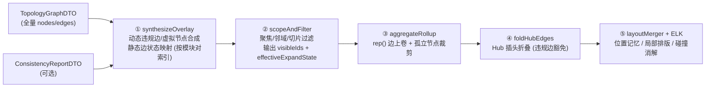
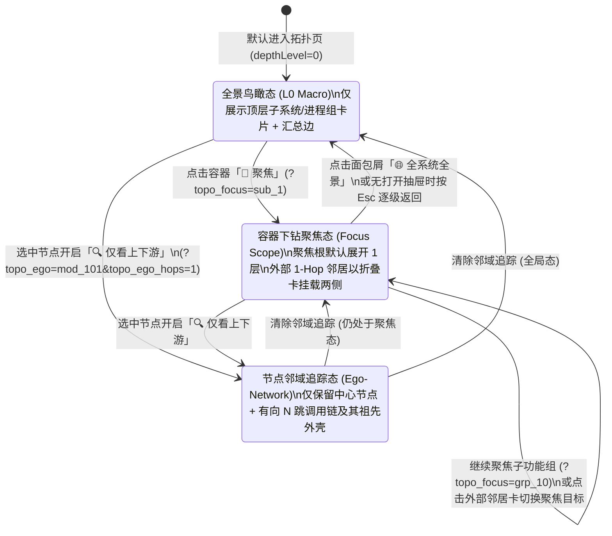
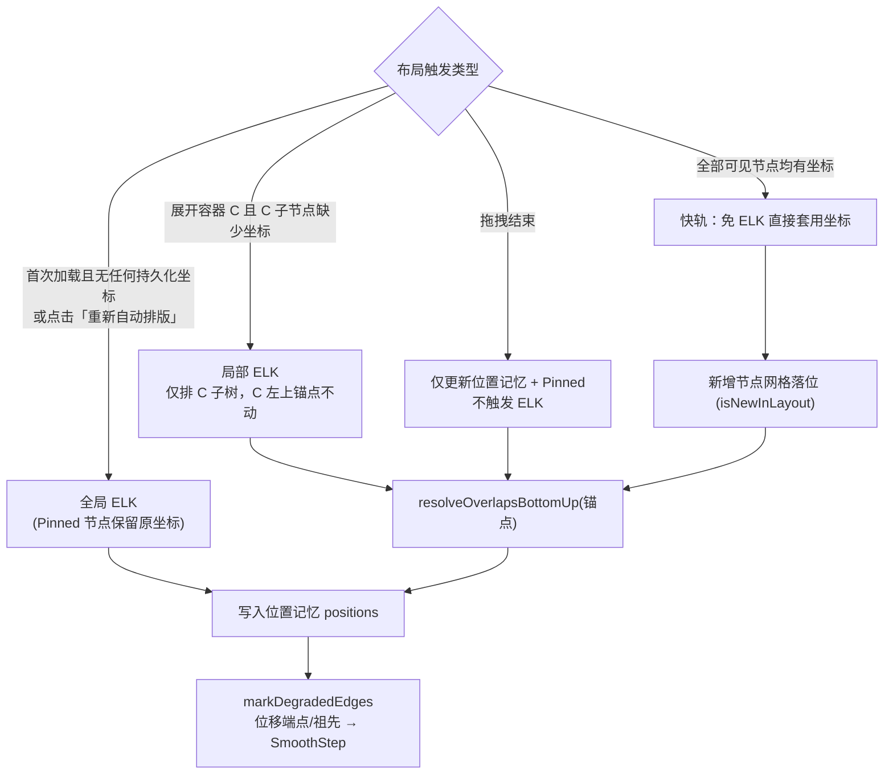

# ADR-15: 大规模架构拓扑渐进式下钻聚焦、多维降噪与双层混合布局持久化设计

- **文档编号**：`15-scalable-topology-focus-and-layout-persistence-adr.md`
- **文档版本**：v1.3.0（经架构深度检视加固，且多级框中框展开部分已由 ADR-17 演进升级）
- **日期**：2026-11-13
- **状态**：已采纳 (Accepted)（局部渲染交互已由 [`ADR-17`](./17-topology-single-layer-drilldown-and-layout-ux-adr.md) 演进替代）
- **关联特性**：`F-04`（分层复合架构拓扑与一致性画布）、`F-04.1`（C4 渐进式钻取、容器下钻聚焦与 N-Hop 邻域视图）、`F-04.2`（多维切片过滤、聚光灯降噪、高扇入折叠与搜索飞跃）、`F-04.3`（位置记忆混合布局引擎与公私双层布局持久化）、`SC-11`（大规模拓扑端到端验收）
- **关联设计**：[`docs/02-design/03-architecture-elements-and-topology.md` §6](../02-design/03-architecture-elements-and-topology.md)、[`docs/02-design/05-database-schema.md` §3.7](../02-design/05-database-schema.md)、[`docs/03-api/01-http-api-contract.md` §2.2](../03-api/01-http-api-contract.md)
- **关联作战卡**：[`docs/04-tasks/20-m19-scalable-topology-focus-and-layout-persistence.md`](../04-tasks/20-m19-scalable-topology-focus-and-layout-persistence.md)（M19）、[`docs/04-tasks/22-m21-topology-single-layer-drilldown-and-layout-ux.md`](../04-tasks/22-m21-topology-single-layer-drilldown-and-layout-ux.md)（M21）
- **演进关系**：保留 [`ADR-05`](./05-hierarchical-topology-canvas-redesign.md) 的分层模型与边上卷底座，**正式修正并取代 ADR-05 §2 决策项 #3（“手动拖动后的排版不保存”）**；本 ADR 中的「同屏多级框中框嵌套展开（`INCLUDE_CHILDREN`、全局深度滑杆 `L0~Ln`、`全展` 按钮、滚轮语义展开）」部分自 **M21 起已由 [`ADR-17`](./17-topology-single-layer-drilldown-and-layout-ux-adr.md) 演进升级为「单层平铺逐级下钻（Scoped Flat Canvas）」**，其余五段式纯函数管线、LCA 外部邻居代表、有向 N-Hop 邻域、聚光灯、Hub 插头折叠及 `traefik_topology_layouts` 双层持久化底座继续沿用。

### 修订记录

| 版本 | 日期 | 修订说明 |
| :--- | :--- | :--- |
| v1.0.0 | 2026-11-09 | 初版：C4 渐进式探索、Pinned + AABB 混合布局与 `(view, focus_scope)` 双层布局持久化 |
| v1.1.0 | 2026-11-09 | **架构深度检视加固**：1. 渲染管线重排为「一致性叠加合成 ➔ 作用域裁剪 ➔ 边上卷 ➔ Hub 折叠 ➔ 布局」五段式，以「透明祖先 + 显式可见集」实现聚焦与外部邻居卡（修正裁剪先于动态违规边合成导致的边丢失缺陷）；2. 混合布局由「全局 ELK + Pinned 覆写」改为「**位置记忆 + 局部子树排版 + 自底向上碰撞消解**」，明确 Pinned 与推开优先级、父容器尺寸逐层传播与边退化判定，拖拽不再触发 ELK；3. 布局过期判定由全内容哈希 `model_version` 改为树结构指纹 `structure_version` + 前端节点集合 Diff；4. 持久化模型拆分为「**位置层（按视图统一、相对父坐标）**」与「**视角层（个人书签）**」，团队基准按 `view` 唯一、个人书签仅存差量覆写；5. 统一守卫出口并封堵搜索/滚轮/邻域等绕过路径；6. 统一全部跨文档参数（§6 参数字典）；7. 以可度量性能预算替代未经验证的耗时承诺 |
| v1.2.0 | 2026-11-10 | **三态交互分离、子树聚光灯与父容器包围盒加固 (`M19.1`)**：1. **修正决策 #1 双击语义**：废除反直觉的“展开态双击收起”，确立**双击单向渐进下钻（折叠容器双击 ➔ 原地展开；已展开容器双击 ➔ 进入隔离聚焦；叶子模块双击 ➔ 打开画像抽屉上下游关系页；空白处双击 ➔ 退回上一级聚焦）**，收起操作仅通过标题栏折叠按钮 `▾` 或浮动操作条触发，并移除 220ms 单击防抖延迟；2. **修正决策 #8 聚光灯集合与三态分离**：将 `Hover 预览`、`Selection 选中`、`Focus 下钻` 显式分离（存在选中主体时鼠标悬停与移出不再改写聚光灯锁定态；单击选中默认不弹抽屉，抽屉开启时跟随选中自动切换）；`computeSpotlightSet` 升级为以**主体子树 $S = \{v\} \cup \text{descendants}(v)$** 为计算单元，内部后代节点与内部边 100% 保亮，跨子树边界的 1-Hop 关联拆分为上游调用方（`UPSTREAM`）与下游被调方（`DOWNSTREAM`）语义分层染色；3. **新增选中浮动操作条 (`NodeActionBar`) 与画像抽屉「上下游关系」页**：支持一键切换 1/2 跳邻域过滤、展开/聚焦/折叠、查看上下游列表并点击逐跳定位对端；4. **加固决策 #4 父容器包围盒与未展开子节点 Diff 防腐**：修复未展开容器内子节点被误判为新增节点触发横向堆叠溢出的缺陷，并在坐标后处理与混合合并阶段强制执行自底向上父容器包围盒撑大与位移边退化（`SmoothStep`）标记 |
| v1.3.0 | 2026-11-13 | **演进对齐 [`ADR-17`](./17-topology-single-layer-drilldown-and-layout-ux-adr.md) (`M21`)**：标注 M19 建立的五段式管线、LCA 外部邻居卡、有向 N-Hop 邻域、聚光灯、Hub 插头折叠与 `traefik_topology_layouts` 双层持久化表继续作为核心底座；同屏多层复合框中框展开（`INCLUDE_CHILDREN`、全局深度滑杆、全展、滚轮展开）正式升级为 `ADR-17` 定义的「单层平铺逐级下钻 + ELK 110px 层距 + 1:1 `border-box` + 四向智能锚点 + 按作用域隔离的显式固定位置记忆」 |

> [!NOTE]
> **向后演进提示 (`ADR-15` ➔ `ADR-17`)**：若涉及单层平铺下钻规则、ELK 正交参数表、`border-box` 尺寸常量、四向智能锚点、工具栏四组收纳及位置记忆作用域隔离的最新权威规范，请直接以 [`ADR-17`](./17-topology-single-layer-drilldown-and-layout-ux-adr.md) 为准。

---

## 1. 背景与真实规模痛点 (Context & Problem Statement)

随着 `code-traefik` 在企业真实生产产品线落地，架构资产规模快速增长至以下量级：
- **业务子系统 (`SUBSYSTEM`, depth 0)**：约 **25 个**；
- **功能组 (`FUNCTIONAL_GROUP`, depth 1..8)**：每个子系统约 10 个，全系统约 **250 个**（单子系统内最大支持 8 级自嵌套）；
- **功能模块 (`MODULE`, Leaf)**：每个功能组约 10 个，全系统约 **2,500 个**；
- **总节点与依赖边规模**：全图共计 **~2,775 个节点** 与 **5,000 ~ 10,000 条** 底层模块服务契约边。

在这一真实规模下，M6 阶段确立的首版全量画布体验暴露出 **四大核心瓶颈**：

1. **“全量平铺”引发的视觉毛线团与排版卡顿**：
   - 当用户将顶部工具栏的层级滑杆拉至 `L2` 或点击「全展」时，2,775 个复合嵌套节点与数千条跨容器正交边同时送入 ELK (`layered` + `INCLUDE_CHILDREN` + `ORTHOGONAL`) 计算并挂载至 React Flow DOM；
   - ELK Worker 计算耗时长达数秒、画布平移缩放帧率骤降，`fitView` 将视口缩放到 `0.15x` 极限，数千条正交折线交织成“蛛网毛线团（Hairball）”，彻底丧失架构可读性；
   - 此外，现有搜索框会**自动展开全部命中节点的父链**、滚轮语义自动展开会持续加深层级，均可绕开任何人工克制直接触发全展。
2. **缺乏“分而治之”的局部下钻聚焦与多维切片能力**：
   - 架构师审视宏观架构时只需看 25 个子系统的 `L0` 鸟瞰图；而子系统负责人或一线研发日常 90% 的时间只关心**“本子系统内部的功能组与模块，以及与我有直接调用关系的 1-Hop 上下游”**，或**“某一个具体模块的 1~2 跳调用链”**。当前画布缺乏容器级下钻隔离（Scoped Subgraph）与多维切片过滤（按子系统、按负责人 `Owner`、按一致性异常状态）。
3. **局部操作引发全局镜头乱跳与手动排版清零**：
   - 现有 `ArchCanvas.tsx` 在每次 `layoutNodes.length` 变化且 `draggedNodeIds.size === 0` 时，都会无条件触发全局 `rfInstance.fitView()`，瞬间把镜头拉回全局全景；
   - `useElkLayout.ts` 在任意容器展开/折叠后以 ELK 全局重排结果全盘覆写所有节点坐标；且 `draggedNodeIds` 是 ELK 重排的依赖项，首次拖动某节点即触发一次全量重排并覆写坐标，存在拖拽回弹风险。
4. **布局无法保存，破坏团队固定的“架构心智地图（Mental Map）”**：
   - 研发团队对系统拓扑有强烈的空间方位共识（终端/接入网关在最左、交易核心在中央、账务/清结算在右上、公共基础底座在底部、外部银联/微信在最右）。ADR-05 早期规定“拖拽不保存”，导致每次刷新或新增一条依赖边，ELK 都会重新洗牌节点相对位置，且架构师无法将精心排布的拓扑图固化发布为全团队共享的默认视图。

---

## 2. 核心架构决策矩阵 (Decisions & Trade-offs)

| # | 决策维度 | 决策结论 | 架构落地设计与权衡依据 |
| :---: | :--- | :--- | :--- |
| **1** | **大规模分层探索范式** | **C4 渐进式三级探索：L0 全景鸟瞰 ⟷ 容器下钻聚焦 (`Focus Scope` + 1-Hop 外部邻居卡) ⟷ 节点 N-Hop 邻域 (`Ego-Network`)** | 默认以 `L0` 顶层容器折叠卡加载；**双击遵循单向渐进下钻语义（折叠容器双击 ➔ 原地展开；已展开容器双击 ➔ 进入隔离聚焦；叶子模块双击 ➔ 打开画像抽屉上下游关系页；空白处双击 ➔ 返回上一级聚焦）**，容器标题栏同时保留 `[🎯 聚焦]` 与 `[📌 固定]` 快捷入口，收起操作仅通过标题栏 `▾` 或浮动操作条触发；聚焦根默认展开 1 层，与聚焦域存在跨界契约的外部容器以强制折叠的 `Neighbor Card` 呈现。 |
| **2** | **可见规模守卫** | **单一出口的可见节点守卫 (`MAX_SAFE_VISIBLE_NODES = 150`)** | 所有改变展开态或可见集的入口（层级滑杆、全展、单点展开、滚轮语义展开、搜索定位、邻域追踪、多维过滤、聚焦切换、书签应用）统一经过 `applyVisibilityChange()` 预估可见节点数，**与是否处于聚焦/过滤态无关**；超阈值时弹出引导（滚轮语义展开改为非模态提示并放弃本次展开），提供「仍要展开」逃生口。 |
| **3** | **渲染管线** | **五段式纯函数管线：一致性叠加合成 ➔ 作用域裁剪 ➔ 边上卷 ➔ Hub 折叠 ➔ 布局** | 从 `rollup.ts` 拆出 `synthesizeOverlay`（动态违规边/虚拟节点合成），使作用域裁剪可见全部动态边；作用域裁剪不删除节点，而是输出**显式可见集 `visibleIds` + 有效展开态 `effectiveExpandState`**（透明祖先与强制折叠），保证 `rep()` 边代表收敛不丢边。详见 §3.1。 |
| **4** | **混合布局引擎** | **位置记忆 (`Position Memory`) + 局部子树排版 (`Local ELK`) + 自底向上碰撞消解与父包围盒兜底 (`resolveOverlapsBottomUp`)** | 所有已排布节点的相对父坐标进入会话位置记忆；展开容器时仅对该容器子树执行局部 ELK，其余节点原位不动；碰撞消解与坐标后处理均自底向上逐层撑开展开态父容器包围盒（确保子节点绝不溢出父容器框）；未展开容器内的子节点不进入增量 Diff 放置。详见 §4.1。 |
| **5** | **视口相机控制** | **局部操作零跳变 + 显式导航才居中 + 搜索飞跃** | 仅在首次加载（且布局无有效视口）、切换视图、切换聚焦域、点击 `[居中]`/`[重新自动排版]`/应用书签时执行 `fitView`；局部展开/折叠/拖拽严禁全局 `fitView`。 |
| **6** | **布局持久化模型** | **位置层 + 视角层双层分离：团队基准（`SHARED`，按 `view` 唯一）+ 个人书签（`PRIVATE`，仅存差量）+ `localStorage` 草稿** | 坐标均为相对父容器坐标，与所处聚焦域无关，故**位置层按视图统一**，聚焦视图复用同一套内部排布（避免同一容器两套心智地图）；个人书签保存聚焦域/过滤/展开/视口等视角状态，并仅存相对团队基准的坐标差量覆写，团队基准更新后个人书签自动继承。详见 §4.2。 |
| **7** | **架构演进兼容性** | **树结构指纹 `structure_version` + 前端节点集合 Diff (`Graceful Diff Merge`)** | `model_version` 为全内容哈希（含边、名称、元数据与环境端点），任何依赖边或描述变更都会改变，**不适用于布局过期判定**；新增仅对 `(id, parent_id)` 计算的 `structure_version`，相同即跳过 Diff；不同则在前端按已展开容器内的节点 ID 集合计算新增/删除节点，存量节点 100% 原位，新增节点落位于父容器网格空位。 |
| **8** | **连线风暴治理与三态交互** | **子树级 1-Hop 聚光灯 (`Subtree Spotlight`) + 三态分离 (`Hover / Selection / Focus`) + 选中浮动操作条 (`NodeActionBar`) + 高扇入折叠 + 三档语义 LOD** | 1. **三态分离**：无选中时悬停（100ms 防抖，展开容器仅标题栏触发）临时预览聚光灯；单击立即选中锁定聚光灯并展示浮动操作条（鼠标移出不清除选中，单击默认不弹抽屉，抽屉开启时跟随选中切换，点空白或 `Esc` 清除）；2. **子树级聚光灯**：以主体及其全部可见后代 $S$ 为整体，内部后代与内部边全亮，跨子树边界的 1-Hop 关联按上游调用方 (`UPSTREAM`) 与下游被调方 (`DOWNSTREAM`) 分色高亮，祖先外壳保留上下文；3. **画像抽屉新增「上下游关系」页**，支持按异常优先级检视并点击逐跳定位对端。 |
| **9** | **连线路由取舍** | **持久化坐标下的边统一采用 `SmoothStep` 动态正交路径** | ELK `layered` 无法在固定节点坐标下计算正交拐点；凡端点或其祖先链相对最近一次 ELK 输出发生位移的边，一律退化为 `getSmoothStepPath`。纯自动排版（无位移）时保留 ELK 正交拐点。未来可评估 `libavoid-js` 实现固定节点正交路由（不在本 ADR 范围）。 |

---

## 3. C4 渐进式探索与局部聚焦子图架构 (`Scoped Subgraph & Ego-Network`)

### 3.1 五段式渲染管线

- **① 与 ② 的顺序是强约束**：动态 `VIOLATION / UNATTRIBUTED` 边及 `VIRTUAL_UNREGISTERED_INTERFACE` 虚拟节点必须先合成，作用域裁剪与「仅看异常」过滤才能看到它们；
- **② 不删除节点**：`nodeMap` 始终保留全量节点，裁剪结果以显式可见集 `visibleIds` 与有效展开态 `effectiveExpandState` 表达，保证 `rep()` 能把不可见外部叶子收敛到其代表容器；
- **聚光灯 (`Spotlight`) 为渲染期计算**，不进入管线，避免悬停触发重排。

### 3.2 三级渐进式视野状态机

### 3.3 容器下钻聚焦与外部邻居代表规则

当用户聚焦于目标容器 $C$（例如 `sub_1`）时：

1. **内部集 $V_{\text{in}}$**：$C$ 及所有 `ancestors` 包含 $C$ 的后代节点；
2. **透明祖先 (`Transparent Ancestors`)**：$C$ 的祖先在 `effectiveExpandState` 中视为展开但**不进入可见集**，从而 $C$ 成为画布根；节点层级展示（图例、LOD、相对深度滑杆）按 `relativeDepth = depth − C.depth` 计算，无需改写节点 `ancestors`；
3. **外部邻居代表 $R_{\text{ext}}(u)$**：对每条一端在 $V_{\text{in}}$、另一端 $u \notin V_{\text{in}}$ 的边（含 ① 合成的动态边）：
   - 一般规则：取 $u$ 祖先链上 **$\text{LCA}(u, C)$ 的直接子节点**；若 $u$ 与 $C$ 无公共祖先，取 $u$ 的顶层祖先（`depth == 0`）；
   - 特例：若按一般规则得到 `ext_container`，则 `EXTERNAL_SYSTEM` / `EXTERNAL_ENDPOINT` 叶子**单独成卡**；`VIRTUAL_UNREGISTERED_INTERFACE` 单独成卡；
   - $R_{\text{ext}}$ 在 `effectiveExpandState` 中**强制折叠**，其祖先链置为透明展开，使 `rep(u) = R_ext(u)`；
   - 方向标注 `meta.neighborDirection = 'UPSTREAM' | 'DOWNSTREAM' | 'BIDIRECTIONAL'`；排版时通过 ELK `elk.layered.layering.layerConstraint`：`UPSTREAM → FIRST`、`DOWNSTREAM → LAST`、`BIDIRECTIONAL` 不约束，实现“上游在左、下游在右”；
4. **两端均在 $V_{\text{in}}$ 外的边**全部剔除。

### 3.4 有向 N-Hop 邻域 (`Ego-Network`)

- 以叶子层有向图为基础（容器作为中心时以其全部叶子后代为种子）：**上游 = 沿反向边扩展 N 跳；下游 = 沿正向边扩展 N 跳；两者取并集，严禁混合方向扩展**（避免把“兄弟调用方”拉入）；
- 命中叶子的祖先链在 `effectiveExpandState` 中自动展开，未命中的兄弟节点不可见；
- 邻域结果同样经过可见规模守卫，超限时引导改用 `1` 跳。

---

## 4. 混合布局引擎与双层持久化架构 (`Hybrid Layout & Dual-Tier Persistence`)

### 4.1 位置记忆 + 局部子树排版 + 自底向上碰撞消解

1. **坐标相对性契约**：React Flow 节点 `position` 均为**相对 `parentId` 父容器左上角**的局部坐标（画布根节点相对根原点）。拖动顶层容器时其子孙局部坐标不变；坐标与所处聚焦域无关。
2. **位置记忆 (`positions`) 与固定集 (`pinned`)**：
   - `positions`：会话内所有已排布节点的相对父坐标，自动维护；
   - `pinned`：用户拖拽过的节点，语义为「**重新自动排版时保留**」，并显示 `📌` 徽章，可单点解除。
3. **事件处理规则**：
   - **展开容器 $C$**：仅对 $C$ 子树中缺坐标的部分执行局部 ELK，得到 $C$ 新尺寸；$C$ 左上锚点不动，$C$ 外节点沿用 `positions`；随后执行碰撞消解；
   - **折叠容器 $C$**：$C$ 收缩为卡片尺寸，兄弟节点**不回缩**（保持稳定）；
   - **拖拽结束 (`onNodeDragStop`)**：坐标钳制在父容器内边距之内（越界则撑开父容器），写入 `positions` 与 `pinned`，以被拖节点为锚点执行碰撞消解，**严禁触发 ELK**；
   - **重新自动排版**：全局 ELK，`pinned` 节点保留坐标、其余节点采用 ELK 结果。
4. **自底向上碰撞消解 (`resolveOverlapsBottomUp`)**：
   - 在锚点所在父容器内，按与锚点的距离由近及远逐个处理兄弟节点，与“已落定集合”检测包围盒重叠（含 `LAYOUT_SIBLING_GAP = 32px`）；重叠时沿最小穿透轴（水平向右或垂直向下）平移；
   - **锚点永不移动**；**未固定节点优先移动**；`pinned` 节点仅在确实与锚点或已落定节点重叠时才被推开，推开后保持原相对方位并同步更新其固定坐标；
   - 父容器尺寸重算为「子节点包围盒 + 内边距」，若尺寸变化则以该父容器为新锚点在祖父容器中继续消解，直至根或尺寸不变；
   - 每个节点只沿正方向单调平移、每层只扫描一次，算法必然终止，复杂度 $O(n^2)$（$n$ 为同层兄弟数）。
5. **边退化判定 (`markDegradedEdges`)**：凡边的源/目标或其任一祖先，相对最近一次 ELK 输出的绝对坐标发生位移（含被推开节点与被移动容器的全部后代），或该汇总边在最近一次 ELK 输出中不存在拐点数据，该边标记 `isDraggedDegraded = true` 使用 `SmoothStep`；快轨模式下全部边为 `SmoothStep`（§2 决策 #9）。
6. **镜头补偿 (`computeViewportCompensation`)**：若被操作节点的绝对坐标变化 $(\Delta x, \Delta y)$，则 `viewport.x -= Δx × zoom; viewport.y -= Δy × zoom`；本算法下锚点不动，补偿量通常为 0。

### 4.2 位置层 + 视角层双层持久化与加载优先级

在后端新增第 18 张业务表 **`traefik_topology_layouts`**（详见 [`05-database-schema.md` §3.7](../02-design/05-database-schema.md)）：

| 层 | 记录 | 唯一性 | 内容 |
| :--- | :--- | :--- | :--- |
| **位置层（团队基准）** | `scope='SHARED'` | 每个 `view` 至多 1 条 | 全视图统一的完整 `node_positions`（相对父坐标 + `pinned`）、默认展开态与默认视口；乐观锁 `revision` |
| **视角层（个人书签）** | `scope='PRIVATE'` | 每人 ≤ 20 条，同视图名称唯一，每 `(view, focus_scope)` 至多 1 个默认 | `focus_scope`、`filter_state`、`expand_state`、`viewport`，以及**相对团队基准的坐标差量** `node_positions` |
| **本地草稿** | `localStorage` | 每 `(userId, view)` 1 份 | 未保存的坐标差量与 `pinned`，携带其基线 `base = {canonical_revision, bookmark_id}` |

- **生效坐标** = `ELK 结果 ⊕ 团队基准 ⊕ 书签差量 ⊕ 草稿差量`（右侧覆盖左侧）；
- **聚焦态持久化切片**：聚焦态下仅持久化聚焦根**严格后代**的坐标，聚焦根自身与外部邻居卡属于聚焦专属根层，不落库；
- **发布团队基准**：前端读取最新基准，合并当前位置记忆中的可持久化坐标后携带 `expected_revision` 整体提交；并发冲突返回 `409 LAYOUT_REVISION_CONFLICT`，前端提示刷新后重试；
- **加载优先级 (`resolveInitialLayout`)**：

$$\text{基线} = \text{URL 书签 (topo\_layout\_id)} \succ \text{当前 (view, focus\_scope) 默认书签} \succ \text{团队基准} \succ \text{无 (ELK)}$$

$$\text{生效} = \text{基线} \oplus \text{草稿（仅当草稿.base 与当前基线一致；否则丢弃并提示）}$$

- **操作闭环**：
  - **普通用户**：拖拽即写入草稿（`500ms` 防抖，工具栏显示 `● 未保存本地调整`）；可「📑 另存为个人视图」、「↺ 恢复基线」（清除草稿）或「重新自动排版」；
  - **模块管理员 (`traefik_admin`)**：额外拥有「🏛️ 发布为团队基准布局」与「重置团队基准」；
  - **深链降级**：打开他人或已删除的书签 `topo_layout_id`，前端收到 `403 / 404` 后降级至团队基准并 toast 提示；书签 `focus_scope` 引用的容器已删除时降级至 `GLOBAL`。

### 4.3 架构演进增量 Diff 合并 (`diffLayoutAgainstGraph`)

1. 拓扑 Graph API 新增 `structure_version`（仅对排序后的 `(id, parent_id)` 计算 SHA-256），保存布局时记录该值；
2. 加载时若 `structure_version` 相同，直接跳过 Diff；不同则前端计算：
   - **删除节点**：保存坐标中存在、当前图中不存在的节点 ID → 静默清理；
   - **新增节点**：当前可见、无保存坐标、但其父容器下至少存在 1 个已保存坐标兄弟的节点（说明该容器保存时已排布）→ 放置于父容器已排布包围盒右侧/底部的网格空位，标记 `data.isNewInLayout = true` 并渲染 `✨ 新增` 徽标；
3. 仅当 `addedCount > 0 || removedCount > 0` 时显示琥珀色提示条（纯依赖边、名称、描述或环境端点变化**不提示**）。

---

## 5. 后果与收益评估 (Consequences)

### 正向收益 (Positive)
1. **规模可控**：`L0` 鸟瞰与聚焦视图默认可见节点处于数十量级，所有展开入口受单一守卫约束，杜绝全展卡死；
2. **心智地图稳定**：位置记忆使展开/折叠/拖拽后全部节点（而非仅 Pinned 节点）保持原位；位置层按视图统一，全景与聚焦视图看到同一套内部排布；
3. **团队与个人协同**：团队基准一次发布全员继承，个人书签仅存差量、随基准演进自动更新；
4. **探索与排障效率**：多维切片（子系统 / Owner / 异常状态）、有向邻域、聚光灯、Hub 折叠与搜索飞跃，使架构漂移定位从“大海捞针”变为秒级直达。

### 性能预算（以 `SC-11` 与性能单测验收，替代未经验证的耗时承诺）

| 环节 | 规模 | 预算 (P95) | 验收方式 |
| :--- | :--- | :--- | :--- |
| ① 叠加合成 + ② 裁剪过滤 + ③ 边上卷 | 2,775 节点 / 10,000 边 | 本地 `≤ 30ms`（CI 阈值 `≤ 60ms`） | `ArchCanvasScale.perf.test.ts` |
| 局部 ELK（单容器展开） | 子树 ≤ 120 节点 | `≤ 150ms` | `SC-11` 浏览器实测 |
| 全局 ELK（Worker 异步） | 可见 ≤ 150 节点 | `≤ 400ms`，不阻塞主线程 | `SC-11` 浏览器实测 |
| 快轨直出 | 可见 ≤ 150 节点 | `≤ 100ms`（免 ELK） | `SC-11` 浏览器实测 |
| Graph API 传输 | 全量 DTO | 启用 `gzip` 协商压缩，配合 `ETag/304` | Go 单测 + `SC-11` |

### 潜在代价与应对 (Trade-offs & Mitigations)
1. **状态组合复杂度上升**：聚焦域、邻域、多维过滤、展开态与三层坐标共同决定画面。通过将管线五段与布局合并全部抽象为无副作用纯函数（`overlay.ts` / `subgraph.ts` / `noiseReduction.ts` / `layoutMerger.ts` / `layoutPersistence.ts`），配套 `≥ 90%` 覆盖率的 Vitest 单测锁定；
2. **持久化坐标下失去 ELK 正交拐点**：已在决策 #9 明确接受 `SmoothStep` 取舍，纯自动排版场景仍保留正交路由；
3. **全量下发 + 前端裁剪**：在 ~2,775 节点 / 万级边规模下仍选择全量下发以保持裁剪零往返延迟，通过 `gzip` 压缩、`ETag/304` 与按模块对索引的叠加合成控制带宽与 CPU 开销；若规模再增长一个数量级，再评估服务端按作用域分片下发。

---

## 6. 统一参数与命名字典 (Single Source of Truth)

> 本节为 ADR-15 / M19 全部文档（Feature Matrix、设计、数据库、API 契约、作战卡）的**唯一参数基准**，其他文档出现冲突时以本节为准。

### 6.1 阈值与常量

| 常量 / 参数 | 取值 | 说明 |
| :--- | :--- | :--- |
| `MAX_SAFE_VISIBLE_NODES` | `150` | 可见节点守卫阈值，所有可见性变更入口统一生效 |
| `FOCUS_DEFAULT_EXPAND_DEPTH` | `1` | 进入聚焦时聚焦根展开 1 层；层级滑杆按相对聚焦根深度计量 |
| `HUB_CALLER_THRESHOLD` | `8` | 某节点被 `≥ 8` 个**不同顶层调用方容器**依赖即判定为 Hub |
| `LAYOUT_SIBLING_GAP` | `32px` | 同层兄弟节点碰撞消解安全间距 |
| 聚光灯淡化透明度 | 节点 `0.2` / 边 `0.15` | 定义为 `ArchCanvas.css` 内 `--arch-dim-node-opacity` / `--arch-dim-edge-opacity` |
| 悬停聚光灯防抖 | `80ms` | 单击选中锁定，点击空白或 Esc 清除 |
| 语义 LOD 档位 | `zoom < 0.45` / `0.45 ≤ zoom < 0.85` / `zoom ≥ 0.85` | macro / medium / detail |
| 搜索飞跃 | `rfInstance.fitView({ nodes: [{ id }], maxZoom: 1.15, duration: 360 })` + `2s` 脉冲 | 候选下拉最多 20 项，按类型分组 |
| 邻域跳数 | `1 \| 2`（有向扩展，默认 `1`） | 见 §3.4 |
| 草稿写入防抖 | `500ms` | `localStorage` 键 `traefik_topo_draft_v2_${userId}_${view}` |
| 个人书签配额 | `20` 条 / 人 | 超限 `400 PERSONAL_VIEW_QUOTA_EXCEEDED` |
| `node_positions` 上限 | `5000` 条，节点 ID 键长 `≤ 128` | `expand_state.overrides` 同上限 |
| 布局请求体上限 | `1MB` | 超限 `413 PAYLOAD_TOO_LARGE` |
| JSON 载荷版本 | `schema_version = 1` | 行级列，前端读取时按版本迁移或降级 |

### 6.2 URL Search Params（统一 `topo_` 前缀，与既有 `view` / `session_id` / `env_agent_id` 共存）

| 参数 | 示例 | 说明 |
| :--- | :--- | :--- |
| `topo_focus` | `sub_1` / `grp_10` / `pgrp_3` / `proc_7` | 聚焦根容器 ID，缺省为全局 |
| `topo_ego` / `topo_ego_hops` | `mod_101` / `1` | 邻域追踪中心与跳数 |
| `topo_subsystems` | `sub_1,sub_3` | 顶层容器多选（逗号分隔） |
| `topo_my` | `1` | 仅看我负责的 |
| `topo_status` | `ABNORMAL` / `VIOLATION_ONLY` | 一致性状态快筛（缺省 `ALL`，未挂载批次时禁用） |
| `topo_hide_isolated` | `1` | 隐藏孤立节点 |
| `topo_hub_fold` | `1` | 开启 Hub 插头折叠 |
| `topo_layout_id` | `42` | 指定个人书签 |

### 6.3 CSS 类名（扁平 BEM）与节点数据字段

| 用途 | 命名 |
| :--- | :--- |
| 聚光灯淡化 | `.code-arch-node--dimmed`、`.code-arch-edge--dimmed` |
| 语义 LOD | `.code-arch-canvas--lod-macro`、`.code-arch-canvas--lod-medium`、`.code-arch-canvas--lod-detail` |
| 搜索命中 / 飞跃脉冲 | `.code-arch-node--search-match`、`.code-arch-node--pulse` |
| 固定 / 新增徽章 | `.code-arch-node__pin-badge`、`.code-arch-node__new-badge` |
| 外部邻居卡 | `.code-arch-neighbor-card--upstream`、`--downstream`、`--bidirectional` |
| Hub 插头徽章 | `.code-arch-hub-pill`（状态色修饰 `.code-arch-hub-pill--violation` 等） |
| 节点数据字段 | `data.isPinned`、`data.isNewInLayout`、`meta.isExternalNeighbor`、`meta.neighborDirection` |
