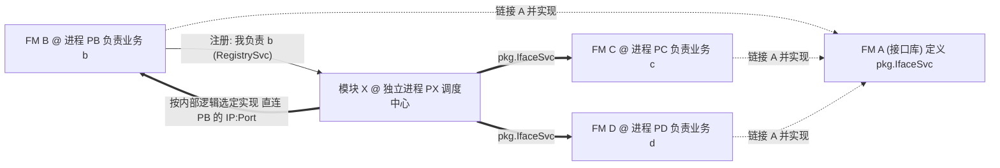
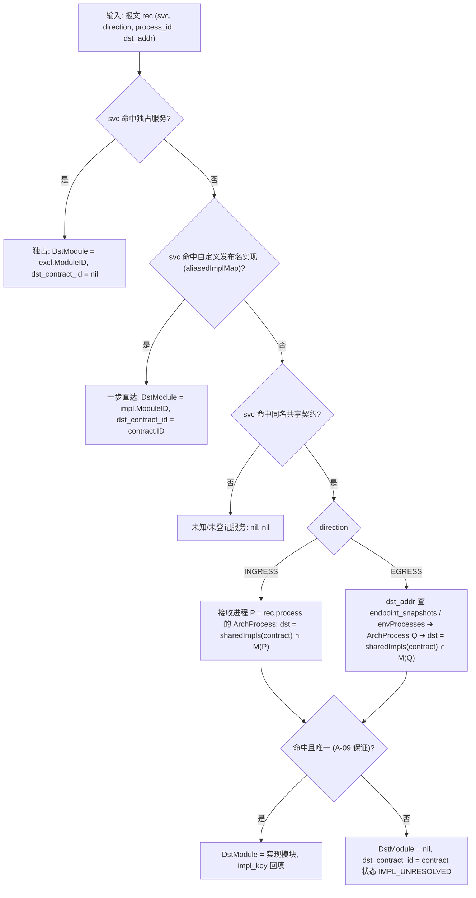

# ADR-16: 多实现服务契约（接口库定义 + 多进程实现 + 调度中心分发）建模与表达设计

- **文档编号**：`16-multi-implementation-service-contract-adr.md`
- **文档版本**：v2.0.0
- **日期**：2026-11-13
- **状态**：已采纳 (Accepted)，M20 已实施并迭代升级（支持自定义运行期发布名）
- **关联特性**：`F-01`（三级架构元素建模）、`F-02`（物理进程蓝图与模块服务契约）、`F-04`（分层复合架构拓扑）、`F-05`（实测调用拓扑还原与一致性验证）、`F-12`（重放与 Mock）
- **关联设计**：[`docs/02-design/03-architecture-elements-and-topology.md`](../02-design/03-architecture-elements-and-topology.md) §1–§5、[`docs/02-design/05-database-schema.md`](../02-design/05-database-schema.md)
- **演进关系**：**修订 A-05（全局唯一 PROVIDE）**，将其收窄为「独占契约 (`EXCLUSIVE`) 及自定义唯一发布名实现 (`ALIASED`) 全局唯一供给」，同名共享实现按 `(contract_id, impl_key)` 唯一并受 `A-09` 进程互斥约束；保持 A-03、A-04 对业务模块的约束不变。

### 修订记录

| 版本 | 日期 | 修订说明 |
| :--- | :--- | :--- |
| v0.1.0 | 2026-11-11 | 初稿：接口库模块类型、多实现契约登记、分发依赖、按目的进程的实现定位、拓扑表达与重放 Mock 隔离 |
| v1.0.0 | 2026-11-11 | 评审采纳：1. 逻辑视图默认「按接口聚合」；2. `IMPL_UNRESOLVED` 正式作为第八类一致性状态；3. `impl_key` 仅为架构 SSOT 登记的实现身份，首期不与调度中心注册表对账（Non-Goal 5） |
| v2.0.0 | 2026-11-13 | 兼容实际业务线「LIB 定义标准契约 + 各实现自定义唯一运行期发布名（如 `DH_SyncService` 或任意派生名）」模式：1. 解耦 `ServiceContract.service_name`（`.pb` 契约名）与 `ModuleService.service_name`（运行期发布名）；2. 新增 `is_custom_service_name` 标识，自定义发布名全系统唯一且**豁免 A-09 跨进程互斥**；3. `decoder.Registry` 增加 `ServiceAliases` 与实现级 `ServiceIgnores`，单份 `.pb` 解码全部自定义发布名报文；4. `ContractResolver` 增加 Tier 1b 一步直达归因；5. 新增「存量独占服务挂接到多实现契约」接口 |

---

## 1. 背景与问题 (Context)

### 1.1 业务形态（已与架构负责人确认）



1. **FM A** 是一个**库**：定义 Protobuf 服务 `pkg.IfaceSvc`（如 `SyncService`），被编译链接进 B、C、D（以及作为客户端桩链接进 X），**自身不是运行期部署单元**。
2. **FM B / C / D** 各自实现**同一个** `pkg.IfaceSvc`，请求/应答消息类型相同；每个实现有一个**业务身份**（`impl_key`，如 `b` / `c` / `d` 或 `DH` / `XY`）。在实际业务线中存在两种运行期发布形态：
   - **形态一（同名共享）**：B、C、D 线上报文 `ascServiceName` 完全相同（均直接发布 `pkg.IfaceSvc`），且 B、C、D 部署在不同进程中；
   - **形态二（自定义唯一发布名）**：B、C、D 在运行期将服务发布为各自自定义的唯一名称（如 `DH_SyncService`、`CustomSync_C`，不强制固定命名规则），线上报文 `ascServiceName` 各不相同（此时业务上亦可能同进程部署多个实现），但载荷仍使用 LIB 中 `pkg.IfaceSvc` 的 `.pb` 消息结构。
3. **X 是独立进程**，内部有选择逻辑，按注册表或规则路由并调用其中一个实现。

### 1.2 与现有模型的冲突

| 现有约束 / 算法 | 冲突 |
| :--- | :--- |
| **A-05** `uk_traefik_mod_svc_name` 全局唯一 PROVIDE | B 声明后，C、D 声明同名服务被 `409` 拦截 |
| §5.1 `ResolveDestinationModule(provideMap[svc])` | 一服务多实现，目的模块无法定位；一致性比对、重放兼容 (`ValidateReplayProcessCompatibility`)、因果树全部受影响 |
| **A-03** 模块单归属 1 个 `ArchProcess` | 库 A 被链接进多个进程，无法、也不应挂到某个进程 |
| `ModuleService` 同时承载「契约定义」与「供给者」 | 本场景定义者 (A) 与实现者 (B/C/D) 是不同模块 |
| Agent `ScopedMockMatcher` 以 `service:operation` 为方法键 | X 重放时调用 B、C 的 Mock 可能互相错配 |

若退化为「把 A 登记成 PROVIDE」：拓扑只显示 `X → A`，B/C/D 成为孤点；A 无法放入物理视图；实测流量全部误归属 A。该方案不可接受。

---

## 2. 决策矩阵 (Decisions)

| # | 决策点 | 选定方案 | 理由 |
| :--- | :--- | :--- | :--- |
| **1** | 库模块的表达 | `Module.module_kind ∈ {BUSINESS, CONTRACT_LIB}`；`CONTRACT_LIB` 留在逻辑树中，**禁止绑定 `ArchProcess`**，不参与运行期 PROVIDE/DEPEND | 库是设计期契约的属主，不是运行期单元；保留其在子系统/功能组中的归属与负责人 |
| **2** | 契约定义与实现分离 | 新增 `traefik_service_contracts`（仅多实现契约需登记）；`traefik_module_services` 每行语义为「某模块实现某服务」，新增 `contract_id` + `impl_key` | 独占契约零迁移（无 contract 行即 `EXCLUSIVE`）；多实现契约显式登记定义者与实现清单 |
| **3** | 唯一性 (修订 A-05) | 独占与自定义发布名实现：`service_name` 全局唯一（部分唯一索引 `WHERE contract_id IS NULL OR is_custom_service_name = true`）；多实现契约内：`UNIQUE(contract_id, impl_key)` 与 `UNIQUE(contract_id, module_id)`；自定义发布名亦不得与任何 `ServiceContract.service_name` 冲突 | 保持对既有数据与自定义运行期服务名的强约束，同时开放同名共享多实现 |
| **4** | 实现进程互斥 (修订 A-09) | **仅对同名共享实现**（`is_custom_service_name = false`）要求同一契约的实现模块两两分属不同 `ArchProcess`；**自定义唯一发布名实现（`is_custom_service_name = true`）豁免 A-09，允许同进程部署** | 同名共享仍靠「目的进程 ➔ 唯一实现」消歧；自定义唯一发布名本身即可靠报文 `ascServiceName` 消歧，无需限制部署形态 |
| **5** | 调度方依赖 | `ModuleDependency` 新增 `contract_id`：**分发依赖 (`DISPATCH`)**，语义为「调用该契约的任意已登记实现」，静态图与一致性比对按当前实现集合自动展开（展开边携带各实现实际的 `service_name`）；仍允许 `service_id` 直接依赖某个具体实现 | 契合「注册制、实现可增减」的调度中心形态，新增实现无需改 X 的声明 |
| **6** | 实测目的实现定位与解码 | 解码：`decoder.Registry` 维护 `ServiceAliases`（自定义发布名 ➔ `.pb` 契约名）与实现级 `ServiceIgnores`，单份 LIB `.pb` 即可解码所有自定义服务名；归因：Tier 1a 独占 / **Tier 1b 自定义发布名一步直达** / Tier 2 同名共享按目的进程消歧（失败归 `IMPL_UNRESOLVED`） | 自定义发布名天然无歧义、不触发 `IMPL_UNRESOLVED`；同名共享仍利用固化端点字典确定性消歧 |
| **7** | 拓扑表达 | 逻辑视图：`CONTRACT_LIB` 以 «interface» 虚线卡渲染；新增**实现关系边 `REALIZATION`**（B ⇢ A，独立图层）；分发边支持「按接口聚合 / 按实现展开」双模；物理视图不渲染库，实现模块挂「实现 `pkg.IfaceSvc` [b]」标签 | 让读图者同时看懂「设计意图（谁定义、谁实现）」与「真实网络调用（X 到底调了谁）」 |
| **8** | 重放 Mock 隔离 | 下游 Mock 规则与下游端点携带不透明的**目的标签 `dst_tag`**（= 目的 `ArchProcess.code`），Agent 按连接原始目的地址映射标签，方法键扩展为 `service:operation@dst_tag` | 防止 X 重放时 B/C 应答串用；Agent 仍保持零 DB、零 `.pb` |

---

## 3. 数据模型 (Data Model)

### 3.1 `traefik_modules`（新增列）

| 列 | 类型 | 约束 | 说明 |
| :--- | :--- | :--- | :--- |
| `module_kind` | `varchar(16)` | `NOT NULL DEFAULT 'BUSINESS'`，`CHECK (module_kind IN ('BUSINESS','CONTRACT_LIB'))` | 模块类型 |

- `CHECK (module_kind = 'BUSINESS' OR arch_process_id IS NULL)`：库模块不可绑定进程（`BindModuleProcess` 返回 `400`）。
- `CONTRACT_LIB` 模块禁止创建 `traefik_module_services` 行与 `traefik_module_dependencies` 行（`400`）。
- 库模块已有被登记的契约时，禁止改回 `BUSINESS`，也禁止删除（`409`）。

### 3.2 `traefik_service_contracts`（新表）

| 列 | 类型 | 约束 | 说明 |
| :--- | :--- | :--- | :--- |
| `id` | `bigserial` | PK | |
| `service_name` | `varchar(128)` | `NOT NULL`，`uk_traefik_svc_contract_name` | `{package}.{serviceName}`，校验同 A-07 (`^[A-Za-z0-9._-]{1,63}$`) |
| `definer_module_id` | `bigint` | `NOT NULL`，FK `traefik_modules(id)` `ON DELETE RESTRICT` | 定义方，必须为 `CONTRACT_LIB` |
| `provide_mode` | `varchar(16)` | `NOT NULL DEFAULT 'MULTI_IMPL'`，`CHECK (provide_mode IN ('MULTI_IMPL'))` | 预留扩展位，首期仅 `MULTI_IMPL` |
| `impl_key_label` | `varchar(64)` | `NOT NULL DEFAULT ''` | 实现身份的业务含义说明，如「业务类型」 |
| `description` / 审计列 | | | 同其他架构表 |

### 3.3 `traefik_module_services`（新增列与索引调整）

| 列 | 类型 | 说明 |
| :--- | :--- | :--- |
| `contract_id` | `bigint NULL`，FK `traefik_service_contracts(id)` `ON DELETE RESTRICT` | `NULL` 表示独占契约（现状） |
| `impl_key` | `varchar(64) NOT NULL DEFAULT ''` | 实现身份（如 `b`、`DH`），多实现时必填，`^[A-Za-z0-9._-]{1,64}$` |
| `service_name` | `varchar(128) NOT NULL` | **运行期实际发布名**：独占服务为自身名；多实现时默认等于 `contract.service_name`，**允许用户自定义为任意唯一服务名（如 `DH_SyncService`）** |
| `is_custom_service_name` | `boolean NOT NULL DEFAULT false` | 标记是否为自定义运行期发布名（`contract_id IS NOT NULL AND service_name <> contract.service_name`） |

索引与约束：
- 部分唯一索引 `uk_traefik_mod_svc_name_excl ON (service_name) WHERE contract_id IS NULL OR is_custom_service_name = true`（确保独占服务与自定义发布名实现全局唯一）；
- `uk_traefik_mod_svc_contract_impl ON (contract_id, impl_key) WHERE contract_id IS NOT NULL`；
- `uk_traefik_mod_svc_contract_mod ON (contract_id, module_id) WHERE contract_id IS NOT NULL`；
- `CHECK ((contract_id IS NULL AND impl_key = '') OR (contract_id IS NOT NULL AND impl_key <> ''))`；
- `CHECK (contract_id IS NOT NULL OR is_custom_service_name = false)`。

跨表不变量（应用层事务内，先取 `pg_advisory_xact_lock(hashtext(service_name))`）：
1. 创建契约时，若已存在同名独占行或同名自定义发布名实现，返回 `409`（独占行可走升级，见 §7 迁移）；
2. 创建实现时（指定 `contract_id`）：若未传 `service_name` 则默认等于 `contract.service_name`（`is_custom_service_name = false`）；若传入不同于 `contract.service_name` 的自定义名（`is_custom_service_name = true`），则校验该名称未与任何 `ServiceContract.service_name`、独占服务或其他自定义发布名实现冲突（冲突返 `409`）；
3. 支持后续更新已登记实现的运行期 `service_name`、`diff_ignore_paths` 与 `description`，变更后联动刷新 `decoder.Registry`。

### 3.4 A-09 实现进程互斥校验（v2.0 精准收窄）

在以下两个入口统一执行 `AssertContractImplProcessDisjoint`（事务内）：
- **新增/修改实现**（`POST /api/arch/modules/:id/services`、`PUT /api/arch/module-services/:serviceId`）：仅当该实现**沿用契约原名**（`is_custom_service_name = false`）时，其所属 `arch_process_id` 不得与同契约其他沿用契约原名的实现（`is_custom_service_name = false`）相同；
- **绑定模块到进程**（`POST /api/arch/modules/:id/process-binding`）：仅针对该模块名下 `is_custom_service_name = false` 的多实现契约实现，检查目标进程中是否已有同契约的其他 `is_custom_service_name = false` 实现。

违反返回 `409 Conflict`；**使用自定义唯一发布名（`is_custom_service_name = true`）的实现模块豁免 A-09，允许部署在同一进程内**。未绑定进程的实现允许存在（物理视图落入「未部署」容器）。

### 3.5 `traefik_module_dependencies`（新增列）

| 列 | 类型 | 说明 |
| :--- | :--- | :--- |
| `contract_id` | `bigint NULL`，FK `traefik_service_contracts(id)` `ON DELETE RESTRICT` | 分发依赖目标契约 |

- `CHECK (num_nonnulls(service_id, contract_id) + (is_external::int) = 1)`：内部具体实现、分发契约、外部系统三选一；
- `uk_traefik_dep_consumer_contract ON (consumer_module_id, contract_id) WHERE contract_id IS NOT NULL`；
- 同一消费方对同一契约**同时**存在分发依赖与具体实现依赖时，返回 `409`（语义重复）。

### 3.6 录制端点字典快照

`traefik_recording_sessions` 新增 `endpoint_snapshots jsonb NOT NULL DEFAULT '[]'`，在创建批次、编译下游时一次性固化：

```go
// EndpointSnapshotItem 录制时刻「网络端点 ➔ 标准架构进程」字典项
type EndpointSnapshotItem struct {
	Endpoint      string `json:"endpoint"`        // "IP:Port"，含同机 127.0.0.1 别名
	ArchProcessID uint64 `json:"arch_process_id"`
	Source        string `json:"source"`          // LOCAL | FALLBACK | SHARED_UNIQUE
}
```

字典来源与 `CompileProcessDownstreams`（设计文档 §3.2）同一套推导结果，**只纳入能确定 `ArchProcess` 的端点**（匿名 `extra_downstreams` 不入字典）。

---

## 4. 解码别名解析与实测目的实现定位 (`ResolveDestinationFull` v2.1)



- **Protobuf 解码别名链 (`decoder.Registry`)**：`CompiledRegistry` 维护 `ServiceAliases`（自定义发布名 `DH_SyncService` ➔ `.pb` 契约名 `pkg.SyncService`）与独立的实现级 `ServiceIgnores`（按实际服务名加载 `DiffIgnorePaths`）。`LookupOperation` 先直查原名，未命中时自动经 `ServiceAliases` 映射到契约 `.pb` 描述符完成 JSON 反序列化与 Diff，无需为每个自定义实现复制 `.proto`。
- **自定义发布名实现零歧义**：`aliasedImplMap` 命中时，无论是 `INGRESS` 还是 `EGRESS`、无论对端进程是否纳入当前录制批次，均可一步确定 `dst_module_id` 与 `dst_contract_id`，不会产生 `IMPL_UNRESOLVED`。
- **EGRESS 优先、INGRESS 互证（同名共享实现）**：X 的出站记录为跨进程调用的唯一权威统计源（沿用设计文档 §5.2）；若 B 也在同批次被监控，其入站记录按接收进程直接定位，可作为互证。
- **`traefik_traffic_records`** 写入 `dst_contract_id` 与 `dst_module_id`；离线批量对账 (`OfflineBatchAttribution`) 一并计算。
- **来源判定**：X 的 `dependMap` 将 `DISPATCH` 分发依赖展开为**契约名 ∪ 该契约全部实现的运行期发布名**（如 `pkg.SyncService`、`DH_SyncService`、`XY_SyncService`），确保多模块共进程场景下 `UNIQUE_DEPEND` 来源归因准确命中。

---

## 5. 一致性验证规则

1. **静态边展开**：分发依赖 `X ➔ contract` 在比对前展开为 `X ➔ B`、`X ➔ C`、`X ➔ D` 三条静态边，每条携带 `(contract_id, impl_key)` 以及**该实现实际的运行期 `ServiceName`**（如 `DH_SyncService`）；各自独立套用既有的 `VERIFIED / OUTBOUND_VERIFIED / UNCOVERED / NOT_MONITORED / NOT_OBSERVABLE` 判定。
2. **越权**：实测定位到实现 C，但 X 既无分发依赖、也无对 C 的具体实现依赖 ➔ `VIOLATION`。X 仅直接依赖 B 却实测调用 C ➔ `X ➔ C` 为 `VIOLATION`。
3. **新增第八类 `IMPL_UNRESOLVED`（实现待定）**：仅当同名共享契约命中但目的实现无法定位时出现；不计入 `UNCOVERED` 分母，琥珀色虚线（复用 `--color-warning`）。逻辑视图挂在 `X ➔ A` 的契约虚拟边上（展开模式下该虚拟边仅在存在 `IMPL_UNRESOLVED` 时出现）；物理视图（不渲染库）挂在源进程 ➔ 动态虚拟节点「实现待定: `pkg.IfaceSvc`」上，节点注入方式与 `UNREGISTERED_INTERFACE` 一致。
4. **契约实现覆盖率**：`已验证实现数 / 本批次可观测实现数`，在契约详情与治理大盘中展示。

`ConsistencyEdgeResult` 新增 `ContractID *uint64`、`ImplKey string`；`ConsistencyReportDTO` 新增 `ImplUnresolvedCount`。

---

## 6. 拓扑与界面表达

### 6.1 逻辑视图 (`LOGICAL`)

| 元素 | 表达 |
| :--- | :--- |
| 库模块 A | `MODULE` 节点，`meta.module_kind = "CONTRACT_LIB"`，虚线边框 + «interface» 角标；卡片显示定义的契约数与实现数 |
| 实现关系 | 新边类型 `REALIZATION`（实现模块 ➔ 库模块），UML 实现线（虚线 + 空心三角）；**独立图层可开关**；不参与 Tarjan 环路检测、不参与一致性叠加、与调用边分开上卷 |
| 分发调用 | 按实现展开时为 `X ➔ B / C / D` 三条调用边，标签 `pkg.IfaceSvc [b]`；按接口聚合时收敛为一条虚拟边 `X ➔ A`，徽章「×3 实现」，一致性状态取最严重者 |
| 默认模式 | **逻辑视图默认「按接口聚合」**（体现设计意图、抑制扇出），一键切换「按实现展开」；URL 参数 `topo_contract_mode=AGG|EXPAND` |

### 6.2 物理视图 (`PHYSICAL`)

- 库模块**不渲染**（也不放入「未部署」容器，因为它本就不可部署）；
- 实现模块照常位于各自进程容器内，卡片附加标签「实现 `pkg.IfaceSvc` [b]」；
- 分发调用始终按实现展开为真实的进程间连线 `PX ➔ PB / PC / PD`。

### 6.3 DTO 增量

- `GraphNode.Meta`：`module_kind`；实现模块追加 `implements: [{contract_id, service_name, impl_key}]`；
- `GraphEdge`：`Kind` 新增 `REALIZATION`；新增 `ContractID *uint64`、`ImplKey string`；
- `EdgeServiceItem`：新增 `ContractID *uint64`、`ImplKey string`；
- `structure_version` 只依赖 `(id, parent_id)`，不受影响，既有布局持久化 (ADR-15) 无需迁移。

### 6.4 架构管理界面 (`/architecture`)

- 模块表单新增「模块类型」；
- 库模块详情新增「定义的接口」页签：登记契约（从已激活 `.pb` 的服务中选择），以及**实现矩阵**（`impl_key`、运行期发布服务名 `service_name`、实现模块、所属进程、负责人、最近一次验证状态）和「分发调用方」列表；支持「+ 纳管存量独占服务」直接归并到契约下；
- 实现模块声明 PROVIDE 时，若服务名已登记契约，表单自动切换为「实现契约」，要求填写 `impl_key` 并开放自由编辑「运行期发布服务名」（默认预填契约名，支持快捷生成 `{impl_key}_{Service}` 或任意合法服务名）；
- 依赖表单区分「依赖接口（分发到全部实现）」与「依赖具体实现」。

---

## 7. 重放、Mock 与契约演进

1. **重放兼容性 (`ValidateReplayProcessCompatibility`)**：对多实现契约的入站记录，所需模块 = 源进程快照中实现该契约的模块（自定义发布名实现直接通过 `rec.DstModuleID` 精准定位），目标进程必须承载同一实现模块。
2. **Mock 隔离**：`DownstreamEndpoint` 新增 `DstTag string`，`MockRuleDownstream` 新增 `DstTag string`。主控按 `dst_contract_id` 非空的 EGRESS 记录填写目的 `ArchProcess.code`；Agent 用连接原始目的地址查端点标签，方法键扩展为 `service:operation@dst_tag`；标签缺失时退回现有键，保持向后兼容。对自定义唯一发布名实现，因 `serviceName` 本身已各不相同，即使同进程部署亦天然隔离。
3. **破坏性变更雷达与黄金套件**：契约 `.pb` 变更的影响面 = 全部实现模块（含自定义发布名实现） + 全部分发调用方 + 具体实现依赖方。
4. **存量迁移**：
   - 已有「某模块独占 PROVIDE `svc`」需要升级为多实现契约并新建契约时，使用「转换为多实现契约」（`POST /api/arch/service-contracts/convert`）；
   - 已有多个业务模块各自登记了独占服务（如 `DH_SyncService`、`XY_SyncService`）需归并到 LIB 契约 `SyncService` 时，提供「纳管存量独占服务」（`POST /api/arch/service-contracts/:id/attach`）：单事务内保留原 `service_name` 与 `service_id`（不破坏历史录制批次与依赖），设置 `contract_id`、`impl_key` 与 `is_custom_service_name`，并刷新解码器别名池。

---

## 8. 后果 (Consequences)

### 正向收益
- 逻辑视图同时表达「谁定义、谁实现、谁调度」；物理视图仍是 100% 真实的进程间调用；
- 独占契约及其全部代码路径零迁移，多实现为增量能力；
- 同时覆盖「同名共享实现（按目的进程消歧）」与「自定义唯一发布名实现（如 `DH_SyncService`，直接复用 LIB `.pb` 解码、一步归因且允许同进程部署）」两类真实业务形态。

### 代价与风险
| 风险 | 应对 |
| :--- | :--- |
| A-05 由「全局唯一」改为「分模式唯一」，所有使用 `provideMap` 的路径需改造（`topology/attribution.go`、`topology/consistency.go`、`topology/graph_topology.go`、`diff/compatibility.go`、`diff/scheduler.go`） | 抽取统一的 `ContractResolver` 组件，替代散落的 `map[string]uint64` 构造 |
| X 注册表地址与挂载有效端点不一致导致 `IMPL_UNRESOLVED` | 专门状态与修复提示；`advertise_ip` 覆盖 |
| 新增第八类一致性状态影响前端图例与治理大盘统计 | 在作战卡中同步更新图例、筛选与大盘口径 |
| 自定义发布名修改后需及时同步内存解码别名映射 | 在 `ModuleService` 与 `ServiceContract` 写接口落库后同步触发 `decoder.Registry.Reload()` |

---

## 9. 非目标 (Non-Goals)

1. 同一多实现契约下**未自定义唯一发布名（同名共享）**的多个实现部署在同一进程（违反 A-09，首期不支持；若使用自定义唯一发布名如 `DH_SyncService` / `XY_SyncService` 则允许同进程部署）；
2. 各实现使用不同的消息类型（如 `Any` / `bytes` 内嵌实现私有消息）的差异化解码；
3. 解析 X 的注册报文以自动发现实现清单（实现清单以架构 SSOT 登记为准）；
4. 单环境内同一实现的多副本负载均衡（仍受 A-03 约束）；
5. `impl_key` 与调度中心（X）运行期注册表的对账：`impl_key` 仅作为架构 SSOT 中登记的实现身份标识（展示、筛选、Mock 标签辅助），首期不校验其与 X 注册报文中业务身份字符串的一致性。

---

## 10. 评审结论 (2026-11-11 / 2026-11-13 v2.0 修订)

| # | 议题 | 结论 |
| :--- | :--- | :--- |
| 1 | 逻辑视图默认契约展示模式 | **采纳「按接口聚合」为默认**（`topo_contract_mode` 缺省 `AGG`），可一键切换「按实现展开」；物理视图恒为按实现展开 |
| 2 | 目的实现无法定位的状态归类 | **新增第八类一致性状态 `IMPL_UNRESOLVED`（实现待定）**，与描述来源端歧义的 `UNATTRIBUTED` 并列，不计入 `UNCOVERED` 分母 |
| 3 | `impl_key` 与调度中心注册表对账 | **首期不做**，列为 Non-Goal 5；`impl_key` 仅为架构 SSOT 登记值 |
| 4 | 自定义运行期发布服务名 (v2.0) | **放开允许用户自由定义** `ModuleService.service_name`（不限制前缀规则）；`is_custom_service_name = true` 时全局唯一并豁免 A-09，`decoder.Registry` 经 `ServiceAliases` 自动映射至 LIB `.pb` 解码 |
