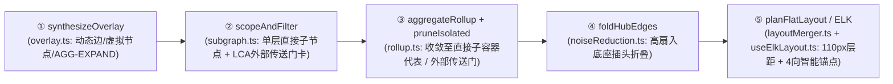

# ADR-17: 架构拓扑单层平铺逐级下钻、ELK 正交布局校准与全链路易用性升级设计

- **文档编号**：`17-topology-single-layer-drilldown-and-layout-ux-adr.md`
- **文档版本**：v1.0.0
- **日期**：2026-11-13
- **状态**：已采纳 (Accepted)，待 M21 实施
- **关联特性**：`F-04`（分层复合架构拓扑与一致性画布）、`F-04.1`（单层平铺逐级下钻与外部传送门卡）、`F-04.2`（多维切片过滤、聚光灯与 Hub 插头折叠）、`F-04.3`（按作用域隔离的位置记忆与双层布局持久化）、`F-04.4`（多实现契约拓扑表达）、`SC-11`（大规模拓扑端到端验收）
- **关联设计**：[`docs/02-design/03-architecture-elements-and-topology.md` §4 & §6](../02-design/03-architecture-elements-and-topology.md)、[`docs/02-design/04-control-plane-and-web-console.md` §4.1, §4.2 & §4.9](../02-design/04-control-plane-and-web-console.md)、[`docs/02-design/05-database-schema.md` §3.7](../02-design/05-database-schema.md)、[`docs/03-api/01-http-api-contract.md` §2.2](../03-api/01-http-api-contract.md)
- **关联作战卡**：[`docs/04-tasks/22-m21-topology-single-layer-drilldown-and-layout-ux.md`](../04-tasks/22-m21-topology-single-layer-drilldown-and-layout-ux.md)（M21）
- **演进关系**：保留 [`ADR-15`](./15-scalable-topology-focus-and-layout-persistence-adr.md) 的五段式渲染管线、LCA 外部邻居代表、有向 N-Hop 邻域、1-Hop 聚光灯、Hub 插头折叠与 `traefik_topology_layouts` 双层持久化底座；**正式演进并替代 `ADR-15` 中的「同屏多级框中框嵌套展开（`INCLUDE_CHILDREN`、全局深度滑杆 `L0~Ln`、全展按钮、滚轮语义展开）」方案，切换为「单层平铺逐级下钻（Single-Layer Progressive Drill-Down / Scoped Flat Canvas）」范式**。

### 修订记录

| 版本 | 日期 | 修订说明 |
| :--- | :--- | :--- |
| v1.0.0 | 2026-11-13 | 初版采纳：确立单层平铺逐级下钻状态机、ELK 单层正交间距参数表、`border-box` 1:1 尺寸契约、四向智能锚点、按 `(view, focus_scope)` 隔离的显式固定位置记忆、零 DDL 持久化兼容，以及面包屑与四组渐进式工具栏 UX 规范 |

---

## 1. 背景与根因诊断 (Context & Root Cause Analysis)

`ADR-15`（M19）与 `ADR-16`（M20）上线后，架构与研发团队在真实大规模模型与子系统多实现契约联调中（如 `PAYMENT_GROUP` 含多个渠道实现与 `CONTRACT_LIB` 接口库卡），持续反馈 **“架构拓扑总是拉不好、节点卡片互相遮挡、跨层连线绕回头弯、展开后画布难以阅读”**。结合前端布局代码（`useElkLayout.ts`、`layoutMerger.ts`、`layoutPersistence.ts`、`ArchCanvas.css`、`RollupEdge.tsx`）与 ELK 实际输出结果，诊断出 **五大系统性根因**：

1. **交互范式根因：同屏多层「框中框」叠加造成视觉拥挤与复合排布失控**
   - 当模块数量达到数十至上千级时，在全局画布或父容器内同时原地撑开多层虚线复合框（`Subsystem > FunctionalGroup L1..L8 > Module`），会导致内边距层层嵌套膨胀、父容器标题栏被压缩、跨多层级连线穿越多道边框；
   - 实际上，架构师和研发人员关注的是**特定层级内的直接请求拓扑**（全局看子系统间关系；进入子系统看内部功能组间与跨子系统关系；进入功能组看模块间与外部交互），不需要在同一画布上同时堆叠所有深层细节。
2. **ELK 子容器参数缺失与 `20px` 层间挤压缺陷**
   - 原 `useElkLayout.ts` 仅在根图设置了 `elk.layered.spacing.nodeNodeBetweenLayers: 100`，而在复合父容器（`convertNode`）内**未配置** `nodeNodeBetweenLayers`、`elk.direction`、`elk.spacing.edgeNode` 与外部节点 `layerConstraint`；
   - `elkjs` 对子容器层间水平间距默认回退到 **`20px`**。而汇总边标签（如 `1 契约`，宽约 `56px~84px`）远宽于 `20px`，必然直接压盖相邻节点边框并撕裂边路由。
3. **CSS 真实渲染尺寸与 ELK 计算尺寸严重错位**
   - `ArchCanvas.css` 中的 `.code-arch-module`、`.code-arch-external` 等卡片采用 `content-box` 计算 `width + padding + border`，实际 DOM 宽度比 ELK 传入尺寸宽出 `16px ~ 26px`，且多行标题与契约角标会把卡片高度撑高到 `~95px`（ELK 却按 `74px` 计算）；
   - `.code-arch-ext-ctx` 样式为 `230px`（`border-box`），而 ELK 分配 `240px`，导致右侧 `<Handle>` 锚点相对实际卡片边缘向右悬空浮出 **`10px`**。
4. **位置记忆串扰、自动排版坐标被误锁定、拖拽未钳制**
   - 原实现将 `onPositionsComputed` 输出的所有 ELK 自动坐标写入 `positions` 位置记忆；切换筛选条件（如切换 `AGG/EXPAND`、开关 `REALIZATION`、开关异常筛选）或聚焦域时，会复用过时坐标与全局触发 `resolveOverlapsBottomUp`，进而将节点标记为位移态（`touchedIds`），使 `markDegradedEdges` 将本可正交排版的边全部退化为 `SmoothStep`，丢失 ELK 正交 `bendPoints`；
   - 此外，`handleNodeDrag` 缺少对 `flowNodes` 状态的最小内边距钳制，且未区分“ELK 自动排版坐标”与“用户手动固定坐标（`pinned`）”。
5. **固定左右锚点导致垂直节点间「回头弯」及工具栏过载**
   - `RollupEdge` / 节点默认全部使用左侧 `target` + 右侧 `source`，一旦实现模块位于接口库卡片正上方或正下方（常见于 `REALIZATION` 与横向少层拓扑），连线被迫从右侧绕回左侧形成巨大 `S` 型回头弯；多条边汇聚到同一锚点时，多个 `"1 契约"` 标签胶囊完全重叠；
   - 工具栏存在 8+ 组控件（含与单层下钻冲突的 `层级滑杆`、`全展`、`滚轮展开`），`EdgeDetailDrawer` 头部直接渲染原始节点 ID（如 `mod_101 ➔ mod_102`）而非中文名称。

---

## 2. 核心架构决策矩阵 (Decisions & Trade-offs)

| # | 决策维度 | 决策结论 | 技术契约与设计依据 |
| :---: | :--- | :--- | :--- |
| **1** | **核心探索范式** | **单层平铺逐级下钻 (`Single-Layer Progressive Drill-Down / Scoped Flat Canvas`)** | **全局层 (`focusScope = 'GLOBAL'`)**：仅平铺渲染顶层容器（`SUBSYSTEM` / `PROCESS_GROUP` / `UNDEPLOYED_CONTAINER` / `EXTERNAL_*`）及跨顶层聚合边。 **任意下钻层 (`focusScope = containerId`)**：双击容器或点击卡片主操作 `[进入 ▸]` 直接下钻进入该容器的独立单层画布；**画布不再绘制聚焦根自身的外层虚线包裹框**（当前所处位置由顶部面包屑展示），内部仅渲染 `n.parent_id === focusNode.id` 的**直接子节点（`relativeDepth === 1`）**与跨界外部传送门卡，全部可见节点 `parentId` 均为 `undefined`（平铺无嵌套）。 |
| **2** | **层内收敛与外部传送门规则** | **内部直接子容器收敛 $R_{\text{in}}(u)$ + 跨界 LCA 外部传送门卡 $R_{\text{ext}}(u)$** | 1. **内部节点代表 $R_{\text{in}}(u)$**：若节点 $u \in V_{\text{in}}$ 的深度高于当前层（`relativeDepth >= 2`），沿其祖先链收敛至作为 `focusNode` 直接子节点的祖先（全局态为 `depth === 0` 顶层节点）；同一直接子容器内部互调收敛为卡片微章 `内部依赖: N` / `进程内调用: N`。 2. **外部传送门卡 $R_{\text{ext}}(u)$**：与 $V_{\text{in}}$ 存在调用边（含一致性动态 `VIOLATION / UNATTRIBUTED / IMPL_UNRESOLVED` 边）的外部节点 $u \notin V_{\text{in}}$，仍沿用 `ADR-15` 的 LCA 规则取 $\text{LCA}(u, \text{focus})$ 的直接子节点（外部系统与动态虚拟节点单独成卡），但以扁平卡片渲染，带方向修饰（`⬅️ 上游调用方` / `➡️ 下游依赖方` / `↔️ 双向关联`），点击/双击 `[↗ 跳转至该域]` 一键切换聚焦。 |
| **3** | **ELK 单层正交参数校准** | **扁平单层 `layered` + `110px` 层间净空 + `FIRST / LAST` 外部卡约束** | 废除复合 `INCLUDE_CHILDREN` 嵌套排布，统一在根图下使用标准化 ELK 参数： - `elk.algorithm = 'layered'`, `elk.direction = 'RIGHT'` - `elk.edgeRouting = 'ORTHOGONAL'`, `elk.layered.nodePlacement.strategy = 'BRANDES_KOEPF'` - `elk.spacing.nodeNode = '48'`（同层垂直间距 `48px`） - **`elk.layered.spacing.nodeNodeBetweenLayers = '110'`**（跨层水平间距 `110px`，为边标签胶囊留足两侧净空） - `elk.spacing.edgeNode = '36'`, `elk.spacing.edgeEdge = '24'`, `elk.layered.spacing.edgeNodeBetweenLayers = '36'` - 外部传送门卡注入节点属性 `elk.layered.layering.layerConstraint`：`UPSTREAM -> 'FIRST'`（强制最左列），`DOWNSTREAM -> 'LAST'`（强制最右列），`BIDIRECTIONAL -> 不约束`。 |
| **4** | **CSS 与 ELK `1:1` 盒模型契约** | **全节点强制 `box-sizing: border-box`，DOM 外框与 ELK 计算尺寸像素级 `1:1` 相等** | 消除 `content-box` 造成的 `16px~26px` 偏差与锚点悬空： - `CONTAINER`（平铺容器卡）：`260 × 96` - `MODULE`（`BUSINESS` / `CONTRACT_LIB` 卡）：`240 × 88`（标题单行截断 + Tooltip，底部徽章不撑高） - `EXTERNAL_CONTEXT`（外部传送门卡）：`240 × 104` - `EXTERNAL_SYSTEM / EXTERNAL_ENDPOINT / UNREGISTERED_INTERFACE / IMPL_UNRESOLVED`：`216 × 72` |
| **5** | **四向智能锚点与防叠标签** | **四向 `<Handle>`（`top/right/bottom/left`）+ 动态最优出口 `selectOptimalHandles` + 多边标签偏移** | 1. 每类节点渲染 4 个标准锚点（`top`、`right`、`bottom`、`left`）； 2. `selectOptimalHandles(sourceRect, targetRect)`：当 $|\Delta y| > |\Delta x| \times 1.15$ 且（水平中心接近或 $\Delta x < 40\text{px}$）时，自动选取 `bottom -> top` 或 `top -> bottom` 垂直走线（彻底消灭实现模块在接口库正上方/正下方时的绕侧回头弯）；当 $\Delta x < -40\text{px}$ 时选取 `left -> right` 逆向走线；其余默认 `right -> left`； 3. 当 $K \ge 2$ 条 `SmoothStep` 边汇聚在同一目标/源锚点时，按同组序数计算标签垂直/水平错位 `(idx - (K - 1) / 2) * 26px`，防止标签重叠。 |
| **6** | **位置记忆隔离与显式固定定律** | **按 `(view, focus_scope)` 分桶隔离 + 仅用户主动拖拽或图钉固定才锁定坐标** | 1. **撤销自动坐标污染**：`onPositionsComputed` 产出的 ELK 自动排布坐标仅用于当前渲染快照，**严禁写入 `pinned` 或跨作用域持久覆盖表**；只有用户显式拖拽 (`onNodeDragStop`) 或点击图钉 (`📌`) 的节点才标记为 `pinned = true`； 2. **切换筛选/整理重新走 ELK**：当用户切换 `AGG/EXPAND`、`REALIZATION`、`异常过滤`、`1/2 跳邻域` 或点击 `[✨ 自动整理]` 时，所有**未固定**节点交由 ELK 重新产出最优正交布局与 `bendPoints`（已固定节点仅在坐标全部固定走快轨或 `[✨ 自动整理]` 保位后做局部碰撞消解时保持不动）； 3. **作用域隔离**：每个 `focusScope` 维护独立的位置内存槽位，不再发生父级与子级、聚焦态与全局态坐标互相踩踏。 |
| **7** | **零 DDL 持久化兼容** | **沿用第 18 张表 `traefik_topology_layouts`，零 SQL / API 破坏性变更** | 1. 内部直接子节点（如 `sub_1`、`grp_10`、`mod_101`）全局仅属于唯一父容器，其坐标即代表在该父容器单层视图下的平铺坐标，直接以节点 ID 为键存于 `node_positions`； 2. 当用户在某聚焦域内拖拽固定了外部传送门卡 `extId` 时，采用作用域限定复合键 `${focusScope}::${extId}` 存储（长度远低于后端既有 `<= 128` 限制）； 3. `SavedExpandState` 保留历史字段兼容反序列化，新视图交互中不再依赖多层展开树。 |
| **8** | **下钻交互与返回手势** | **统一双击/按钮下钻 + 顶部层级面包屑 + `Esc / Backspace` 返回上一级** | 1. **全局双击协议**：双击容器卡 $\rightarrow$ 下钻至 `focusScope = node.id`；双击 `ExternalContextNode` 传送门卡 $\rightarrow$ 直接聚焦到该外部域（当其为容器时）或以其父域聚焦；双击叶子 `Module` 卡 $\rightarrow$ 打开 `NodeInspectDrawer`；双击画布空白处或按 `Esc` / `Backspace`（非输入框焦点时）$\rightarrow$ **返回上一级 `parentScope`**； 2. **顶栏面包屑 `.code-arch-breadcrumb`**：展示 `[← 返回上一级]`、`🌐 全系统全景 (L0) > 💳 子系统 (L1) > 📦 功能组 (L2)`、当前层资产与边统计摘要胶囊及 `[🌐 返回全局]`； 3. 废弃在单层模式下已无语义的 `层级滑杆 (L0~Ln)`、`[全展]` 与 `滚轮自动展开`。 |
| **9** | **工具栏渐进式披露** | **顶部工具栏收敛为 4 个高频控制组 + `[⚙️ 筛选与图层 (N)]` Popover + Filter Chips** | 仅保留 4 个高信噪比分组：① **视角与环境**（`逻辑架构\|物理部署`、环境实例叠加、一致性录制批次）；② **搜索与异常快筛**（搜索候选自动下钻聚焦至目标父容器层并 `fitView` 脉冲高亮 + `全部\|仅异常\|仅违规`）；③ **筛选与图层 Popover**（聚合 `仅我负责的`、`隐藏孤立`、`折叠 Hub`、`1/2 跳邻域`、`契约模式 AGG/EXPAND`、`显示 REALIZATION 实现边`，激活态在栏上渲染可单点关闭的 Filter Chip）；④ **布局与视图**（`✨ 自动整理`、`居中`、`📑 视图书签`、管理员 `🏛️ 发布基准`）。 |
| **10** | **抽屉可读性闭环** | **`EdgeDetailDrawer` 显示业务节点中文名与类型徽章，支持跨层快速聚焦跳转** | 彻底替换原先直接显示 `edge.source` / `edge.target` 原始内部 ID（如 `mod_101 ➔ ext_ctx_sub_2`）的调试态展示：从 `nodeMap` 解析 `[类型徽章] 中文名称 (Code)`，并附带 `[🎯 聚焦源容器]` / `[🎯 聚焦目标域]` 一键穿透按钮。 |

---

## 3. 五段式纯函数管线单层演进对照 (Pipeline Evolution)

为保持前端可测性与架构整洁性，仍然沿用 `ADR-15` 建立的五段式纯函数数据流，仅在 **② 作用域裁剪 (`scopeAndFilter`)** 与 **⑤ 布局规划 (`planLayout` / `useElkLayout`)** 执行单层平铺重构：

| 阶段 | 原 `ADR-15` 复合展开态行为 | 演进后 `ADR-17` 单层平铺行为 |
| :--- | :--- | :--- |
| **`① synthesizeOverlay`** | 同原规范（合成动态违规/未归属/`IMPL_UNRESOLVED` 边与虚拟节点，应用 `contractMode` / `showRealization`） | 完全保留，无需结构改动 |
| **`② scopeAndFilter`** | 依赖 `expandState` + `level` 滑杆计算多层级展开集合，`visibleIds` 同时包含聚焦根外壳、`depth=1..k` 混合节点及部分展开外部节点 | 废弃 `expandState` 与滑杆层级展开；内部可见集严格收敛为 **`focusNode` 的直接子节点**（全局态为 `depth === 0`）+ **1-Hop 外部传送门卡**（支持与多维过滤、N-Hop 邻域交集配合：若开启邻域或搜索/异常过滤命中深层节点，向上映射至当前层代表节点；或在全局聚焦切换直达目标父容器） |
| **`③ aggregateRollup`** | 通过 `rep()` 沿祖先寻找首个折叠容器 | 沿当前层的「直接子代表节点映射表」收敛：同一直接子容器内边聚合为该容器卡的 `internalEdgeCount` 徽章；跨直接子节点/外部卡的边汇总为汇总边 |
| **`④ foldHubEdges`** | 统计跨顶层调用方 `>= 8` 折叠为 `.code-arch-hub-pill` | 保持算法不变，作用域直接作用于当前单层平铺节点 |
| **`⑤ ELK & 位置记忆`** | 复合 `INCLUDE_CHILDREN` 嵌套排版 + 全局共池 `positions` + 自动全锁 | 扁平单层 `layered` 正交排版（`nodeNodeBetweenLayers=110`、`FIRST/LAST` 列约束）；`1:1 border-box` 尺寸；按 `(view, focusScope)` 隔离位置记忆且仅 `pinned`/已拖拽节点锁定坐标；四向智能锚点路由 `selectOptimalHandles` |

---

## 4. 权衡后果与兼容性说明 (Consequences & Compatibility)

1. **视觉信噪比与可读性的质的提升**：
   - 在任何时刻，单层画布展示的卡片数通常控制在 **5 ~ 35 张**之间（极少突破 `150` 安全阈值，守卫仅在极端大单组时兜底保护），卡片全部尺寸统一、无嵌套边框阻挡、左右层距 `110px` 保证边标签清爽不压节点；
   - 外部上下游分别锚定画布最左 (`FIRST`) 与最右 (`LAST`) 两列，形成清晰的自左向右调用叙事流，契合 C4 模型“Context ➔ Container ➔ Component”的心智预期。
2. **如果用户在极少数场景下想跨两层同时对比两个深层模块怎么办？**
   - 可以通过点击任意节点使用 **`1跳 / 2跳上下游邻域 (Ego-Network)`** 视图，或通过顶部搜索候选直接飞跃定位到具体模块所在父容器层并高亮其 1-Hop 上下游传送门。这比在千节点画布中把整个嵌套大框撑开具有更高的实用价值。
3. **向后兼容与零数据库迁移**：
   - 后端 API 路由与 `traefik_topology_layouts` 数据库表无需新增或变更字段；既有团队基准与个人书签中的内部节点 `(x, y)` 坐标在单层平铺下可平滑读取（因每个内部节点的直接父容器唯一），历史复合展开专用的旧参数在未识别或缺失时安全忽略，不破坏线上数据。
