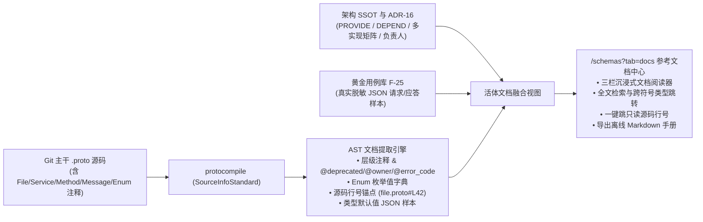
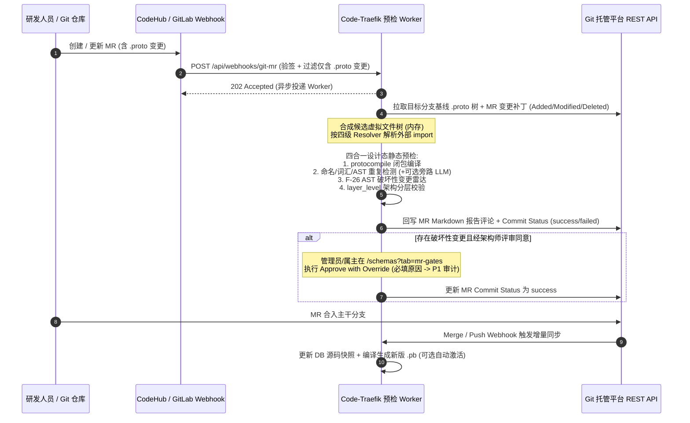
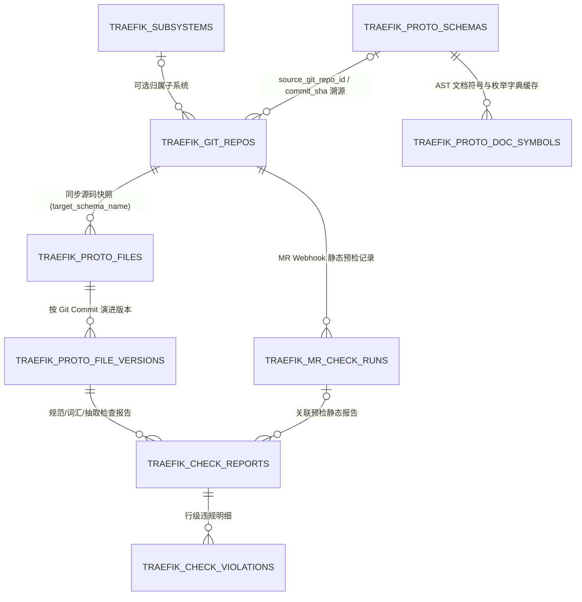

# ADR-18：废弃外部 Proto 系统，在 Code-Traefik 内构建 Git-Only Proto 全生命周期、接口参考文档与 MR 协同治理架构决策

- **文档编号**：`18-proto-full-lifecycle-and-git-mr-governance-adr.md`
- **文档版本**：v1.1.0（按深度架构检视修订：确立 Git-Only 源码 SSOT 与轻量只读视图、取消 Web 编辑与悲观锁、新增全注释驱动的「活体接口参考文档中心 (Proto Reference Docs)」、补齐 `Compilation Bundle` 映射与四级虚拟 `Resolver`）
- **日期**：2026-11-13
- **状态**：已提议待排期 (Proposed for M22~M25)
- **关联特性**：升维兑现 `F-18`（活体接口参考文档中心 Reference Docs），重定义 `F-21`（`.proto` 源码全生命周期、Git/MR 门禁与统一编译入池），扩展 `F-03`~`F-03.7`、`F-24`、`F-26`；规划新增 `F-28`~`F-32`
- **演进与替代关系**：
  - 鉴于独立兄弟项目 **`code-proto`** 与原型项目 **`protohub`** 已正式废弃，**正式撤销 `01-feature-matrix.md` 中 `Non-Goal 4` 关于“接口变更 MR 追踪与 `.proto` 源码管理归属 `code-proto`”的旧边界约束**；
  - 保留并充分复用 [`ADR-06`](./06-proto-schema-repository-and-field-inspection-adr.md)、[`ADR-10`](./10-enhanced-proto-schema-file-management-adr.md)、[`ADR-14`](./14-governance-dashboard-golden-suite-and-ci-gate-adr.md) 与 [`ADR-16`](./16-multi-implementation-service-contract-adr.md) 已建成的全局单一生效 `.pb` 池（`CompiledRegistry`）、`CompileTrialPool`、`DiffIgnorePaths` 前向继承、多实现契约别名映射（`ServiceAliases`）与 AST 破坏性变更检测（`F-26`），**向上游打通「Git-Only `.proto` 源码 ➔ 四合一 MR 静态门禁 ➔ 纯 Go `protocompile` 打包编译出 `.pb` ➔ 全注释活体接口参考文档中心 ➔ 生效池与运行态契约验证」全链路闭环**。

---

## 1. 背景与问题陈述 (Context & Problem Statement)

在此前的工作区演进规划中，Proto 治理职责被切分在多个系统中：
- **`protohub`**（Node.js + SQLite 独立原型）：承担 `.proto` 文本文件 CRUD、悲观编辑锁、版本历史 Diff、Git 仓库导入与一致性检查、命名规范/术语词汇表/LLM 智能检查、重复消息抽取建议、审核流与通知，以及依赖架构图；
- **`code-proto`**（规划中的独立兄弟模块）：原计划承担企业级 `.proto` 仓库管理与 MR 接口变更追踪（因此 `code-traefik` 在 [`ADR-10`](./10-enhanced-proto-schema-file-management-adr.md) 中取消了 `F-21`，并在 `Non-Goal 4` 中回避了源码与 MR 管理）；
- **`code-traefik`**（当前主平台）：已建成基于 `.pb`（`FileDescriptorSet`）的跨集闭包编译、字段字典树、AST 破坏性变更拦截（`F-26`）、多实现服务契约（`ADR-16`）、黄金契约套件（`F-25`）与 CI 质量门禁（`F-27`）。

随着 **`code-proto` 与 `protohub` 正式全面废弃**，以及对团队实际研发工作流的深度复盘，原规划及 v1.0.0 初稿暴露出 **4 个核心治理断层与架构隐患**：

1. **全量 `.proto` 注释价值沉睡，缺少权威的「接口参考文档中心 (Reference Docs)」**：
   - 团队 `.proto` 源文件中沉淀了大量 File / Package / Service / Method / Message / Field / Oneof / Enum 及枚举值注释；但以往手工使用 `protoc` 编译 `.pb` 时常遗漏 `--include_source_info`，且现有 `F-03.2` 字段字典树仅面向单个 RPC 操作的 Diff 忽略勾选，**缺少按子系统/服务/消息/枚举全景浏览、支持文档标签（`@deprecated`、`@owner`、`@error_code`）渲染、融合架构认领血缘与黄金样本 JSON、并可直跳源码行号的接口参考文档（`F-18`）**；
2. **Git 与 MR 静态防线脱节，且不能在 Web 端制造双写脑裂**：
   - 研发日常已在 Git 仓库中修改 `.proto` 并提 MR，若再在 Web 端保留在线编辑器与悲观文件锁（`fileLock`），不仅制造“Git 托管 vs Web 托管”双源分裂，若由平台机器人代提 MR 还会造成 Commit Author 审计失真与 Webhook 回环；**应当确立 Git-Only 唯一写入口（SSOT），Web 端专注只读源码浏览、历史 Diff、MR 门禁审计与参考文档展示**；
3. **缺少从单文件 `.proto` 到逻辑制品包 `ProtoSchema (.pb)` 的聚合契约与 MR 合成边界**：
   - `code-traefik` 的生效池、Diff 继承与 `F-26` 比对以多文件打包的 `ProtoSchema.name`（如 `dophi_order`）为粒度，单靠孤立的 `.proto` 单文件表无法自动聚合成包；同时 MR 只返回增量 `CodeChanges`（含删除/重命名），若不基于目标分支全量基线合成虚拟文件树，会导致 `F-26` 误报大量缺失服务；
4. **`protohub` 静态质量防线尚待去债承接**：
   - `protohub` 已验证有效的命名规范、领域词汇表、重复消息抽取、LLM 语义辅助、分层依赖方向（`layer_level`）与站内/邮件通知需要在去除技术债（正则解析不准、本地磁盘状态、明文 Git 密码、硬编码二段式包名正则、重型前端编辑器、内存通知易丢、小结构体重复检测误报）后高质量融入 `code-traefik`。

---

## 2. 核心思考与架构决策 (Architectural Thinking & Decisions)

### 2.1 原则一：「Git-Only 源码为源（SSOT），`.pb` 为编译制品」与 `Compilation Bundle` 聚合模型

1. **彻底取消 Web 在线编辑与悲观编辑锁 (`fileLock`)**：
   - 明确 **Git 仓库是 `.proto` 源码的唯一写入口（SSOT）**；
   - 平台内不再维护 Web 端修改器、悲观文件锁（`locked_by / lock_expires_at`）、草稿编辑状态流或“平台机器人自动创建分支提 MR”的复杂回环机制；
   - Web 端仅提供**轻量级只读（Read-Only）源码浏览器**（语法高亮、行号锚点、搜索、Commit 间文本 Diff 与行级违规标注）及不落盘的在线编译/规范预演沙箱（可选），彻底消除双写脑裂与状态机竞态。
2. **补齐 `N 个 .proto ➔ 1 个 ProtoSchema` 的 `Compilation Bundle` 聚合桥梁**：
   - 解决“单文件粒度”与现有“多文件 `.pb` 制品粒度（`traefik_proto_schemas`）”断层的关键契约：每个纳管的 Git 仓库（或仓库内的配置路径规则）在 `traefik_git_repos` 中显式声明 **`target_schema_name`**（如 `dophi_order`）、**`target_category`**（`BASE_LIB | BUSINESS | GATEWAY`）以及 **`proto_include_dirs`**（`jsonb []string`，支持多搜索根路径如 `["apis/proto", "third_party"]`）；
   - 当 Git 主干同步或 MR 预检触发时，系统拉齐该 Bundle 下全量 `.proto` 源文件作为完整编译单元，经纯 Go 编译直接产出对应 `target_schema_name` 的标准 `FileDescriptorSet`（写入 `traefik_proto_schemas` 版本号递增并关联 `source_git_repo_id`、`source_commit_sha`、`source_mr_iid`），**100% 无缝复用现有的 `DiffIgnorePaths` 向前继承（`F-03.6`）与 `F-26` 破坏性变更雷达**。
3. **纯 Go `protocompile` 编译器与四级虚拟 `Resolver` 确定性寻址链**：
   - 引入 **`github.com/bufbuild/protocompile`** 替代外部 `protoc` 子进程和 `protohub` 正则解析器，编译选项**强制启用 `SourceInfoStandard`**（提取全部符号精确行号、列号与 `LeadingComments` / `TrailingComments` / `LeadingDetachedComments`）；
   - 固化虚拟 `protocompile.Resolver` 的**四级确定性寻址优先级**：
     1. **当前编译批次 / MR 合成虚拟文件树**（本次同步或 MR 变更后的内存源码树，按 `proto_include_dirs` 归一化相对路径）；
     2. **数据库内其他已同步 Git 仓库主干最新 `.proto` 源码**（优先匹配 `BASE_LIB` 仓库）；
     3. **当前全局生效池 `CompiledRegistry.Files` 中的 `FileDescriptorProto`**（`protocompile.SearchResult` 原生支持直接返回已反序列化描述符，兼容早期仅上传 `.pb` 尚无源码的存量基础库）；
     4. **Go 标准库内置 `google/protobuf/*.proto`（Well-Known Types）**。
4. **100% 无状态零宿主机磁盘存储**：
   - 放弃 `protohub` 的 `storage/proto-files/` 与宿主机磁盘 `git-cache` 浅克隆；
   - 参照工作区 `code-pipeline` 模式，优先通过 **GitLab / CodeHub / CodeArts REST API**（Repository Tree API 获取 `.proto` 树与 Blob SHA + Raw File API 按内容增量拉取 + MR Changes API）在内存中完成比对与拉取（必要时辅以纯 Go 内存文件系统 `go-git` + `memfs`），并统一挂载 `SafeDialer` SSRF 防护；源码正文通过 `content_sha256` 持久化于 PostgreSQL，保障控制面多副本完全无状态。

---

### 2.2 原则二：全注释驱动的「活体接口参考文档中心（Living Proto Reference Docs，升维 `F-18`）」

既然全量 `.proto` 源码已通过 Git 同步且由 `protocompile` 强制保留 `SourceInfoStandard`，平台天然拥有比普通 `.pb` 反射更丰富、更权威的元数据。将原backlog 项 `F-18` 正式升维为平台核心特色之一——**全注释驱动的活体接口参考文档中心**：

1. **全层级 `SourceCodeInfo` 注释与结构化文档标签解析**：
   - 从 `FileDescriptorProto` + `SourceCodeInfo` 精确提取 7 个维度的注释与位置信息：
     - **File / Package 导览**：文件头注释、所属子系统/Git 仓库、当前生效 Commit SHA 与版本；
     - **Service 契约卡片**：Service 注释、点分全名（`{package}.{serviceName}`）、`@deprecated` 废弃提示与替代接口指引、`@owner` 属主标注；
     - **RPC Method 详情**：方法签名（Unary / Streaming 模式）、Method 注释、约定错误码标签（如注释中的 `@error_code 1001 参数非法` 自动解析为结构化错误码表）；
     - **Message / Field / Oneof 递归表**：字段名、JSON 名、Tag 编号、类型（支持点击复杂子 Message 或 Enum 类型名称原地跳转/锚点定位）、修饰符（`OPTIONAL / REPEATED / MAP / ONEOF`）、字段注释、以及是否配置了 `F-03.3` Diff 忽略；
     - **Enum 枚举值字典表（补齐现有 `schema_tree.go` 仅展示类型名的空白）**：完整列出枚举定义下的全部枚举项名称、数值（Number）与中文业务语义注释。
2. **「静态注释 + 架构血缘 + 活体样本」三位一体融合**：
   - 每个 Service 文档页自动融合 `code-traefik` 的独有治理视角：**供给架构模块（`PROVIDE`）与所属标准进程（`ArchProcess`）**、**多实现契约矩阵（`ADR-16`：`CONTRACT_LIB` 定义方、`impl_key`、运行期自定义发布名 `ServiceAliases`）**、**已声明的下游消费方列表（`DEPEND` / `DISPATCH`）**；
   - 每个 Method 同时提供两类 Payload 示例：**① 基于 AST 类型推导的默认结构示例 JSON**，以及 **② 关联 `traefik_golden_suite_items` 中的真实黄金契约回归请求/应答 JSON 样本**（方便接入方直接参考真实报文结构）。
3. **源码直跳与离线导出**：
   - 文档中每个 Service、Method、Message、Field、Enum 均携带源文件路径与行号（`start_line`），点击 `[📄 查看源码 file.proto#L42]` 直接切至只读源码视图并高亮滚动至目标行；
   - 支持按单服务、按子系统或按 `ProtoSchema` 制品包一键导出排版精良的 **离线 Markdown 接口参考手册**。

---

### 2.3 原则三：Git MR 四合一设计态静态门禁与「全量基线 + MR 补丁」合成算法

1. **正交划清「设计态 MR 门禁」与「运行态 `F-27` 门禁」边界**：
   - MR 阶段业务代码往往尚未编译部署到测试环境，在 MR Webhook 中联动 `F-27`（测试环境运行态重放）存在严重的时序错位且会争抢 Agent 排他租约；
   - 因此，MR Webhook 严格收敛为秒级纯内存/CPU 的 **四合一设计态静态门禁**：
     1. **`protocompile` 闭包编译检查**：拦截语法错误、Tag 重复、缺失或循环 `import`；
     2. **静态规范、词汇与公共抽取检查**：命名正则检查、领域术语检查、AST 重复 Message 抽取建议（以及可选旁路异步 LLM 术语提示，仅作为 `WARNING/SUGGESTION`）；
     3. **`F-26` AST 破坏性变更检测**：对比合成后的候选 `FileDescriptorSet` 与目标制品当前生效/目标分支基线，精确列出受影响下游模块、标准进程与负责人；
     4. **`layer_level` 架构分层依赖校验**：禁止底层模块逆向依赖上层模块；若涉及 `ADR-16` `CONTRACT_LIB`，强制校验实现模块的 `layer_level` 不低于接口库模块（实现依赖抽象，而非反向污染）。
2. **明确「MR 候选虚拟文件树合成算法」（消除删减文件漏检与增量误报）**：
   - 从目标分支（或数据库内已同步主干快照，核对 `target_branch_head_sha`）取得该 `Compilation Bundle` 的全量 `.proto` 映射表 `Map[relPath]content`；
   - 应用本次 MR 变更列表：写入 `Added / Modified` 的最新文件内容，**显式剔除 `Deleted` 与 `Renamed(OldPath)` 文件**；
   - 对合成后的全量虚拟文件树执行 `protocompile` 编译，再将得到的完整 `FileDescriptorSet` 送入 `DetectBreakingChanges`，彻底杜绝“单文件编译漏掉未改文件被误报删除”或“删文件变更逃逸 `F-26`”的问题。
3. **MR 门禁状态回写与豁免审批闭环 (`Approve with Override`)**：
   - 预检完成后自动向 CodeHub / GitLab 回写结构化 Markdown MR Comment（附带直达 `code-traefik` 预检详情、源码 Diff 与 `F-26` 下游影响面的深链）及 Commit Status（`pending -> success / failed`）；
   - 当确需发布经架构评审通过的破坏性重构或紧急回滚时，模块负责人或 `traefik_admin` 可在平台 MR 门禁详情页点击 **`[⚠️ 豁免放行]`**（必填 `override_reason`，强制写入 `P1` 级高危审计日志），后端同步将远端 MR Commit Status 刷新为 `success`。

---

### 2.4 原则四：对 `protohub` 原有特性的「吸收、精简与去债」决策矩阵

| `protohub` 原有特性 | 处置策略 | 升级重构要点（去债与精简） |
| :--- | :---: | :--- |
| **1. `.proto` 在线编辑与悲观文件锁 (`fileLock`)** | **彻底废弃** | • 确立 **Git-Only** 唯一写入口，消除 Web/Git 双写脑裂、机器人代提 MR 身份悖论与锁超时状态机复杂度。 |
| **2. `.proto` 解析、只读浏览与版本 Diff** | **吸收并轻量化** | • 淘汰正则 `protoParser.ts`，改用 `protocompile` AST（`SourceInfoStandard`）； • 前端**不引入重型 `monaco-editor` 全语言 Worker**，采用基于 `--color-*` 语义 Token 的**轻量级只读语法高亮代码视图 + 行级违规标红 + 双栏 Text Diff**，严控单二进制 `go:embed` 体积增量（`< 1.5MB`）。 |
| **3. 全注释接口参考文档 (`Reference Docs`)** | **新增升维 (`F-18`)** | • 基于 `protocompile` 全层级注释与标签构建文档中心，整合枚举字典、架构认领血缘（含 `ADR-16` 多实现）、黄金用例真实 JSON 样本、源码行号直跳与 Markdown 离线导出。 |
| **4. Git 仓库导入与一致性检查** | **吸收并无状态加固** | • **安全红线**：替换明文密码/SSH Key 为服务端主密钥 **AES-256-GCM 加密存储**，API 脱敏，统一挂载 `SafeDialer` SSRF 防护； • 放弃宿主机磁盘 `git-cache`，改用 **Git REST API / 内存 FS** 拉取与基于 **Git Blob SHA / SHA256** 的精准对账（补齐原 `TODO`）。 |
| **5. 命名规范静态检查 (`namingRules`)** | **吸收并可配置化** | • 修正 `protohub` 硬编码二段式正则 `/^[a-z0-9]+\.[a-z0-9]+$/` 拒绝 `dophi.order.v1` 的缺陷； • 改为 `traefik_check_rules` 可配置规则引擎与豁免白名单，默认兼容 `{org}.{domain}.{version}` 与 `{subsystem}.{module}`。 |
| **6. 领域词汇表与 LLM 智能检查** | **吸收并异步隔离** | • 迁移 `vocabulary_terms` 至 `traefik_vocabulary_terms`； • **LLM 旁路异步 + 3s 超时熔断 + `(term, vocabulary_hash)` 缓存**：绝不阻塞 Webhook 响应，仅作 `WARNING/SUGGESTION` 提示。 |
| **7. 重复消息检测 / 公共接口抽取** | **吸收并加防误报护栏** | • 修正原正则把所有字段类型解析为 `'unknown'` 导致的虚高误报；改用 AST 真实类型 + 字段名结构指纹； • **防误报护栏**：限定 `field_count >= 3`（过滤 `Empty`/`IdReq`/`PageReq`）、豁免同包跨版本演进（如 `v1`/`v2`）与已入 `BASE_LIB` 消息，先经字段签名倒排桶预筛再算相似度（避免全量 $O(N^2)$）。 |
| **8. 审核工作台与通知通道** | **转向 MR 门禁与可靠通知** | • 审核流与 Git MR 预检记录收口，支持对 `F-26` / 规则拦截执行带原因审计的 `Approve with Override`； • 放弃重启即丢的内存 `Map` 通知，改用 PostgreSQL 持久化 `traefik_notifications` 站内通知为主渠道；外部邮件对接**对齐工作区 `code-notifier`（Windows Tray HTTP Webhook `/api/notify/email`）或可选 SMTP**，作为可配置异步降级通道，离线不阻塞主流程。 |
| **9. 架构层级方向校验 (`architecture_layers`)** | **吸收并对齐 `ADR-16`** | • 为 `traefik_subsystems` / `traefik_modules` 增加可选 `layer_level`（如 `1=基础底座层 ... 4=应用接入层`）； • 校验 `DEPEND` 禁止底层逆向依赖上层，并要求 `REALIZATION`（实现模块）层级 $\ge$ `CONTRACT_LIB` 接口库模块层级。 |
| **10. 依赖图前端挂载 & 拓扑图导出** | **直接补齐 (`F-32`)** | • `/schemas?tab=graph` 挂载后端已就绪的 `GET /api/proto-schemas/dependencies-graph`；`/topology` 补齐 PNG / SVG 一键导出。 |
| **11. 本地 SQLite & 独立用户表** | **明确废弃** | • 100% 复用 `code-bench` 统一用户/部门/审计体系与 `code-traefik` PostgreSQL `traefik_*` 前缀隔离。 |

---

## 3. 建议的数据模型与 API 演进蓝图 (Conceptual Data Model & API)

遵循 `code-traefik` 强制 `traefik_*` 表前缀隔离规范（在现有 19 张业务表基础上按里程碑增量演进），规划以下核心模型（已剔除悲观锁与本地磁盘路径字段）：

1. **Git 仓库、`Compilation Bundle` 与 MR 门禁域**：
   - `traefik_git_repos`：仓库名称、平台类型（`GITLAB | CODEHUB | GITHUB`）、仓库 URL、默认分支（如 `main`）、**`proto_include_dirs` (`jsonb []string`)**、**`target_schema_name`（对应 `ProtoSchema.name`）**、**`target_category`（`BASE_LIB | BUSINESS | GATEWAY`）**、自动编译开关（`auto_compile_on_merge`）、自动激活开关（`auto_activate_on_merge`）、加密凭据密文（`credentials_encrypted` AES-256-GCM）、Webhook Secret 摘要（`webhook_secret_hash`）、`last_synced_commit_sha`；
   - `traefik_mr_check_runs`：记录每次 MR 触发的 `repo_id`、`mr_iid`、`mr_title`、`mr_url`、`author_name`、`source_branch`、`target_branch`、`head_sha`、状态（`PENDING | PASSED | FAILED | OVERRIDDEN | ERROR`）、四合一预检摘要（编译状态 + 规范违规数 + `F-26` 破坏性变更明细 + 层级违规数）、受影响下游模块快照、豁免审批记录（`overridden_by`、`override_reason`、`overridden_at`）及远端 MR Comment/Status 回写状态。
2. **只读 `.proto` 源码资产与活体文档索引域**：
   - `traefik_proto_files`：所属 `git_repo_id`、`file_path`（相对 Include 根目录路径，仓库内唯一）、`package_name`、`target_schema_name`、当前主干最新版本指针 `latest_version_id`、`content_sha256`、`is_deleted`（支持软删追踪）、最近同步 `commit_sha`（**无 `locked_by` 等锁字段**）；
   - `traefik_proto_file_versions`：`file_id`、`version`（按同步变化递增）、`content`（`text` PostgreSQL 持久化）、`content_sha256`、`commit_sha`、`commit_message`、`author_name`、`committed_at`；
   - `traefik_proto_doc_symbols`（或由编译产物派生索引的文档索引表）：记录从生效 `.pb`（含 `SourceCodeInfo`）提取的 Service / Method / Message / Enum 文档摘要、注释文本、解析后的标签（`@deprecated`、`@owner`、`@error_code`）、源文件路径与精确起始行号（`start_line`），支撑毫秒级全文检索与跨文件类型跳转；
   - `traefik_proto_schemas`（既有表增量扩展）：新增 `source_type`（`UPLOAD_PB | GIT_COMPILE`）、`git_repo_id`、`source_commit_sha`、`source_mr_iid`（保留手工上传 `.pb` 作为兼容兜底通道）。
3. **静态规范、领域词汇、层级与持久化通知域**：
   - `traefik_subsystems` / `traefik_modules`：新增可选字段 `layer_level`（整数，默认 `0` 不限制）；
   - `traefik_check_rules`：可配置规则模板（文件/包名/Service/Message/Field/Enum 正则、开关、严重等级 `ERROR | WARNING | INFO` 与豁免白名单）；
   - `traefik_vocabulary_terms`：标准术语、同义词 `aliases` (`jsonb`)、业务域、中英文说明；
   - `traefik_check_reports` / `traefik_check_violations`：记录文件、行号、列号、规则编码、严重等级、建议文本；
   - `traefik_notifications`：持久化站内通知（收件人、事件类型、标题、摘要、深链、已读状态）+ 外部 Webhook（`code-notifier` / SMTP）投递状态与重试计数。

### 核心 API 契约演进概览

| 方法 | 路由路径 | 守卫 | 核心职责 |
| :---: | :--- | :---: | :--- |
| `GET` | `/api/proto-docs/tree` | `JWT` | 返回按子系统/制品包/Package 聚合的接口参考文档导航树（含 Service 计数、`@deprecated` 标识与搜索过滤） |
| `GET` | `/api/proto-docs/services/:serviceName` | `JWT` | 返回指定 Service 全景参考文档：Service/Method 注释与标签、入出参嵌套树、**Enum 枚举值字典**、默认 JSON 示例、**黄金用例真实 JSON 样本**、架构认领与多实现矩阵、源码行号锚点 |
| `GET` | `/api/proto-docs/export` | `JWT` | 按 `service_name` / `schema_id` / `subsystem_id` 导出离线 Markdown 接口参考文档 |
| `GET` | `/api/proto-files` & `/:id/content` & `/:id/diff` | `JWT` | 分页检索 Git 同步的只读 `.proto` 文件树；获取源码正文、行号级违规标记及任意两个 Commit 版本间的文本 Diff |
| `CRUD` | `/api/git-repos` & `POST /:id/sync` & `GET /:id/consistency` | `AdminOnly` | 纳管 Git 仓库与 `Compilation Bundle` 映射（凭据 AES-GCM 加密）；手动触发无状态增量同步或 SHA256 一致性对账 |
| `POST` | `/api/webhooks/git-mr` | `WebhookSecret` | 接收 CodeHub/GitLab MR 与主干 Merge 事件，常量时间验签后异步执行四合一设计态静态门禁或主干自动编译入池 |
| `GET` | `/api/mr-check-runs` & `POST /:id/override` | `JWT` / `AdminOrOwner` | 查看 MR 预检详情（源码 Diff + 规范报告 + `F-26` 下游影响面）；授权豁免放行并刷新远端 MR 状态（写 P1 审计） |
| `CRUD` | `/api/check-rules` & `/api/vocabulary-terms` | `JWT` / `AdminOnly` | 管理命名规范策略与领域词汇表，触发全量/仓库级静态规范与 AST 重复消息扫描 |
| `GET/POST` | `/api/notifications` & `/read` | `JWT` | 站内通知列表、未读计数与标记已读 |

---

## 4. 统一信息架构（IA）与前端工作台融合设计（零侧边栏膨胀）

为严守侧边栏导航极简原则，**保持现有 4 组 10 项一级菜单结构完全不变**，将原「Proto 契约」(`/schemas`) 全面升级为 **「Proto 契约与文档中心」**，通过 URL `?tab=` 参数无缝收口 5 个聚焦工作区（并保留 `?tab=catalog` 向后兼容重映射至 `?tab=docs` 或保留视图切换）：

1. **`?tab=docs`（默认落地或与台账并行）：`📖 接口参考文档`（活体 Reference Docs，`F-18`）**
   - 左侧可检索文档树（按 `子系统 / 制品包 / Package / Service` 分组，支持关键词秒搜服务名、方法名、Message、Enum 与注释中文语义）；
   - 中央三段式接口详情画布（Service 概览与 `@owner/@deprecated` 徽章 ➔ RPC 方法契约与架构认领/多实现矩阵 ➔ 字段表 + **Enum 枚举值字典表** + 黄金用例真实 JSON 样本 + 错误码表）；
   - 顶部工具栏提供 `[📥 导出 Markdown 手册]` 与 `[📄 查看源码行号]` 一键穿透至 `?tab=sources`。
2. **`?tab=sources`：`📄 只读源码与 Git 仓`**
   - 左侧按仓库/目录树浏览，右侧为基于 `--color-*` 语义 Token 的**轻量级只读语法高亮代码阅读器**（支持行号锚点 `#L42` 高亮、规范违规波浪线/行内注解、Commit 版本选择与双栏只读 Diff）；
   - 顶部提供 `[⚙️ Git 仓库配置与对账]` 抽屉入口（管理员配置 `Compilation Bundle`、加密凭据、触发同步与查看 SHA256 差异）。
3. **`?tab=mr-gates`：`🛡️ MR 门禁与规范`**
   - 展示 Git MR 四合一预检流水线记录（一屏同看 MR 变更文件 Diff + 规范检查报告 + `F-26` AST 破坏性变更与受影响下游模块），提供 `[⚠️ 豁免放行 (Override)]` 弹窗；
   - 内置子抽屉/切换区维护可配置命名规则、领域词汇表与跨文件重复 Message 公共抽取建议。
4. **`?tab=assets`：`📦 .pb 制品台账`（完整保留现有 `ADR-10` 能力）**
   - 保留现有全局单一生效池、按制品聚合台账、手工上传兜底、激活/停用、AST 破坏性变更阻断雷达及 `DiffIgnorePaths` 配置，并新增 **`Git Commit / MR` 来源徽章**；保留原服务目录树视图入口以兼容既有深链。
5. **`?tab=graph`：`🕸️ 契约依赖图`（`F-32`）**
   - 前端正式挂载 `dependencies-graph` 接口可视化视图，支持按 `BASE_LIB` / 业务域 / 循环依赖高亮及跳转文档/源码；`/topology` 同步补齐 PNG / SVG 一键导出。
- **顶栏全局通知中心铃铛**：展示持久化未读 MR 拦截通知与规范告警通知，支持点击直达对应 MR 预检详情。

---

## 5. 建议的分阶段实施路线 (Recommended Phased Roadmap: M22 ~ M25)

为遵循工作区 SDD + TDD 纪律、控制每次迭代风险并持续可验收交付，拆分为 4 个递进里程碑（并在 `F-24` 治理大盘保持原有 `40 + 30 + 30` 健康分主公式不变的前提下，在 M25 增加独立的静态规范合规率扩展卡片）：

| 里程碑 | 主题 | 核心交付范围 | 关键技术验证门禁 (TDD) |
| :---: | :--- | :--- | :--- |
| **M22** | **编译底座、分层约束与依赖图谱** | 1. 引入 `protocompile`（开启 `SourceInfoStandard`）与四级虚拟 `Resolver` 抽象编译器； 2. 架构元素引入 `layer_level` 分层校验（含 `REALIZATION` $\ge$ `CONTRACT_LIB`）； 3. `/schemas?tab=graph` 挂载 `.pb` 依赖图；`/topology` 支持导出 PNG/SVG（`F-32`）。 | 四级虚拟 `Resolver` 编译单测；分层逆向依赖拦截单测（含 `CONTRACT_LIB` 场景）；`F-26` 与 `protocompile` 产物无缝衔接单测。 |
| **M23** | **活体接口参考文档中心与轻量只读源码视图** | 1. 基于 `SourceCodeInfo` 构建文档提取引擎（Service/Method/Message/Oneof/Enum 注释、`@deprecated/@owner/@error_code`、行号锚点）； 2. `/schemas?tab=docs` 融合架构血缘、`ADR-16` 多实现矩阵、黄金用例真实 JSON 样本及 Markdown 导出（`F-18`）； 3. 轻量只读源码浏览（语法高亮 + 行号定位 + 只读 Diff，零重型 Worker）。 | 全层级注释与 Enum 枚举值提取单测；黄金用例样本匹配单测；Markdown 导出格式单测；前端构建产物体积预算校验（`< 1.5MB` 增量）。 |
| **M24** | **静态规范引擎、领域词汇表与 AST 重复抽取** | 1. 可配置命名规范引擎（兼容 `dophi.order.v1` 等多段式包名）与 `traefik_vocabulary_terms` CRUD（含 `protohub` 词汇迁移工具）； 2. AST 级跨文件重复 Message 检测（带 `field_count >= 3`、同包版本豁免与倒排预筛护栏）； 3. 异步旁路 LLM 术语辅助检查（开关、3s 超时熔断与缓存）。 | 多段式包名合规单测；`Empty`/`IdReq` 小结构体零误报与跨模块相似 DTO 检出率单测；LLM 超时降级不影响主流程单测。 |
| **M25** | **Git 无状态同步、MR 四合一门禁与通知中心** | 1. `traefik_git_repos` CRUD（AES-GCM 加密、SSRF 防护、`Compilation Bundle`）及 REST API / 内存 FS 增量同步与 SHA256 对账； 2. `traefik_proto_files` / `versions` 只读快照入库； 3. MR Webhook 验签、虚拟文件树合成算法、四合一设计态预检、MR Comment/Status 回写、`Approve with Override` 审计与主干合入自动编译入池； 4. `traefik_notifications` 站内通知 + 可选 `code-notifier` Webhook 投递；`F-24` 大盘展示合规率扩展指标。 | Mock Git API + Mock MR Webhook（含增删改 `.proto` 文件）端到端集成测试；`Approve with Override` 写 P1 审计测试；`F-24` 既有 `40+30+30` 健康分测试零破坏。 |

---

## 6. 风险与权衡 (Risks & Mitigations)

1. **风险一：多仓库跨仓 `import` 时的版本漂移**
   - **缓解措施**：四级虚拟 `Resolver` 优先采用同仓库/本次 MR 虚拟树，跨仓依赖解析数据库内已同步的主干最新 `.proto` 或当前生效 `BASE_LIB` `.pb`；当上游 `BASE_LIB` 变更时，支持在台账一键触发关联下游 Bundle 的静态兼容性复检。
2. **风险二：超大 Git 仓库拉取或 Webhook 并发冲击**
   - **缓解措施**：Webhook 验签后立即返回 `202 Accepted` 并按 `(repo_id, head_sha)` 幂等去重投递异步 Worker；通过 Git REST API / 内存 FS 仅按 `proto_include_dirs` 路径过滤拉取 `.proto` 文件，严禁在宿主机磁盘留存克隆工作区。
3. **风险三：外部 LLM 与通知服务不可用**
   - **缓解措施**：LLM 语义检查默认旁路异步执行（3s 超时 + 缓存），仅作 `WARNING/SUGGESTION`；站内通知强落库 `traefik_notifications`，`code-notifier`（Windows Tray HTTP Webhook）或 SMTP 作为可选异步投递通道并具备重试上限与熔断。
4. **风险四：`protohub` 存量资产平滑退场**
   - **缓解措施**：在 `M24` 提供一次性 CLI 导入工具，支持将旧 `protohub/storage/protohub.db` 中的领域词汇表（`vocabulary_terms`）直接导入 `traefik_vocabulary_terms`；对于尚未接入 Git 的零散 `.proto` 文件，先完成建仓初始化提交再接入 `traefik_git_repos` 统一纳管。
