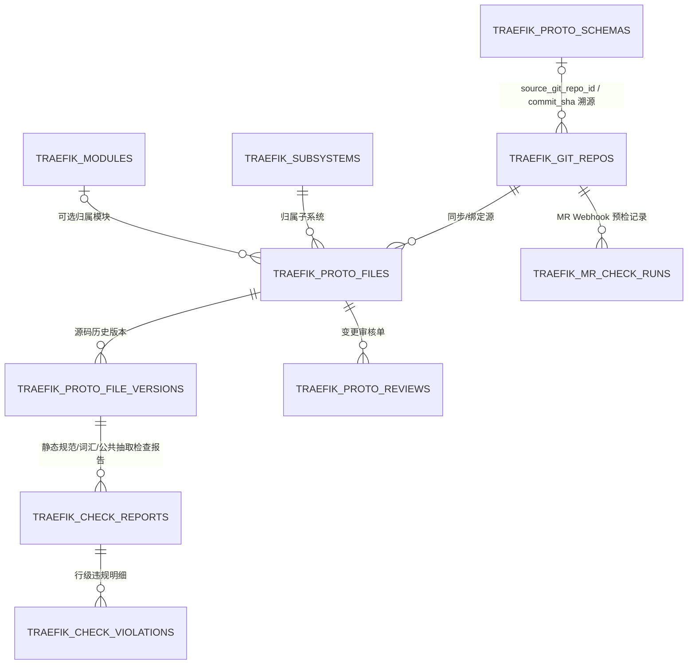

# ADR-18：废弃外部 Proto 系统，在 Code-Traefik 内构建 Proto 全生命周期与 Git/MR 协同治理架构决策

- **文档编号**：`18-proto-full-lifecycle-and-git-mr-governance-adr.md`
- **文档版本**：v1.0.0
- **日期**：2026-11-13
- **状态**：已提议待排期 (Proposed for M22+)
- **关联特性**：演进并重定义 `F-21`（由“从 `code-proto` 导入 `.pb`（已取消）”重定义为“`.proto` 源码全生命周期、Git/MR 协同门禁与统一编译入池”）、扩展 `F-03`~`F-03.7`、`F-18`、`F-26`（设计态破坏性变更雷达）、`F-27`（CI/CD 质量门禁）；规划新增 `F-28`~`F-32`
- **演进与替代关系**：
  - 鉴于独立兄弟项目 **`code-proto`** 与原型项目 **`protohub`** 已正式废弃，**正式撤销 `01-feature-matrix.md` 中 `Non-Goal 4` 关于“接口变更 MR 追踪与 `.proto` 源码管理归属 `code-proto`”的旧边界约束**；
  - 保留并充分复用 [`ADR-06`](./06-proto-schema-repository-and-field-inspection-adr.md)、[`ADR-10`](./10-enhanced-proto-schema-file-management-adr.md) 与 [`ADR-14`](./14-governance-dashboard-golden-suite-and-ci-gate-adr.md) 已建成的全局单一生效 `.pb` 池（`CompiledRegistry`）、`CompileTrialPool`、`DiffIgnorePaths` 前向继承、AST 破坏性变更检测（`F-26`）与 CI 质量门禁（`F-27`），**向上游延伸打通“`.proto` 源码托管 / Git & MR 协同 ➔ 静态规范与词汇检查 ➔ 纯 Go 编译出 `.pb` ➔ 破坏性变更阻断与审核 ➔ 生效池与运行态活体契约验证”全链路闭环**。

---

## 1. 背景与问题陈述 (Context & Problem Statement)

在此前的工作区演进规划中，Proto 治理职责被切分在多个系统中：
- **`protohub`**（Node.js + SQLite 独立原型）：承担 `.proto` 文本文件 CRUD、悲观编辑锁、版本历史 Diff、Git 仓库导入与一致性检查、命名规范/术语词汇表/LLM 智能检查、重复消息抽取建议、人工审核流与邮件/站内通知，以及基于 `import` 的分层依赖架构图；
- **`code-proto`**（规划中的独立兄弟模块）：原计划承担企业级 `.proto` 仓库管理与 MR 接口变更追踪（因此 `code-traefik` 在 [`ADR-10`](./10-enhanced-proto-schema-file-management-adr.md) 中取消了 `F-21`，并在 `Non-Goal 4` 中回避了源码与 MR 管理）；
- **`code-traefik`**（当前主平台）：已建成基于 `.pb`（`FileDescriptorSet`）的跨集闭包编译、字段字典树、AST 破坏性变更拦截（`F-26`）、架构拓扑一致性验证、黄金契约套件（`F-25`）与 CI 门禁（`F-27`）。

随着 **`code-proto` 与 `protohub` 正式全面废弃**，若 `code-traefik` 继续仅停留在“被动接收已编译 `.pb`”的边界，将产生 **4 个严重的治理断层**：

1. **设计态源头治理缺失**：团队缺少统一的 `.proto` 源码托管、在线浏览/编辑、文本版本 Diff、悲观防冲突锁以及变更审核台，无法替代 `protohub` 既有的日常协作能力；
2. **Git 与 MR（Merge Request）防线脱节**：研发人员在 Git 仓库修改 `.proto` 后，必须在本地手动 `protoc` 编译出 `.pb` 并上传至 `code-traefik` 才能触发 `F-26` 破坏性变更检测；**无法在提交 MR 的第一时间自动拦截不规范命名、违反术语规范或破坏性 Proto 改动**，导致问题发现过晚；
3. **`protohub` 静态质量防线尚未承接**：`protohub` 已验证有效的**命名规范检查、领域词汇表、重复消息（公共接口抽取）检测、LLM 语义术语校验、审核通知与架构分层方向约束（`layer_level`）**，在 `code-traefik` 中尚未覆盖；
4. **“源码”与“运行态契约”双源割裂风险**：如果简单把 `protohub` 原封不动搬进 `code-traefik`，会引入两套割裂的模型（`.proto` 文件一套表、`.pb` 描述集另一套表），并把 `protohub` 的历史技术债（正则解析不准、本地磁盘存储、内存通知易丢、明文存储 Git 密码、硬编码二段式包名正则）带入高可靠的生产级平台。

因此，需要确立一份清晰的架构决策：**如何以 `code-traefik` 既有“活体契约 + `.pb` 单一生效池”为底座，高质量吸收 `protohub` 特性并实现 Git/MR 原生协同，构建 Proto 全生命周期治理闭环。**

---

## 2. 核心思考与架构原则 (Architectural Thinking & Principles)

### 2.1 原则一：「源码为源（Source），`.pb` 为编译制品（Artifact）」的双层统一模型
- **核心思路**：不要让 `.proto` 文本管理和 `.pb` 描述集管理变成两套互不相干的功能，而应建立 **「`.proto` 源码版本 ➔ 编译构建 ➔ `.pb` 描述集版本 (`traefik_proto_schemas`)」** 的直接衍生血缘。
- **架构落地建议**：
  1. 在 `code-traefik` 控制面引入纯 Go 的 Protobuf 编译器 **`github.com/bufbuild/protocompile`**（替代调用外部 `protoc` 二进制子进程，也彻底淘汰 `protohub` 基于正则的行解析 `protoParser.ts`）。
  2. `protocompile` 具备零外部进程依赖、支持虚拟文件系统 `Resolver`（可同时从当前批次的 `.proto` 源码树、数据库内 `BASE_LIB` 源码或既有生效 `.pb` 的 `FileDescriptorProto` 中解析 `import`）、支持提取完整 `SourceCodeInfo`（精确行号与源码注释 `leading_comments`）的优势；编译结果直接产出标准 `FileDescriptorSet`，无缝接入现有的 `CompiledRegistry`（`F-03.6`）和 `DetectBreakingChanges`（`F-26`）。
  3. **禁止将 `.proto` 源码裸存在宿主机本地磁盘**（纠正 `protohub` 的 `storage/proto-files/` 设计）：源码正文应直接持久化在 PostgreSQL 中（配合 `content_sha256` 去重或独立内容表），确保多副本部署无状态且与数据库事务一致。

### 2.2 原则二：「Git-First + Web IDE 受控提交」双轨协同，而非在 Web 端再造一个 Git
- **核心痛点权衡**：既要满足“习惯在 Git 仓库中改 `.proto` 发 MR”的团队工程习惯，又要保留 `protohub`“直接在 Web 端查看、在线修改、锁定编辑与提交审核”的便捷体验，且**不能造成 Git 与平台数据库双写脑裂**。
- **推荐双轨模式**：
  - **轨道 A：Git 仓库直连与 MR Webhook 门禁（主推生产模式）**
    - 参照工作区 `code-pipeline` 已验证的 CodeHub / GitLab Merge Request Webhook 集成模式（识别 `object_kind = "merge_request"` / `X-Event: Merge Request Hook`），在 `code-traefik` 纳管 `traefik_git_repos`；
    - 绑定仓库与目标目录/前缀、默认分支（如 `main`）、所属领域分类（`BASE_LIB | BUSINESS | GATEWAY`）或归属子系统/模块；
    - **MR 创建 / 更新事件触发五合一预检流水线**：
      1. 拉取源分支变更的 `.proto` 文件树 + 目标分支基线树（配合全球生效 `BASE_LIB` 底座）；
      2. 执行 `protocompile` 闭包编译检查（拦截语法错误、缺失 `import`）；
      3. 执行静态规范检查（命名规则、领域术语词汇表、重复 Message 抽取建议、可选异步 LLM 术语辅助）；
      4. 执行 **`F-26` AST 破坏性变更检查**（对比源分支编译结果与当前生效/目标分支基线，列出所有受影响的下游模块、标准进程与负责人）；
      5. 执行 **架构层级依赖方向校验**（如基础层禁止引用应用层）及可选联动 **`F-27` 运行态黄金套件回归门禁**。
    - 预检完成后，自动通过托管平台 API **回写 MR Comment（结构化 Markdown 报告 + 直达 `code-traefik` 详情深链）**，并**回写 MR Commit Status / Check State（`success / failed`）**，在代码托管平台侧直接实现合并阻断；
    - **MR 合入主干分支后**：Webhook 触发自动同步主干 `.proto` 源码快照并编译生成新版 `.pb`（可选自动激活或进入管理员/属主发布确认队列）。
  - **轨道 B：Web 端在线管理与受控编辑（保留 `protohub` 体验并消除脑裂）**
    - 对**未绑定 Git 仓库**（平台托管型）的 `.proto` 文件：支持 Web 端直接上传、Monaco Editor 在线编辑、悲观锁（`lock/unlock`，超时自动释放 + 管理员强制解锁写审计）、版本历史文本 Diff、提交平台内部审核流；
    - 对**已绑定 Git 仓库**的 `.proto` 文件：Web 端默认处于受保护只读/锁检查模式，若用户确需在 Web 端在线修改，**保存/提交审核时不直接覆盖主干**，而是由后端通过 Git API/本地工作区创建特性分支并**自动发起一条 MR**（或通过审核后合并回 Git），保证 Git 仓库始终是该文件集合的唯一源码真实源（SSOT）。

### 2.3 原则三：对 `protohub` 原有特性的「吸收、升级与去债」决策矩阵

| `protohub` 原有特性 | 处置策略 | 升级重构要点（避免把历史技术债带入 `code-traefik`） |
| :--- | :---: | :--- |
| **1. `.proto` 解析与文件 CRUD / 版本 Diff** | **吸收并升级** | • 淘汰正则 `protoParser.ts`，改用 `protocompile` AST 精确提取包/服务/消息/字段/枚举/注释与行号； • 前端使用 Monaco Editor（Proto 语法高亮 + 违规波浪线标红 + Diff Editor 版本对比）。 |
| **2. 悲观文件锁 (`fileLock`)** | **吸收并升级** | • 保留 5~30 分钟可配置超时续租与持锁人展示； • 补齐管理员强制解锁与 `audit_logs` 审计记录（对齐 Agent 租约治理体验）。 |
| **3. Git 仓库导入与一致性检查** | **吸收并加固** | • **安全红线**：`protohub` 明文存储密码与 SSH Key；`code-traefik` 必须使用服务端主密钥 **AES-256-GCM 加密存储**，API 返回一律脱敏，禁止 SSRF； • 一致性检查升级为基于 **Git Blob SHA / File SHA256** 的精准内容对比（补齐 `protohub` 原 `checkConsistency` 中的 `TODO: 检查修改的文件`），并联动 MR Webhook 自动触发。 |
| **4. 命名规范静态检查 (`namingRules`)** | **吸收并可配置化** | • **`protohub` 缺陷修正**：`protohub` 硬编码包名正则 `/^[a-z0-9]+\.[a-z0-9]+$/`，会直接拒绝 `dophi.order.v1` 等三段式/带版本号包名！ • 改为在管理端 `/admin/settings`（或 `traefik_check_rules`）提供**可配置规则模板与正则/豁免白名单**，默认兼容 `{org}.{domain}.{version}` 与 `{subsystem}.{module}`。 |
| **5. 领域词汇表与 LLM 智能检查** | **吸收并异步隔离** | • 迁移 `vocabulary_terms`（术语、中英文说明、同义词 `aliases`、业务域）至 `traefik_vocabulary_terms`； • **LLM 检查必须旁路异步 + 缓存 + 熔断**：设置开关、超时阈值（如 3s）与结果缓存，**严禁因外部 LLM 接口抖动阻塞 MR Webhook 响应或阻断文件保存**；仅作为 `warning/suggestion` 辅助提示。 |
| **6. 重复消息检测 / 公共接口抽取** | **吸收并重构算法** | • **`protohub` 缺陷修正**：原 `commonInterfaceRule.ts` 正则提取所有字段类型为 `'unknown'` 导致相似度虚高； • 改用 `protocompile` 解析后的真实字段名 + 字段类型 + 结构指纹（支持跨文件全局比对而不仅限于单文件内），精准发现跨模块重复定义的 Request/DTO 并推荐抽入 `BASE_LIB` 或 `CONTRACT_LIB`。 |
| **7. 审核流程 (`ReviewPage`) 与通知** | **吸收并融合工作区能力** | • 结合 `code-traefik` 角色体系（扩展 `traefik_reviewer` 角色或支持**模块/子系统 `owner_id` 属主会签**）； • 放弃 `protohub` 重启即丢的内存 `Map` 通知，改用 PostgreSQL 持久化站内通知 `traefik_notifications` + **复用/对接工作区 `code-notifier` 或统一 SMTP 通道**。 |
| **8. 架构层级方向校验 (`architecture_layers`)** | **吸收并融入拓扑** | • 为 `traefik_subsystems` / `traefik_modules` 增加可选的 `layer_level`（如 `1=基础底座层 ... 4=应用接入层`）与全局开关； • 在声明 `DEPEND` 及拓扑检查时校验**禁止底层模块逆向依赖上层模块**（与现有 `F-05` 实测越权检测形成“静态分层防线 + 动态契约防线”双保险）。 |
| **9. 依赖图导出图片 & `.pb` 依赖图 UI** | **直接补齐** | • 前端挂载后端已就绪的 `GET /api/proto-schemas/dependencies-graph` 可视化视图； • 为 `/topology` 画布增加 PNG / SVG 一键导出功能。 |
| **10. 本地 SQLite & 独立用户表** | **明确废弃** | • 100% 复用 `code-bench` 统一用户/部门/审计体系与 `code-traefik` PostgreSQL 共享库 `traefik_*` 前缀隔离。 |

---

## 3. 建议的数据模型与 API 演进蓝图 (Conceptual Data Model & Integration)

遵循 `code-traefik` 强制 `traefik_*` 表前缀隔离规范（在现有 19 张业务表基础上按里程碑增量演进），建议规划以下核心模型与扩展点：

1. **Git 与 MR 集成域**：
   - `traefik_git_repos`：仓库地址、协议（HTTPS/SSH）、主干分支、`.proto` 扫描根路径（`proto_root_dir`）、自动编译开关、默认分类（`BASE_LIB|BUSINESS|GATEWAY`）、**加密凭据密文 (`credentials_encrypted`)**、Webhook Secret 摘要（`webhook_secret_hash`，参考 `F-27` 常量时间校验）、最近同步 Commit SHA；
   - `traefik_mr_check_runs`：记录每次 MR 触发的 `repo_id`、`mr_iid`、`source_branch`、`target_branch`、`head_sha`、状态（`PENDING | PASSED | FAILED | ERROR`）、检查结果摘要（静态规范违规数 + `F-26` 破坏性变更数 + 层级违规数）、受影响下游模块快照及 MR 评论回写状态。
2. **`.proto` 源码资产与锁版本域**：
   - `traefik_proto_files`：逻辑路径（`file_path`，全局或仓库内唯一）、`package_name`、`subsystem_id` / `module_id`、`git_repo_id`（可空，区分 Git 托管 vs 平台托管）、`status`（`DRAFT | PENDING_REVIEW | APPROVED | REJECTED | ARCHIVED`）、`current_version`、悲观锁字段（`locked_by`、`locked_at`、`lock_expires_at`）；
   - `traefik_proto_file_versions`：`file_id`、`version`、`content`（`text`）、`content_sha256`、`commit_sha`（若来自 Git）、`change_note`、`modified_by`；
   - `traefik_proto_schemas`（既有表增量扩展）：新增 `source_type`（`UPLOAD_PB | GIT_COMPILE | WEB_COMPILE`）、`git_repo_id`、`source_commit_sha` 与 `source_mr_iid`，使每一份线上 `.pb` 都能追溯回具体的 `.proto` 源码与 Git MR 提交。
3. **静态检查、词汇规范与审核通知域**：
   - `traefik_check_rules`（可配置规则参数：包名/文件名/Service/Message/Field 正则、开关与严重等级 `ERROR|WARNING|INFO`）；
   - `traefik_vocabulary_terms`（标准术语、同义词 `aliases` `jsonb`、业务域、中英文说明）；
   - `traefik_check_reports` / `traefik_check_violations`（记录精确到文件与行号的规则违规、词汇建议与重复消息抽取建议）；
   - `traefik_proto_reviews`（审核单、版本快照、审核人、结论与意见；支持自动触发 `.pb` 编译或关联 Git MR 审批）；
   - `traefik_notifications`（持久化站内通知 + 可配置的邮件/`code-notifier` 推送任务状态与重试计数）。

---

## 4. 统一信息架构（IA）与前端工作台融合建议

为避免菜单膨胀破坏现有 4 组体系，建议以**工作台融合**为主、仅做克制的导航增补：

1. **`Proto 契约中心`（由原 `/schemas` 升级）**：统一收敛为 4 个 URL 同步 Tab：
   - `?tab=sources`：**`.proto` 源码库**（按子系统/Git 仓库树浏览、上传/新建、在线 Monaco 编辑器 + 悲观锁状态、行级规范波浪线提示、历史版本 Text Diff、发起检查/提交审核或生成 MR）；
   - `?tab=assets`：**`.pb` 描述集台账**（保留现有全局单一生效池、上传、批量激活、下载、AST 破坏性变更阻断雷达，并展示来源 Commit/MR 徽章）；
   - `?tab=catalog`：**全局契约目录树**（保留现有 Service 聚合分页、Message 字典树与 Diff 忽略路径配置）；
   - `?tab=graph`：**契约依赖关系图**（前端正式挂载 `dependencies-graph`，直观查看 `BASE_LIB` 与业务 `.proto`/`.pb` 之间的引用拓扑与循环依赖）。
2. **`契约核验与回归` / `架构与契约` 组增补**：
   - **`契约审核与 MR 门禁`（`/reviews`）**：双视图收口“平台内审核单”与“Git MR 预检流水线记录”，审核员/模块负责人可在一屏内同时看到 **文本源码 Diff + 规范检查报告 + `F-26` AST 破坏性变更与下游影响面**，一键批准/拒绝；
   - **`规范与词汇库`（`/standards`，或归入治理配置）**：配置命名规范策略、维护领域术语字典、查看公共接口抽取建议及配置异步 LLM 辅助参数；
   - **`Git 仓库集成`（可作为 `/schemas` 子视图或 `/git-repos` 纳入「环境与治理」组）**：配置仓库、加密凭据、Webhook 一键注册/校验及一致性差异对账面板；
   - **顶栏通知中心抽屉**：展示持久化未读审核与 MR 门禁提醒，支持对接外部邮件/`code-notifier`。

---

## 5. 建议的分阶段实施路线 (Recommended Phased Roadmap: M22 ~ M25)

为遵循工作区 SDD + TDD 纪律、控制每次迭代风险并持续可验收交付，建议拆分为 4 个递进里程碑：

| 里程碑 | 主题 | 核心交付范围 | 关键技术验证门禁 |
| :---: | :--- | :--- | :--- |
| **M22** | **静态治理底座与拓扑图谱补齐** | 1. 引入 `protocompile` 抽象编译器服务； 2. 架构元素引入 `layer_level` 分层逆向依赖校验； 3. `/schemas?tab=graph` 前端挂载 `.pb` 依赖关系图；`/topology` 支持导出 PNG/SVG； 4. 可配置命名规范引擎 + `traefik_vocabulary_terms` CRUD（含 `protohub` 数据迁移脚本/导入工具）。 | `protocompile` 虚拟依赖编译单测；分层逆向依赖拦截单测；包名正则兼容 `dophi.order.v1` 多段式命名。 |
| **M23** | **`.proto` 源码托管、在线编辑锁与规范检查** | 1. `traefik_proto_files` / `versions` 表与 API； 2. 悲观编辑锁（含超时与管理员强制解锁）与版本 Text Diff； 3. AST 级重复 Message 检测（公共接口抽取建议）+ 检查报告存储与查看； 4. Web 端 Monaco Editor 集成与源码编译生成 `.pb` 一键入池。 | 并发抢锁返 `409`；基于 `protocompile` 的跨文件重复结构指纹检测准确率测试；源码编译入池后无缝触发 `F-26` 破坏性检查。 |
| **M24** | **Git 仓库同步与 MR 自动化门禁闭环** | 1. `traefik_git_repos` CRUD（AES-GCM 加密凭据、SSRF 防护）、批量导入与 SHA256 一致性对比； 2. CodeHub/GitLab MR Webhook 接入与签名校验； 3. MR 五合一预检（编译 + 规范 + `F-26` 破坏性变更 + 层级校验 + 可选 `F-27` 门禁）及 MR Comment/Status 回写； 4. 主干合入自动编译更新 `.pb`；Web 修改 Git 绑定文件自动提 MR。 | 本地 Mock Git 仓库 + Mock Webhook 端到端集成测试；凭据密文落库与脱敏单测；MR 发现破坏性变更自动回写失败状态。 |
| **M25** | **审核工作台、通知中心与异步 LLM 增强** | 1. `traefik_proto_reviews` 审核工作台（整合源码 Diff + 规范报告 + `F-26` 下游影响面）； 2. `traefik_notifications` 站内通知中心 + 异步重试队列（对接 SMTP / `code-notifier`）； 3. 异步旁路 LLM 术语语义检查（带开关、超时熔断与本地缓存）； 4. `F-24` 治理大盘纳入静态规范合规率指标。 | 审核状态机并发流转单测；LLM 超时/异常降级不影响主流程单测；通知失败自动重试单测。 |

---

## 6. 风险与权衡 (Risks & Mitigations)

1. **风险一：Git 仓库双向修改引发覆盖冲突**
   - **缓解措施**：严格执行**“Git 托管文件不允许 Web 端直接覆盖主干，必须经分支 + MR 合入”**，仅平台托管（无 `git_repo_id`）文件允许 Web 端直接编辑与发布版本。
2. **风险二：超大仓库全量克隆导致 Webhook 响应超时**
   - **缓解措施**：Webhook 验签后立即返回 `202 Accepted` 投递异步 Worker；按仓库维护长驻浅克隆缓存（`git fetch` 增量更新 + 单仓库文件锁），并通过 `proto_root_dir` 限定只扫描 `.proto` 所在目录。
3. **风险三：外部 LLM 服务不稳定拖垮提交流程**
   - **缓解措施**：LLM 语义检查默认**异步旁路执行**或作为检查报告的补充建议项，不作为阻塞提交/编译的强前提，并配置 3s 超时与 `(term, vocabulary_hash)` 缓存。
4. **风险四：`protohub` 存量数据平滑迁移**
   - **缓解措施**：在 `M22/M23` 提供一次性 CLI 导入工具，支持将旧 `protohub/storage/protohub.db` 中的标准词汇表（`vocabulary_terms`）、子系统/模块及 `.proto` 历史文件导入 `code-traefik` 的 PostgreSQL 表中，完成历史资产零丢失退场。
